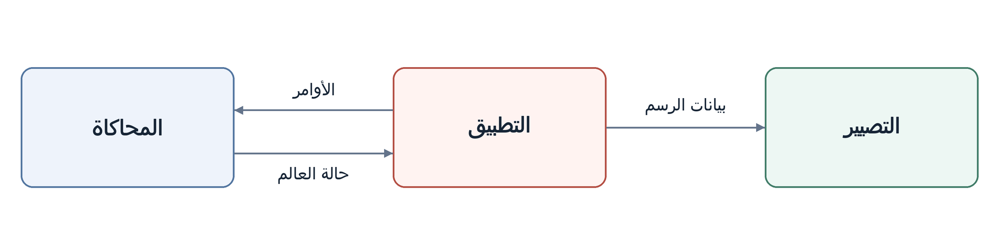

<p align="center" dir="ltr">
  <a href="README.sv.md" lang="sv">Svenska</a> · <a href="README.zh-CN.md" lang="zh-CN">简体中文</a> · <a href="README.de.md" lang="de">Deutsch</a> · <strong lang="ar" dir="rtl">العربية</strong> · <a href="README.es.md" lang="es">Español</a> · <a href="README.ru.md" lang="ru">Русский</a> · <a href="README.th.md" lang="th">ไทย</a> · <a href="README.tr.md" lang="tr">Türkçe</a> · <a href="README.md" lang="en">English</a>
</p>
<p align="center" dir="ltr">
  <a href="https://github.com/YuriPlanet/vera20k/actions/workflows/macos.yml?query=branch%3Amain" title="آخر تشغيل لاختبارات المكتبة على macOS (تُشغّل يدويًا)"></a>
  <a href="https://github.com/YuriPlanet/vera20k/actions/workflows/linux.yml?query=branch%3Amain" title="آخر تشغيل لاختبارات المكتبة على Linux (تُشغّل يدويًا)"></a>
  <a href="https://github.com/YuriPlanet/vera20k/actions/workflows/windows.yml?query=branch%3Amain" title="آخر تشغيل لاختبارات المكتبة على Windows (تُشغّل يدويًا)"></a>
  <a href="https://discord.gg/kmjRUn5m5F"></a>
  
</p>

<div dir="rtl">

# VERA20K

يعيد VERA20K، وهو مشروع يقوده المجتمع، كتابة المحرك الأصلي، `gamemd.exe`. يستخدم ملفات اللعبة
الأصلية، لذا ستحتاج إلى نسختك الخاصة من Red Alert 2: Yuri's Revenge.

VERA20K من صنع اللاعبين ومن أجلهم، وللاعبين الكلمة الأخيرة في تحديد مساره.


## أهداف المشروع

1. الحفاظ على أسلوب اللعب والمظهر والأجواء في لعبة Red Alert 2: Yuri's Revenge الأصلية.
2. دعم معارك أكبر: حتى **30 لاعبًا** و**20,000 وحدة** على خرائط بحجم 500×500.
3. إضافة ميزات معروفة من ألعاب الاستراتيجية في الوقت الحقيقي (RTS)، وأخرى لم يسبق لها مثيل.
4. عميل مدمج للعب متعدد اللاعبين

## الوضع الحالي

**قيد التطوير النشط.**

- **المناوشات:** قابلة للعب على Windows وLinux وmacOS، مع خرائط اللعبة الأصلية والخرائط العشوائية،
  وبناء القواعد وجمع الموارد والقتال وحفظ اللعبة وتحميلها.
- **الحملات:** يمكن بدء المهام؛ ما زال الدعم غير مكتمل.
- **الذكاء الاصطناعي:** تتولى أجزاء من الذكاء الاصطناعي الأصلي بناء القواعد وتنفيذ هجمات مبرمجة.
- **العمل المستمر:** تحسين دقة أسلوب اللعب والرسوم والأداء.
- **اللعب الجماعي:** اللعب عبر الشبكة غير متاح بعد.
- **حجم المعارك:** لم تُعرض بعد معارك تضم 30 لاعبًا و20,000 وحدة.

## البنية المعمارية

يتكون المحرك من ثلاثة أجزاء رئيسية:

- **المحاكاة:** تتولى إدارة حالة اللعب ومنطقه.
- **التصيير:** مسار تصيير جديد تمامًا يعتمد على معالج الرسوميات ويستخدم موارد اللعبة الأصلية،
  بُني للحفاظ على المظهر الأصلي.
- **التطبيق:** يتولى الإدخال والقوائم والصوت والتكامل مع المنصة، ويربط الأنظمة ببعضها.

يدعم هذا الفصل حتمية اللعب.

توضح الأسهم تدفق البيانات:



## متطلبات النظام

- **اللعبة:** Red Alert 2: Yuri's Revenge الإصدار 1.001.
- **نظام التشغيل:** Windows 10 أو أحدث، أو Linux (glibc 2.35 أو أحدث، مثل Ubuntu 22.04 أو Steam Deck)،
  أو macOS 11 أو أحدث على Apple Silicon.
- **الرسوميات:** Vulkan أو DirectX 12 أو Metal.

## البناء والتشغيل

تحتاج إلى:

- **Rust وGit:** [Rust](https://rustup.rs/) 1.97 أو أحدث، مثبتًا عبر rustup، و[Git](https://git-scm.com/).
- **أدوات البناء:** على Windows أدوات بناء C++ من Visual Studio، ويعرض مثبّت Rust تثبيتها؛ وعلى macOS الأمر
  `xcode-select --install`؛ وعلى Debian وUbuntu الأمر `sudo apt install build-essential libasound2-dev pkg-config`.

وقد استُخدم VERA20K للعب على Windows وLinux وmacOS.

<div dir="ltr">

```sh
git clone https://github.com/YuriPlanet/vera20k.git
cd vera20k
cp config.toml.example config.toml
# عدّل config.toml واضبط ra2_dir على مجلد اللعبة قبل التشغيل:
cargo run --release --bin vera20k
```

</div>

يشغل البناء عدة غيغابايت في `target/`.

## كيف نعمل

يكتب معظم الكود وكلاء برمجة بالذكاء الاصطناعي، يستخدمون Ghidra لدراسة المحرك الأصلي،
ثم ينقلون سلوكه إلى Rust ويتحققون منه باستخدام [أدوات المقارنة](tools/native_oracle.md) واختبارات اللعب.
يتبع الوكلاء [AGENTS.md](AGENTS.md).

## التخصيص

يعمل VERA20K افتراضيًا مثل اللعبة الأصلية. يجب أن تبقى كل ميزة جديدة، بما في ذلك الإضافات القادمة
من تعديلات مثل Ares، معطّلة إلى أن تُفعَّل بإحدى الطرق التالية:

- **خيار بناء**، مثل `--features ares` لتضمين [إضافات Ares](docs/ares.md) المدعومة.
- **خيار في ردهة اللعبة**، يُختار لكل مباراة.
- **مفتاح INI**، يضبطه تعديل أو خريطة.

لتشغيل مناوشات YR أو حملاتها للاعب واحد عبر عميل CnCNet، راجع
[إعداد العميل دون اتصال](integrations/cncnet/README.md).

## المساهمة

نرحب بالمساعدة. يمكنك كتابة الكود، أو إعادة هيكلة المحرك، أو اختبار اللعبة، أو مشاركة الأفكار، أو لعبها
جنبًا إلى جنب مع الأصل وإخبارنا بما يبدو غير صحيح. افتح PR وسنتولى الأمر من هناك.
النقاش يجري على [Discord](https://discord.gg/kmjRUn5m5F) وفي مجموعة QQ (1097193563).

## الدعم

<a href="https://paypal.me/vera20k"></a>

تُوزَّع جميع التبرعات المستلمة على
المساهمين وفقًا [لسجل مساهمات TIBTRE](https://github.com/YuriPlanet/tibtre-ledger).

تُرسل الدفعات إلى المساهمين عبر:

<p>     </p>

## شكر ومعلومات قانونية

نشكر OpenRA وXCC Mixer وويكي ModEnc وProject Perfect Mod، وشركة EA على نشر الكود المصدري
للعبتي Command & Conquer وRed Alert تحت رخصة GPL، وكذلك World-Altering Editor وFinal Alert
وYRpp وAres وPhobos وكثيرين غيرهم.

المشروع مرخّص بموجب [GPLv3](LICENSE-GPL). لا يحتوي هذا المستودع على أي ملفات للعبة. تُعد
Command & Conquer وRed Alert علامتين تجاريتين لشركة Electronic Arts Inc.، وتعرض لقطات الشاشة
رسومات من اللعبة تملكها Electronic Arts. لا يتبع VERA20K شركة Electronic Arts ولا يحظى بتأييدها.

ترجمة لـ [README.md](README.md)؛ يُرجى تحديثها مع النسخة الإنجليزية.

</div>
