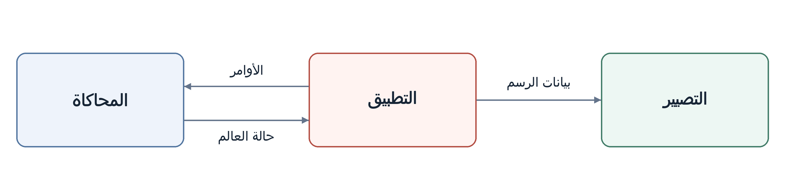

<p align="center" dir="ltr">
  <a href="README.vi.md" lang="vi">Tiếng Việt</a> · <a href="README.sv.md" lang="sv">Svenska</a> · <a href="README.zh-CN.md" lang="zh-CN">简体中文</a> · <a href="README.zh-TW.md" lang="zh-TW">繁體中文</a> · <a href="README.de.md" lang="de">Deutsch</a> · <strong lang="ar" dir="rtl">العربية</strong> · <a href="README.es.md" lang="es">Español</a> · <a href="README.ja.md" lang="ja">日本語</a> · <a href="README.ru.md" lang="ru">Русский</a> · <a href="README.th.md" lang="th">ไทย</a> · <a href="README.tr.md" lang="tr">Türkçe</a> · <a href="README.md" lang="en">English</a>
</p>
<p align="center" dir="ltr">
  <a href="https://github.com/YuriPlanet/vera20k/actions/workflows/linux.yml?query=branch%3Amain" title="آخر تشغيل لاختبارات المكتبة على Linux (تُشغّل يدويًا)"></a>
  <a href="https://github.com/YuriPlanet/vera20k/actions/workflows/windows.yml?query=branch%3Amain" title="آخر تشغيل لاختبارات المكتبة على Windows (تُشغّل يدويًا)"></a>
  <a href="https://discord.gg/kmjRUn5m5F"></a>
  
  
</p>

<div dir="rtl">

# VERA20K

VERA20K محرك جديد للعبة Red Alert 2: Yuri's Revenge. يُلعب مثل الأصل بالوحدات والخرائط والمظهر
نفسها، ويعمل على Windows وmacOS وLinux. صُمم لمعارك أكبر، بما يصل إلى 30 لاعبًا و20,000 وحدة على
خريطة واحدة.

مشروع VERA20K من صنع اللاعبين ومن أجلهم، وللاعبين الكلمة الأخيرة في تحديد مساره.


## التنزيل واللعب

1. ثبّت Red Alert 2: Yuri's Revenge من Steam أو تطبيق EA.
2. نزّل VERA20K لنظامك من [صفحة الإصدارات](https://github.com/YuriPlanet/vera20k/releases).
3. افتح الملف الذي نزّلته. سيعثر على لعبتك ويثبّت VERA20K في مجلد خاص به.

هل واجهتك مشكلة؟ راجع [صفحة المساعدة](https://vera20k.org/ar/help).

## أهداف المشروع

1. الحفاظ على أسلوب اللعب والمظهر والأجواء في لعبة Red Alert 2: Yuri's Revenge الأصلية.
2. دعم معارك أكبر: حتى **30 لاعبًا** و**20,000 وحدة** على خرائط بحجم 500×500.
3. إضافة ميزات معروفة من ألعاب الاستراتيجية في الوقت الحقيقي (RTS)، وأخرى لم يسبق لها مثيل.
4. عميل مدمج للعب متعدد اللاعبين

## المساهمة

يمكن للمساهمين تولي مسؤولية أجزاء من المحرك، مع حرية واسعة لإجراء تغييرات تدفع VERA20K إلى الأمام.

سيساعد القائمون على المشروع في المراجعة والتكامل والدمج، وسيُنسب إليك الفضل كاملًا في مساهمتك.

النقاش يجري على [Discord](https://discord.gg/kmjRUn5m5F) وفي مجموعة QQ (1097193563).

## البنية المعمارية

يتكون المحرك من ثلاثة أجزاء رئيسية:

- **المحاكاة:** تتولى إدارة حالة اللعب ومنطقه.
- **التصيير:** يرسم التضاريس والوحدات والمباني على معالج الرسوميات باستخدام رسومات اللعبة الأصلية.
- **التطبيق:** يتولى الإدخال والقوائم والصوت والتكامل مع المنصة، ويربط الأنظمة ببعضها.

يدعم هذا الفصل حتمية اللعب.

توضح الأسهم تدفق البيانات:



## البناء والتشغيل

تحتاج إلى:

- **لغة Rust وأداة Git:** [Rust](https://rustup.rs/) 1.97 أو أحدث، مثبتًا عبر rustup، و[Git](https://git-scm.com/).
- **أدوات البناء:** على Windows أدوات بناء C++ من Visual Studio، ويعرض مثبّت Rust تثبيتها؛ وعلى macOS الأمر
  `xcode-select --install`؛ وعلى Debian وUbuntu الأمر `sudo apt install build-essential libasound2-dev libxkbcommon-x11-0 pkg-config`.

<div dir="ltr">

```sh
git clone https://github.com/YuriPlanet/vera20k.git
cd vera20k
cp config.toml.example config.toml
# عدّل config.toml واضبط ra2_dir على مجلد اللعبة قبل التشغيل:
cargo run --release --bin vera20k
```

</div>

## كيف نعمل

يكتب معظم الكود وكلاء برمجة بالذكاء الاصطناعي، يستخدمون Ghidra لدراسة المحرك الأصلي،
ثم ينقلون سلوكه إلى Rust ويتحققون منه باستخدام [أدوات المقارنة](tools/native_oracle.md) واختبارات اللعب.
يتبع الوكلاء [AGENTS.md](AGENTS.md).

## التخصيص

يستخدم VERA20K قواعد لعبة Yuri's Revenge الأصلية افتراضيًا. من قائمة **Options** يمكنك ضبط
الصوت والرسوم وأدوات التحكم أو تفعيل ميزات VERA. تحفظ اللعبة تفضيلاتك في ملف `VERA.INI`،
وتضع الخيارات الخاصة بـ VERA في القسم `[VERA]`.

يمكن لإعدادات الردهة والتعديلات والخرائط تغيير قواعد المباراة. ويمكن للتعديلات والخرائط استخدام
ملفات INI لتفعيل ميزات [Ares](docs/ares.md) و[Phobos](docs/phobos.md) التي يدعمها VERA20K.
كما يمكن للتعديل تفعيل Ares بتضمين ملف `ares.mix`. ولا تزال بعض ميزات Phobos تتطلب نسخة
من اللعبة مبنية بخيار `--features phobos`.

لإنشاء تعديل خاص بك، ابدأ بقراءة [دليل التعديلات](docs/modding.md).

## الدعم

<a href="https://paypal.me/vera20k"></a>

تُوزَّع جميع التبرعات المستلمة على
المساهمين وفقًا [لسجل مساهمات TIBTRE](https://github.com/YuriPlanet/tibtre-ledger).

تُرسل الدفعات إلى المساهمين عبر:

<p>     </p>

## شكر ومعلومات قانونية

نشكر OpenRA وXCC Mixer وويكي ModEnc وProject Perfect Mod، وشركة EA على نشر الكود المصدري
للعبتي Command & Conquer وRed Alert تحت رخصة GPL، وكذلك World-Altering Editor وFinal Alert
وYRpp وAres وPhobos وكثيرين غيرهم.

حقوق النشر © 2026 Halvor Nikolai Rusten والمساهمون في VERA20K.
المشروع مرخّص بموجب [GPLv3](LICENSE-GPL) مع [شروط إضافية](LEGAL.md#additional-terms).
لا يحتوي هذا المستودع على أي ملفات للعبة. تُعد
Command & Conquer وRed Alert علامتين تجاريتين لشركة Electronic Arts Inc.، وتعرض لقطات الشاشة
وأيقونة التطبيق، أي النجمة الحمراء من Red Alert 2، رسومات من اللعبة تملكها Electronic Arts.
لا يتبع VERA20K شركة Electronic Arts ولا يحظى بتأييدها.

This product includes software developed by the [Ares Contributors](LICENSES/Ares.txt).

This product includes software developed by the [Phobos Developers](docs/phobos.md#original-project-and-authors).

**اقرأ [الإشعار القانوني](LEGAL.md) قبل أن تشارك VERA20K أو تبيعه أو تنشئ نسخة متفرعة منه.**

## التوثيق

- [معاينة WebAssembly](docs/wasm.md): بنية اختيارية للعب الفردي تعمل في المتصفح.
- [دليل التعديلات](docs/modding.md): ما تستطيع التعديلات فعله وما لا تستطيعه، وكيف يختلف VERA20K عن اللعبة الأصلية.
- [ملفات تعريف INI](docs/ini-roots.md): اختيار ملفات القواعد والرسوم والذكاء الاصطناعي.
- [Ares](docs/ares.md) و[Phobos](docs/phobos.md) و[NPatch](docs/npatch.md): دعم الإضافات وحدوده.
- [نظرة عامة على المحرك](docs/index.md): تنظيم الشيفرة وكيف تترابط أجزاء المحرك.
- [أدوات المطورين](tools/README.md): البناء والاختبارات وفحص موارد اللعبة.
- [اختبار الخرائط](tools/map_observation.md): سيناريوهات مبرمجة ولقطات شاشة وملاحظات عن المباريات.
- [المقارنة مع الأصل](tools/native_oracle.md): مقارنة السلوك مع اللعبة الأصلية.
- [سير العمل في Ghidra](docs/ghidra-workflow.md): فحص المحرك الأصلي.

ترجمة لـ [README.md](README.md)؛ يُرجى تحديثها مع النسخة الإنجليزية.

</div>
