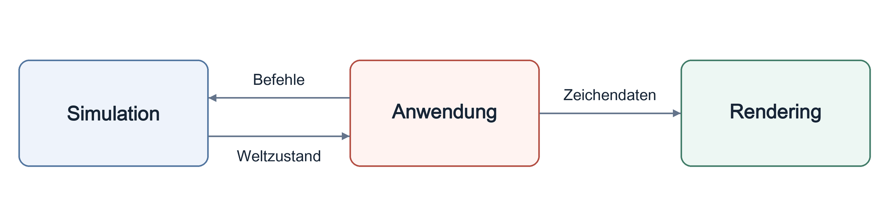

<p align="center" dir="ltr">
  <a href="README.sv.md" lang="sv">Svenska</a> · <a href="README.zh-CN.md" lang="zh-CN">简体中文</a> · <strong>Deutsch</strong> · <a href="README.ar.md" lang="ar" dir="rtl">العربية</a> · <a href="README.es.md" lang="es">Español</a> · <a href="README.ru.md" lang="ru">Русский</a> · <a href="README.th.md" lang="th">ไทย</a> · <a href="README.tr.md" lang="tr">Türkçe</a> · <a href="README.md" lang="en">English</a>
</p>
<p align="center" dir="ltr">
  <a href="https://github.com/YuriPlanet/vera20k/actions/workflows/macos.yml?query=branch%3Amain" title="Letzter Testlauf der Bibliothek unter macOS (manuell gestartet)"></a>
  <a href="https://github.com/YuriPlanet/vera20k/actions/workflows/linux.yml?query=branch%3Amain" title="Letzter Testlauf der Bibliothek unter Linux (manuell gestartet)"></a>
  <a href="https://github.com/YuriPlanet/vera20k/actions/workflows/windows.yml?query=branch%3Amain" title="Letzter Testlauf der Bibliothek unter Windows (manuell gestartet)"></a>
  <a href="https://discord.gg/kmjRUn5m5F"></a>
  
</p>

# VERA20K

VERA20K ist eine von der Community getragene Neuimplementierung der ursprünglichen Engine,
`gamemd.exe`. Sie verwendet die originalen Spieldateien, also brauchst du eine eigene Kopie von
Red Alert 2: Yuri's Revenge.

VERA20K wird von Spielern für Spieler gemacht, und die Spieler haben das letzte Wort, wohin sich
das Projekt entwickelt.


## Projektziele

1. Spielmechanik, Grafik und Atmosphäre des ursprünglichen Red Alert 2: Yuri's Revenge bewahren.
2. Größere Schlachten ermöglichen: bis zu **30 Spieler** und **20.000 Einheiten** auf 500×500-Karten.
3. Bekannte RTS-Funktionen integrieren und einige, die es noch nie gab.
4. Integrierter Mehrspieler-Client

## Aktueller Stand

**In aktiver Entwicklung.**

- **Gefechte:** Unter Windows, Linux und macOS spielbar, mit Originalkarten und zufällig
  generierten Karten, Basisbau, Rohstoffernte, Kämpfen sowie Speichern und Laden.
- **Kampagnen:** Missionen lassen sich starten; die Unterstützung bleibt unvollständig.
- **KI:** Teile der ursprünglichen KI übernehmen den Basisbau und skriptgesteuerte Angriffe.
- **Laufende Arbeiten:** Spielverhalten, Grafik und Leistung.
- **Mehrspielermodus:** Netzwerkspiel ist noch nicht verfügbar.
- **Größenordnung:** Schlachten mit 30 Spielern und 20.000 Einheiten wurden noch nicht demonstriert.

## Herunterladen und spielen

Lade den Installer für Windows, macOS oder Linux von der
[Release-Seite](https://github.com/YuriPlanet/vera20k/releases) herunter. Er findet dein
Yuri's Revenge aus [Steam](https://store.steampowered.com/app/2229850/) oder der
[EA app](https://www.ea.com/games/command-and-conquer/command-and-conquer-the-ultimate-collection)
und richtet VERA20K in einem neuen Ordner ein. Dort kommen künftig auch Mods und neue Inhalte hin,
sodass die Spieldateien nie verändert werden.

Wie du Einzelspieler-Gefechte oder Kampagnen von YR über einen CnCNet-Client startest, steht in der
[Offline-Client-Einrichtung](integrations/cncnet/README.md).

## Einstellungen

Nutze **Options** für Ton und Steuerung und **Vera Options** für VERA-spezifische Funktionen.
Spielereinstellungen, Tastenkürzel und Lobby-Einstellungen werden in `VERA.INI` gespeichert:

- **Windows-Installer:** neben `vera20k.exe`.
- **macOS:** `~/Library/Application Support/VERA20k/VERA.INI`.
- **Linux:** `~/.local/share/VERA20k/VERA.INI` oder in deinem XDG-Datenordner.

`config.toml` legt den Spielordner fest und kann einen anderen Einstellungsordner vorgeben.

Wenn `VERA.INI` fehlt, erstellt VERA die Datei und importiert vorhandene Einstellungen einmalig.
Ohne alte Einstellungen bleibt die Datei zunächst leer; VERA verwendet die integrierten
Standardwerte, bis Einstellungen gespeichert werden. Die Originaldateien `RA2MD.INI` und
`KeyboardMD.ini` werden nur für den Import gelesen und nie überschrieben.

`VERARULES.INI` im selben Ordner enthält optionale Änderungen am Spielverhalten. Die Datei
enthält zunächst auskommentierte Beispiele; die Regeln der Mission oder Karte bleiben maßgeblich.
Zum Bearbeiten und Überschreiben siehe [persönliche Regeln](docs/personal-rules.md).

## Architektur

Die Engine besteht aus drei Hauptteilen:

- **Simulation:** Verwaltet Spielzustand und Spiellogik.
- **Rendering:** Eine völlig neue GPU-Rendering-Pipeline mit den ursprünglichen Spieldaten,
  gebaut, um das ursprüngliche Erscheinungsbild zu bewahren.
- **Anwendung:** Übernimmt Eingaben, Menüs, Audio und Plattformintegration und verbindet die Systeme.

Diese Trennung unterstützt einen deterministischen Spielablauf.

Die Pfeile zeigen den Datenfluss:



## Kompilieren und starten

Du brauchst:

- **Rust und Git:** [Rust](https://rustup.rs/) 1.97 oder neuer, installiert mit rustup, und
  [Git](https://git-scm.com/).
- **Build-Werkzeuge:** unter Windows die C++-Build-Tools von Visual Studio, deren Installation
  der Rust-Installer anbietet; unter macOS `xcode-select --install`; unter Debian und Ubuntu
  `sudo apt install build-essential libasound2-dev pkg-config`.

VERA20K wurde bereits unter Windows, Linux und macOS gespielt.

```sh
git clone https://github.com/YuriPlanet/vera20k.git
cd vera20k
cp config.toml.example config.toml
# Bearbeite config.toml und setze ra2_dir auf deinen Spielordner, bevor du das Spiel startest:
cargo run --release --bin vera20k
```

Der Build belegt mehrere GB in `target/`.

## So arbeiten wir

Der Großteil des Codes wird von KI-Programmieragenten geschrieben. Sie untersuchen die
ursprüngliche Engine mit Ghidra, übertragen dann ihr Verhalten nach Rust und prüfen es mit
[Vergleichswerkzeugen](tools/native_oracle.md) und Spieltests. Die Agenten folgen
[AGENTS.md](AGENTS.md).

## Anpassung

VERA20K spielt sich standardmäßig wie das Originalspiel. Jede neue Funktion, auch Erweiterungen
aus Mods wie Ares, muss ausgeschaltet bleiben, bis sie auf einem dieser Wege aktiviert wird:

- **Eine VERA-Spieleroption** unter **Options → Vera Options**, gespeichert im Abschnitt `[VERA]` in `VERA.INI`.
- **Eine Build-Option**, z. B. `--features ares` für die unterstützten [Ares-Erweiterungen](docs/ares.md).
- **Eine Lobby-Option im Spiel**, die für jede Partie gewählt wird.
- **Ein INI-Schlüssel**, den eine Mod oder eine Karte setzt.

Einstellungen für Ton, Grafik und Steuerung werden in `VERA.INI` gespeichert. Die Spielregeln
stammen aus den Lobby-Einstellungen, Mods oder Karten.

## Mitmachen

Hilfe ist willkommen. Du kannst Code schreiben, die Engine refaktorieren, das Spiel testen,
Ideen einbringen oder es neben dem Original spielen und uns sagen, was sich falsch anfühlt.
Öffne einen PR, und wir kümmern uns um den Rest.

Diskutiert wird auf [Discord](https://discord.gg/kmjRUn5m5F) und in der QQ-Gruppe (1097193563).

## Unterstützen

<a href="https://paypal.me/vera20k"></a>

Alle eingegangenen Spenden werden
gemäß dem [TIBTRE-Beitragsverzeichnis](https://github.com/YuriPlanet/tibtre-ledger) an
Mitwirkende verteilt.

Auszahlungen an Mitwirkende:

<p>     </p>

## Danksagung und Rechtliches

Danke an OpenRA, XCC Mixer, das ModEnc-Wiki, Project Perfect Mod, EA für die Veröffentlichung
des Quellcodes von Command & Conquer und Red Alert unter der GPL, World-Altering Editor,
Final Alert, YRpp, Ares, Phobos und viele andere.

Lizenziert unter der [GPLv3](LICENSE-GPL). Dieses Repository enthält keine Spieldateien.
Command & Conquer und Red Alert sind Marken von Electronic Arts Inc. Die Screenshots zeigen
Spielgrafiken, die Electronic Arts gehören. VERA20K steht in keiner Verbindung zu Electronic Arts
und wird nicht von Electronic Arts unterstützt.

Übersetzung von [README.md](README.md); bitte mit der englischen Version synchron halten.
