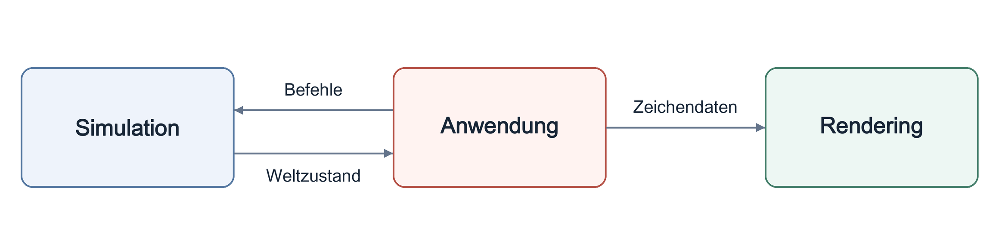

<p align="center" dir="ltr">
  <a href="README.vi.md" lang="vi">Tiếng Việt</a> · <a href="README.sv.md" lang="sv">Svenska</a> · <a href="README.zh-CN.md" lang="zh-CN">简体中文</a> · <a href="README.zh-TW.md" lang="zh-TW">繁體中文</a> · <strong>Deutsch</strong> · <a href="README.ar.md" lang="ar" dir="rtl">العربية</a> · <a href="README.es.md" lang="es">Español</a> · <a href="README.ja.md" lang="ja">日本語</a> · <a href="README.ru.md" lang="ru">Русский</a> · <a href="README.th.md" lang="th">ไทย</a> · <a href="README.tr.md" lang="tr">Türkçe</a> · <a href="README.md" lang="en">English</a>
</p>
<p align="center" dir="ltr">
  <a href="https://github.com/YuriPlanet/vera20k/actions/workflows/linux.yml?query=branch%3Amain" title="Letzter Testlauf der Bibliothek unter Linux (manuell gestartet)"></a>
  <a href="https://github.com/YuriPlanet/vera20k/actions/workflows/windows.yml?query=branch%3Amain" title="Letzter Testlauf der Bibliothek unter Windows (manuell gestartet)"></a>
  <a href="https://discord.gg/kmjRUn5m5F"></a>
  
  
</p>

# VERA20K

VERA20K ist eine neue Engine für Red Alert 2: Yuri's Revenge. Sie spielt sich wie das Original, mit
denselben Einheiten, Karten und demselben Aussehen, und läuft unter Windows, macOS und Linux. Sie
ist für größere Schlachten mit bis zu 20.000 Einheiten auf einer Karte gebaut. Offline-Gefechte bieten
bis zu 120 Spielerplätze, LAN- und Online-Partien bis zu 30.

VERA20K wird von Spielern für Spieler gemacht, und die Spieler haben das letzte Wort, wohin sich
das Projekt entwickelt.


## Herunterladen und spielen

1. Installiere Red Alert 2: Yuri's Revenge über Steam oder die EA app.
2. Lade VERA20K für dein System von der [Release-Seite](https://github.com/YuriPlanet/vera20k/releases) herunter.
3. Öffne die heruntergeladene Datei. Sie findet dein Spiel und richtet VERA20K in einem eigenen
   Ordner ein.

Kommst du nicht weiter? Schau auf der [Hilfeseite](https://vera20k.org/de/help) nach.

## Projektziele

1. Spielmechanik, Grafik und Atmosphäre des ursprünglichen Red Alert 2: Yuri's Revenge bewahren.
2. Größere Schlachten auf 500×500-Karten ermöglichen, mit bis zu **20.000 Einheiten**, **120 Spielerplätzen** in Offline-Gefechten und **30** in LAN- und Online-Partien.
3. Bekannte RTS-Funktionen integrieren und einige, die es noch nie gab.
4. Integrierter Mehrspieler-Client

## Mitmachen

**Geschätzte Pull Requests** — Refactoring, Performance, Wegfindung, UI/UX, Zufallskartengenerator.

Mitwirkende können Verantwortung für Bereiche der Engine übernehmen und haben dabei viel
Spielraum für Änderungen, die VERA20K voranbringen.

Die Maintainer helfen beim Review, bei der Integration und beim Mergen. Dein Beitrag wird
dir vollständig zugeschrieben.

Admins: [Halvor Nikolai Rusten](https://github.com/hrusten), [风雨声](https://github.com/996666925), [Kironix](https://github.com/EncoreAlpha), [Randerion(HaoJun0823)](https://github.com/HaoJun0823), [libi](https://github.com/libi), [zzzzzzh123](https://github.com/zzzzzzh123), [八音盒](https://github.com/1372704087)

Diskutiert wird auf [Discord](https://discord.gg/kmjRUn5m5F) und in der QQ-Gruppe (1097193563).

## Architektur

Die Engine besteht aus drei Hauptteilen:

- **Simulation:** Verwaltet Spielzustand und Spiellogik.
- **Rendering:** Zeichnet Gelände, Einheiten und Gebäude mit den Originalgrafiken auf der GPU.
- **Anwendung:** Übernimmt Eingaben, Menüs, Audio und Plattformintegration und verbindet die Systeme.

Diese Trennung unterstützt einen deterministischen Spielablauf.

Die Pfeile zeigen den Datenfluss:



## Kompilieren und starten

Du brauchst:

- **Rust und Git:** [Rust](https://rustup.rs/) 1.97 oder neuer, installiert mit rustup, und
  [Git](https://git-scm.com/).
- **Build-Werkzeuge:** unter Windows die C++-Build-Tools von Visual Studio, deren Installation
  der Rust-Installer anbietet; unter macOS `xcode-select --install`; unter Debian und Ubuntu
  `sudo apt install build-essential libasound2-dev libxkbcommon-x11-0 pkg-config`.

```sh
git clone https://github.com/YuriPlanet/vera20k.git
cd vera20k
cp config.toml.example config.toml
# Bearbeite config.toml und setze ra2_dir auf deinen Spielordner, bevor du das Spiel startest:
cargo run --release --bin vera20k
```

## So arbeiten wir

Der Großteil des Codes wird von KI-Programmieragenten geschrieben. Sie untersuchen die
ursprüngliche Engine mit Ghidra, übertragen dann ihr Verhalten nach Rust und prüfen es mit
[Vergleichswerkzeugen](tools/native_oracle.md) und Spieltests. Die Agenten folgen
[AGENTS.md](AGENTS.md).

## Anpassung

Du kannst eigene Mods, Karten, Musik und mehr hinzufügen. Sie gehören in den VERA20K-Ordner:
unter Windows der Installationsordner, unter macOS `~/Library/Application Support/VERA20k` und
unter Linux `~/.local/share/VERA20k`.

VERA20K verwendet standardmäßig die Spielregeln von Yuri's Revenge. Unter **Options** kannst du
Ton, Grafik und Steuerung anpassen oder VERA-Funktionen einschalten. Das Spiel speichert deine
Einstellungen in `VERA.INI`. Die VERA-spezifischen Optionen stehen im Abschnitt `[VERA]`.

- **Mods:** Unter **Options → Mods** installiert **Add Mod** eine heruntergeladene Mod, und **New Mod** beginnt eine eigene. Jede Mod bekommt einen eigenen Ordner in `Mods`.
- **Karten:** Lege `.map`-, `.mpr`- oder `.yrm`-Dateien in `Maps`, um sie im Gefecht zu spielen. Online heruntergeladene Karten landen ebenfalls dort.
- **Musik:** Lege WAV- oder AUD-Dateien in `musics` und füge dort eine `music.ini` mit `enable=yes` unter `[Music]` hinzu. Dann laufen deine Lieder in Partien neben der Musik des Spiels; mit `ExclusiveMode=yes` nur deine.
- **HD-Grafik:** Ein [HD-Grafikpaket](docs/hd-art.md) wird wie eine Mod installiert und ausgewählt. Schalte danach **HD art** unter **Options** ein.
- **Sprachen:** Eine Datei `vera20k.<language>.ini` fügt eine Sprache hinzu oder ändert die Texte des Spiels. Siehe [Übersetzen](src/i18n/README.md).

Lobby-Einstellungen, Mods und Karten können die Regeln einer Partie ändern. Mods und Karten können
über ihre INI-Dateien unterstützte Funktionen von [Ares](docs/ares.md), [Phobos](docs/phobos.md) und [Kratos](docs/kratos.md)
aktivieren. Eine Mod kann Ares auch aktivieren, indem sie `ares.mix` mitliefert. Einige
Phobos-Funktionen erfordern weiterhin eine mit `--features phobos` kompilierte Spielversion.

Wie du deine eigene Mod erstellst, zeigt die [Modding-Anleitung](docs/modding.md).

## Unterstützen

<a href="https://paypal.me/vera20k"></a>

Alle eingegangenen Spenden werden
gemäß dem [TIBTRE-Beitragsverzeichnis](https://github.com/YuriPlanet/tibtre-ledger) an
Mitwirkende verteilt.

Auszahlungen an Mitwirkende:

<p>     </p>

## Medien

<p>
  <a href="https://www.youtube.com/@cncvietnam-huydeptrai"></a>
  <a href="https://www.youtube.com/@cncvietnam-huydeptrai">Command &amp; Conquer Vietnam</a> stellt VERA20K vor.<br>
  <a href="https://www.youtube.com/watch?v=njpQRCTZ_MY">1 gegen 29 Brutal-KIs auf Arctic Circle 30</a><br>
  <a href="https://www.youtube.com/watch?v=7r_z_7w0InA&amp;t=1440s">Survival Fortress 5.0</a><br clear="all">
</p>

<p>
  <a href="https://www.youtube.com/@haojunyang2337"></a>
  <a href="https://www.youtube.com/@haojunyang2337">HaoJun Yang</a> stellt VERA20K vor.<br>
  <a href="https://www.youtube.com/watch?v=ucz-EiMeW88">Red Alert 2 in VERA20K 0.41</a><br clear="all">
</p>

## Karteneditoren

<p>
  <a href="https://github.com/996666925/ra2-map-editor"></a>
  <a href="https://github.com/996666925/ra2-map-editor">YR Map Editor</a><br>
  Erstelle Karten für Yuris Rache und teste sie in VERA20K.<br clear="all">
</p>

## Danksagung und Rechtliches

Danke an OpenRA, XCC Mixer, das ModEnc-Wiki, Project Perfect Mod, EA für die Veröffentlichung
des Quellcodes von Command & Conquer und Red Alert unter der GPL, World-Altering Editor,
Final Alert, YRpp, Ares, Phobos und viele andere.

Copyright © 2026 Halvor Nikolai Rusten und die Mitwirkenden an VERA20K.
Lizenziert unter der [GPLv3](LICENSE-GPL) mit [zusätzlichen Bedingungen](LEGAL.md#additional-terms).
Die Spieldateien für Red Alert 2: Yuri's Revenge
stammen aus deiner eigenen Installation.
Command & Conquer und Red Alert sind Marken von Electronic Arts Inc. Die Screenshots und das
App-Symbol, der rote Stern aus Red Alert 2, zeigen Spielgrafiken, die Electronic Arts gehören.
VERA20K steht in keiner Verbindung zu Electronic Arts und wird nicht von Electronic Arts
unterstützt.

This product includes software developed by the [Ares Contributors](LICENSES/Ares.txt).

This product includes software developed by the [Phobos Developers](docs/phobos.md#original-project-and-authors).

**Lies den [rechtlichen Hinweis](LEGAL.md), bevor du VERA20K weitergibst, verkaufst oder forkst.**

## Dokumentation

- [WebAssembly-Vorschau](docs/wasm.md): ein optionaler Einzelspieler-Build, der im Browser läuft.
- [Modding-Anleitung](docs/modding.md): was Mods können und was nicht und worin sich VERA20K vom Originalspiel unterscheidet.
- [INI-Profile](docs/ini-roots.md): Regel-, Grafik- und KI-Dateien auswählen.
- [Ares](docs/ares.md), [Phobos](docs/phobos.md) und [NPatch](docs/npatch.md): Unterstützung der Erweiterungen und ihre Grenzen.
- [Engine-Überblick](docs/index.md): Aufbau des Codes und wie die Teile der Engine zusammenspielen.
- [Entwicklerwerkzeuge](tools/README.md): Builds, Tests und Untersuchung der Spieldaten.
- [Kartentests](tools/map_observation.md): geskriptete Szenarien, Screenshots und Beobachtungen von Partien.
- [Vergleiche mit dem Original](tools/native_oracle.md): Verhalten mit dem Originalspiel vergleichen.
- [Ghidra-Arbeitsablauf](docs/ghidra-workflow.md): die ursprüngliche Engine untersuchen.

Übersetzung von [README.md](README.md); bitte mit der englischen Version synchron halten.
