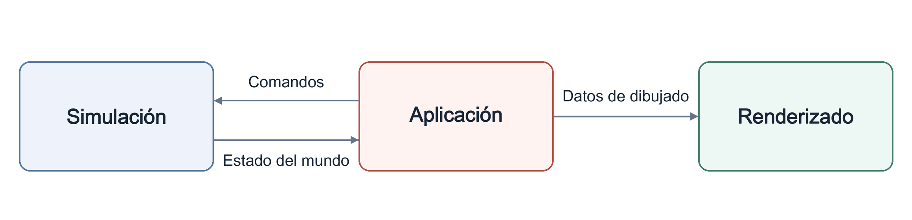

<p align="center" dir="ltr">
  <a href="README.sv.md" lang="sv">Svenska</a> · <a href="README.zh-CN.md" lang="zh-CN">简体中文</a> · <a href="README.de.md" lang="de">Deutsch</a> · <a href="README.ar.md" lang="ar" dir="rtl">العربية</a> · <strong>Español</strong> · <a href="README.ja.md" lang="ja">日本語</a> · <a href="README.ru.md" lang="ru">Русский</a> · <a href="README.th.md" lang="th">ไทย</a> · <a href="README.tr.md" lang="tr">Türkçe</a> · <a href="README.md" lang="en">English</a>
</p>
<p align="center" dir="ltr">
  <a href="https://github.com/YuriPlanet/vera20k/actions/workflows/macos.yml?query=branch%3Amain" title="Última ejecución de las pruebas de la biblioteca en macOS (se inicia manualmente)"></a>
  <a href="https://github.com/YuriPlanet/vera20k/actions/workflows/linux.yml?query=branch%3Amain" title="Última ejecución de las pruebas de la biblioteca en Linux (se inicia manualmente)"></a>
  <a href="https://github.com/YuriPlanet/vera20k/actions/workflows/windows.yml?query=branch%3Amain" title="Última ejecución de las pruebas de la biblioteca en Windows (se inicia manualmente)"></a>
  <a href="https://github.com/YuriPlanet/vera20k/actions/workflows/wasm.yml?query=branch%3Amain" title="Última compilación de WebAssembly (se inicia manualmente)"></a>
  <a href="https://discord.gg/kmjRUn5m5F"></a>
  
</p>

# VERA20K

VERA20K es una reescritura del motor original, `gamemd.exe`, impulsada por la comunidad. Usa los
archivos originales del juego, así que necesitarás tu propia copia de Red Alert 2: Yuri's Revenge.

VERA20K está hecho por jugadores y para jugadores, y son los jugadores quienes tienen la última
palabra sobre su rumbo.


## Objetivos del proyecto

1. Conservar la jugabilidad, el aspecto visual y la atmósfera del Red Alert 2: Yuri's Revenge
   original.
2. Permitir batallas más grandes: hasta **30 jugadores** y **20 000 unidades** en mapas de 500×500.
3. Incorporar funciones ya conocidas de otros RTS y algunas nunca vistas.
4. Cliente multijugador integrado

Consulta la [hoja de ruta](https://github.com/orgs/YuriPlanet/projects/1) para conocer las prioridades actuales y los planes futuros.

## Descargar y jugar

Descarga el instalador para Windows, macOS o Linux desde la
[página de versiones](https://github.com/YuriPlanet/vera20k/releases). El instalador encuentra tu
copia de Yuri's Revenge e instala VERA20K en una carpeta nueva.

Para iniciar escaramuzas o campañas de YR para un jugador desde un cliente de CnCNet, consulta la
[configuración del cliente sin conexión](integrations/cncnet/README.md).

## Contribuir

**No tengas miedo de enviar un PR.** No tiene que ser perfecto; te ayudaremos con el resto.

Toda ayuda es bienvenida, y estas áreas son las que más la necesitan. Cada una enlaza a su
página en la hoja de ruta, con el trabajo en curso y el siguiente paso:

- **[Jugabilidad y combate](https://github.com/YuriPlanet/vera20k/issues/3830):** comportamiento de las unidades, daño y fiabilidad de las escaramuzas.
- **[Rendimiento](https://github.com/YuriPlanet/vera20k/issues/3831):** fotogramas por segundo y respuesta en batallas grandes y en equipos antiguos.
- **[Multijugador](https://github.com/YuriPlanet/vera20k/issues/3832):** unirse a partidas en línea, empezarlas y mantenerlas en marcha, y la fiabilidad del juego cooperativo.
- **[Interfaz y audio](https://github.com/YuriPlanet/vera20k/issues/3833):** menús, textos, [traducciones](src/i18n/README.md) y sonido.
- **[Campañas](https://github.com/YuriPlanet/vera20k/issues/3834):** las misiones se pueden iniciar, pero jugarlas hasta el final aún requiere trabajo: objetivos, disparadores, transiciones con scripts, guardado y carga, y el paso a la siguiente misión.
- **[Compatibilidad con mods](https://github.com/YuriPlanet/vera20k/issues/3835):** funciones de Ares y Phobos, sin cambiar los valores predeterminados del juego original.
- **[Pruebas](https://github.com/YuriPlanet/vera20k/issues?q=is%3Aopen%20label%3Aparity):** jugar VERA20K junto al original e informar de lo que se juega de forma distinta.

Los colaboradores pueden hacerse cargo de áreas del motor, con amplia libertad para introducir
cambios que hagan avanzar VERA20K.

Los mantenedores te ayudarán con la revisión, la integración y la fusión. Conservarás todo el
mérito de tu contribución.

Hablamos en [Discord](https://discord.gg/kmjRUn5m5F) y en el grupo de QQ (1097193563).

## Arquitectura

El motor tiene tres partes principales:

- **Simulación:** Gestiona el estado y la lógica del juego.
- **Renderizado:** Un pipeline de renderizado por GPU totalmente nuevo que usa los recursos
  originales del juego, diseñado para conservar el aspecto original.
- **Aplicación:** Se encarga de la entrada, los menús, el audio y la integración con la plataforma,
  y conecta los sistemas entre sí.

Esta separación favorece una jugabilidad determinista.

Las flechas muestran el flujo de datos:



## Compilar y ejecutar

Necesitas:

- **Rust y Git:** [Rust](https://rustup.rs/) 1.97 o posterior, instalado con rustup, y
  [Git](https://git-scm.com/).
- **Herramientas de compilación:** en Windows, las herramientas de compilación de C++ de Visual
  Studio, que el instalador de Rust ofrece instalar; en macOS, `xcode-select --install`; en Debian
  y Ubuntu, `sudo apt install build-essential libasound2-dev libxkbcommon-x11-0 pkg-config`.

```sh
git clone https://github.com/YuriPlanet/vera20k.git
cd vera20k
cp config.toml.example config.toml
# Edita config.toml y asigna a ra2_dir la carpeta de tu juego antes de ejecutar:
cargo run --release --bin vera20k
```

## Cómo trabajamos

La mayor parte del código la escriben agentes de programación con IA. Usan Ghidra para estudiar el
motor original, después portan su comportamiento a Rust y lo comprueban con
[herramientas de comparación](tools/native_oracle.md) y partidas de prueba. Los agentes siguen
[AGENTS.md](AGENTS.md).

## Personalización

La capacidad del mapa se elige automáticamente, sin opción de compilación: la suma del ancho y alto de `Size` puede llegar a 1024.

De forma predeterminada, VERA20K se comporta igual que el juego original. Toda otra función nueva,
incluidas las extensiones de mods como Ares, debe permanecer desactivada hasta que se active con una
de estas opciones:

- **Una opción de VERA para el jugador**, en **Options**, guardada en la sección `[VERA]` de `VERA.INI`.
- **Una opción de compilación**, como `--features ares` para las [extensiones de Ares](docs/ares.md)
  compatibles.
- **Una clave INI**, definida por un mod o un mapa.

Los ajustes de sonido, gráficos y controles se guardan en `VERA.INI`. Las reglas de juego
provienen de los ajustes del lobby, los mods o los mapas.

La [guía de modding](docs/modding.md) explica cómo crear mods propios.

## Apoya el proyecto

<a href="https://paypal.me/vera20k"></a>

Todas las donaciones recibidas se reparten
entre los colaboradores según el [registro de contribuciones TIBTRE](https://github.com/YuriPlanet/tibtre-ledger).

Pagos a los colaboradores:

<p>     </p>

## Créditos y aviso legal

Gracias a OpenRA, XCC Mixer, la wiki ModEnc, Project Perfect Mod, la publicación por parte de EA del
código fuente de Command & Conquer y Red Alert bajo la GPL, World-Altering Editor, Final Alert, YRpp,
Ares, Phobos y muchos otros.

Copyright © 2026 Halvor Nikolai Rusten y los colaboradores de VERA20K.
Distribuido bajo la licencia [GPLv3](LICENSE-GPL) con [términos adicionales](LEGAL.md#additional-terms).
Este repositorio no contiene archivos del juego.
Command & Conquer y Red Alert son marcas comerciales de Electronic Arts Inc., y las capturas de
pantalla y el icono de la aplicación, la estrella roja de Red Alert 2, muestran arte del juego
propiedad de Electronic Arts. VERA20K no está afiliado a Electronic Arts ni cuenta con su respaldo.

This product includes software developed by the [Ares Contributors](LICENSES/Ares.txt).

**Lee el [aviso legal](LEGAL.md) antes de compartir, vender o hacer un fork de VERA20K.**

## Documentación

- [Vista previa en WebAssembly](docs/wasm.md): una compilación opcional para un jugador que se ejecuta en el navegador.
- [Guía de modding](docs/modding.md): qué pueden hacer los mods y qué no, y en qué se diferencia VERA20K del juego original.
- [Perfiles INI](docs/ini-roots.md): elegir los archivos de reglas, arte e IA.
- [Ares](docs/ares.md), [Phobos](docs/phobos.md) y [NPatch](docs/npatch.md): compatibilidad con las extensiones y sus limitaciones.
- [Visión general del motor](docs/index.md): organización del código y cómo encajan las piezas del motor.
- [Herramientas para desarrolladores](tools/README.md): compilaciones, pruebas e inspección de recursos.
- [Pruebas de mapas](tools/map_observation.md): escenarios con scripts, capturas de pantalla y observación de partidas.
- [Comparaciones con el original](tools/native_oracle.md): comparar el comportamiento con el juego original.
- [Flujo de trabajo con Ghidra](docs/ghidra-workflow.md): inspeccionar el motor original.

Traducción de [README.md](README.md); mantenla al día con la versión en inglés.
