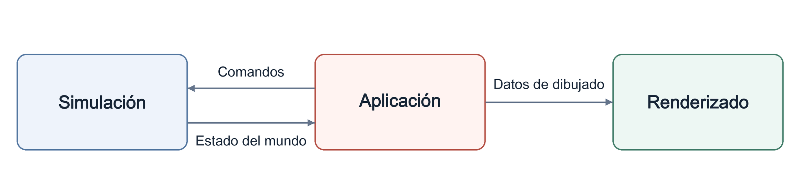

<p align="center" dir="ltr">
  <a href="README.vi.md" lang="vi">Tiếng Việt</a> · <a href="README.sv.md" lang="sv">Svenska</a> · <a href="README.zh-CN.md" lang="zh-CN">简体中文</a> · <a href="README.zh-TW.md" lang="zh-TW">繁體中文</a> · <a href="README.de.md" lang="de">Deutsch</a> · <a href="README.ar.md" lang="ar" dir="rtl">العربية</a> · <strong>Español</strong> · <a href="README.ja.md" lang="ja">日本語</a> · <a href="README.ru.md" lang="ru">Русский</a> · <a href="README.th.md" lang="th">ไทย</a> · <a href="README.tr.md" lang="tr">Türkçe</a> · <a href="README.md" lang="en">English</a>
</p>
<p align="center" dir="ltr">
  <a href="https://github.com/YuriPlanet/vera20k/actions/workflows/linux.yml?query=branch%3Amain" title="Última ejecución de las pruebas de la biblioteca en Linux (se inicia manualmente)"></a>
  <a href="https://github.com/YuriPlanet/vera20k/actions/workflows/windows.yml?query=branch%3Amain" title="Última ejecución de las pruebas de la biblioteca en Windows (se inicia manualmente)"></a>
  <a href="https://discord.gg/kmjRUn5m5F"></a>
  
  
</p>

# VERA20K

VERA20K es un motor nuevo para Red Alert 2: Yuri's Revenge. Se juega como el original, con las
mismas unidades, mapas y aspecto, y funciona en Windows, macOS y Linux. Está hecho para batallas
más grandes, con hasta 20 000 unidades por mapa. Las escaramuzas sin conexión admiten hasta 120 plazas
para jugadores y las partidas en red local o por internet, hasta 30.

VERA20K está hecho por jugadores y para jugadores, y son los jugadores quienes tienen la última
palabra sobre su rumbo.


## Descargar y jugar

1. Instala Red Alert 2: Yuri's Revenge desde Steam o la app de EA.
2. Descarga VERA20K para tu sistema desde la [página de versiones](https://github.com/YuriPlanet/vera20k/releases).
3. Abre el archivo que descargaste. Encuentra tu juego e instala VERA20K en su propia carpeta.

¿Algo no funciona? Consulta la [página de ayuda](https://vera20k.org/es/help).

## Objetivos del proyecto

1. Conservar la jugabilidad, el aspecto visual y la atmósfera del Red Alert 2: Yuri's Revenge
   original.
2. Permitir batallas más grandes en mapas de 500×500 con hasta **20 000 unidades**, **120 plazas para jugadores** en escaramuzas sin conexión y **30** en partidas en red local o por internet.
3. Incorporar funciones ya conocidas de otros RTS y algunas nunca vistas.
4. Cliente multijugador integrado

## Contribuir

**PR que valoramos** — refactorización, rendimiento, búsqueda de rutas, UI/UX, generador de mapas aleatorios.

Los colaboradores pueden hacerse cargo de áreas del motor, con amplia libertad para introducir
cambios que hagan avanzar VERA20K.

Los mantenedores te ayudarán con la revisión, la integración y la fusión. Conservarás todo el
mérito de tu contribución.

Administradores: [Halvor Nikolai Rusten](https://github.com/hrusten), [风雨声](https://github.com/996666925), [Kironix](https://github.com/EncoreAlpha), [Randerion(HaoJun0823)](https://github.com/HaoJun0823), [libi](https://github.com/libi), [zzzzzzh123](https://github.com/zzzzzzh123), [八音盒](https://github.com/1372704087)

Hablamos en [Discord](https://discord.gg/kmjRUn5m5F) y en el grupo de QQ (1097193563).

## Arquitectura

El motor tiene tres partes principales:

- **Simulación:** Gestiona el estado y la lógica del juego.
- **Renderizado:** Dibuja el terreno, las unidades y los edificios en la GPU con los gráficos
  del juego original.
- **Aplicación:** Se encarga de la entrada, los menús, el audio y la integración con la plataforma,
  y conecta los sistemas entre sí.

Esta separación favorece una jugabilidad determinista.

Las flechas muestran el flujo de datos:



## Compilar y ejecutar

Necesitas:

- **Rust y Git:** [Rust](https://rustup.rs/) 1.97 o posterior, instalado con rustup, y
  [Git](https://git-scm.com/).
- **Herramientas de compilación:** en Windows, las herramientas de compilación de C++ de Visual
  Studio, que el instalador de Rust ofrece instalar; en macOS, `xcode-select --install`; en Debian
  y Ubuntu, `sudo apt install build-essential libasound2-dev libxkbcommon-x11-0 pkg-config`.

```sh
git clone https://github.com/YuriPlanet/vera20k.git
cd vera20k
cp config.toml.example config.toml
# Edita config.toml y asigna a ra2_dir la carpeta de tu juego antes de ejecutar:
cargo run --release --bin vera20k
```

## Cómo trabajamos

La mayor parte del código la escriben agentes de programación con IA. Usan Ghidra para estudiar el
motor original, después portan su comportamiento a Rust y lo comprueban con
[herramientas de comparación](tools/native_oracle.md) y partidas de prueba. Los agentes siguen
[AGENTS.md](AGENTS.md).

## Personalización

Puedes añadir tus propios mods, mapas, música y más. Van en la carpeta de VERA20K: la carpeta de
instalación en Windows, `~/Library/Application Support/VERA20k` en macOS y `~/.local/share/VERA20k`
en Linux.

Por defecto, VERA20K usa las reglas originales de Yuri's Revenge. En **Options** puedes ajustar
el sonido, los gráficos y los controles o activar funciones de VERA. El juego guarda tus preferencias
en `VERA.INI`, con las opciones propias de VERA en la sección `[VERA]`.

- **Mods:** en **Options → Mods**, **Add Mod** instala un mod que hayas descargado y **New Mod** empieza uno propio. Cada mod tiene su propia carpeta en `Mods`.
- **Mapas:** pon archivos `.map`, `.mpr` o `.yrm` en `Maps` para jugarlos en escaramuza. Los mapas que descargues en línea también se guardan allí.
- **Música:** pon archivos WAV o AUD en `musics` y añade allí un `music.ini` con `enable=yes` en `[Music]`. Tus canciones sonarán en las partidas junto a la música del juego; con `ExclusiveMode=yes` solo suenan las tuyas.
- **Gráficos HD:** un [paquete de gráficos HD](docs/hd-art.md) se instala y se elige como un mod. Después activa **HD art** en **Options**.
- **Idiomas:** un archivo `vera20k.<language>.ini` añade un idioma o cambia los textos del juego. Consulta [cómo traducir](src/i18n/README.md).

Los ajustes de la sala, los mods y los mapas pueden cambiar las reglas de una partida. Los mods y
los mapas pueden activar las funciones compatibles de [Ares](docs/ares.md), [Phobos](docs/phobos.md) y [Kratos](docs/kratos.md)
mediante sus archivos INI. Un mod también puede activar Ares si incluye `ares.mix`. Algunas funciones
de Phobos aún requieren compilar el juego con `--features phobos`.

Para crear tu propio mod, empieza por la [guía de modding](docs/modding.md).

## Apoya el proyecto

<a href="https://paypal.me/vera20k"></a>

Todas las donaciones recibidas se reparten
entre los colaboradores según el [registro de contribuciones TIBTRE](https://github.com/YuriPlanet/tibtre-ledger).

Pagos a los colaboradores:

<p>     </p>

## Medios

<p>
  <a href="https://www.youtube.com/@cncvietnam-huydeptrai"></a>
  VERA20K aparece en <a href="https://www.youtube.com/@cncvietnam-huydeptrai">Command &amp; Conquer Vietnam</a>.<br>
  <a href="https://www.youtube.com/watch?v=njpQRCTZ_MY">1 contra 29 IA en dificultad brutal en Arctic Circle 30</a><br>
  <a href="https://www.youtube.com/watch?v=7r_z_7w0InA&amp;t=1440s">Survival Fortress 5.0</a><br clear="all">
</p>

<p>
  <a href="https://www.youtube.com/@haojunyang2337"></a>
  VERA20K aparece en <a href="https://www.youtube.com/@haojunyang2337">HaoJun Yang</a>.<br>
  <a href="https://www.youtube.com/watch?v=ucz-EiMeW88">Red Alert 2 en VERA20K 0.41</a><br clear="all">
</p>

## Créditos y aviso legal

Gracias a OpenRA, XCC Mixer, la wiki ModEnc, Project Perfect Mod, la publicación por parte de EA del
código fuente de Command & Conquer y Red Alert bajo la GPL, World-Altering Editor, Final Alert, YRpp,
Ares, Phobos y muchos otros.

Copyright © 2026 Halvor Nikolai Rusten y los colaboradores de VERA20K.
Distribuido bajo la licencia [GPLv3](LICENSE-GPL) con [términos adicionales](LEGAL.md#additional-terms).
Cada jugador debe aportar los archivos
de su propia copia de Red Alert 2: Yuri's Revenge.
Command & Conquer y Red Alert son marcas comerciales de Electronic Arts Inc., y las capturas de
pantalla y el icono de la aplicación, la estrella roja de Red Alert 2, muestran arte del juego
propiedad de Electronic Arts. VERA20K no está afiliado a Electronic Arts ni cuenta con su respaldo.

This product includes software developed by the [Ares Contributors](LICENSES/Ares.txt).

This product includes software developed by the [Phobos Developers](docs/phobos.md#original-project-and-authors).

**Lee el [aviso legal](LEGAL.md) antes de compartir, vender o hacer un fork de VERA20K.**

## Documentación

- [Vista previa en WebAssembly](docs/wasm.md): una compilación opcional para un jugador que se ejecuta en el navegador.
- [Guía de modding](docs/modding.md): qué pueden hacer los mods y qué no, y en qué se diferencia VERA20K del juego original.
- [Perfiles INI](docs/ini-roots.md): elegir los archivos de reglas, arte e IA.
- [Ares](docs/ares.md), [Phobos](docs/phobos.md) y [NPatch](docs/npatch.md): compatibilidad con las extensiones y sus limitaciones.
- [Visión general del motor](docs/index.md): organización del código y cómo encajan las piezas del motor.
- [Herramientas para desarrolladores](tools/README.md): compilaciones, pruebas e inspección de recursos.
- [Pruebas de mapas](tools/map_observation.md): escenarios con scripts, capturas de pantalla y observación de partidas.
- [Comparaciones con el original](tools/native_oracle.md): comparar el comportamiento con el juego original.
- [Flujo de trabajo con Ghidra](docs/ghidra-workflow.md): inspeccionar el motor original.

Traducción de [README.md](README.md); mantenla al día con la versión en inglés.
