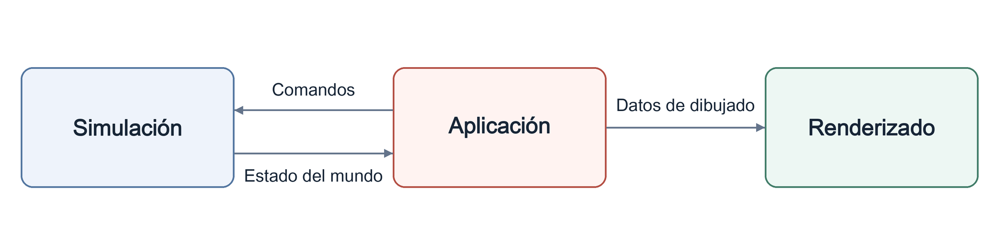

<p align="center" dir="ltr">
  <a href="README.sv.md" lang="sv">Svenska</a> · <a href="README.zh-CN.md" lang="zh-CN">简体中文</a> · <a href="README.de.md" lang="de">Deutsch</a> · <a href="README.ar.md" lang="ar" dir="rtl">العربية</a> · <strong>Español</strong> · <a href="README.ru.md" lang="ru">Русский</a> · <a href="README.th.md" lang="th">ไทย</a> · <a href="README.tr.md" lang="tr">Türkçe</a> · <a href="README.md" lang="en">English</a>
</p>
<p align="center" dir="ltr">
  <a href="https://github.com/YuriPlanet/vera20k/actions/workflows/macos.yml?query=branch%3Amain" title="Última ejecución de las pruebas de la biblioteca en macOS (se inicia manualmente)"></a>
  <a href="https://github.com/YuriPlanet/vera20k/actions/workflows/linux.yml?query=branch%3Amain" title="Última ejecución de las pruebas de la biblioteca en Linux (se inicia manualmente)"></a>
  <a href="https://github.com/YuriPlanet/vera20k/actions/workflows/windows.yml?query=branch%3Amain" title="Última ejecución de las pruebas de la biblioteca en Windows (se inicia manualmente)"></a>
  <a href="https://discord.gg/kmjRUn5m5F"></a>
  
</p>

# VERA20K

VERA20K es una reescritura del motor original, `gamemd.exe`, impulsada por la comunidad. Usa los
archivos originales del juego, así que necesitarás tu propia copia de Red Alert 2: Yuri's Revenge.

VERA20K está hecho por jugadores y para jugadores, y son los jugadores quienes tienen la última
palabra sobre su rumbo.


## Objetivos del proyecto

1. Conservar la jugabilidad, el aspecto visual y la atmósfera del Red Alert 2: Yuri's Revenge
   original.
2. Permitir batallas más grandes: hasta **30 jugadores** y **20 000 unidades** en mapas de 500×500.
3. Incorporar funciones ya conocidas de otros RTS y algunas nunca vistas.
4. Cliente multijugador integrado

## Estado actual

**En desarrollo activo.**

- **Escaramuza:** Se puede jugar en Windows, Linux y macOS, con mapas originales y aleatorios,
  construcción de bases, recolección de recursos, combate y guardado y carga de partidas.
- **Campañas:** Las misiones se pueden iniciar; el soporte sigue incompleto.
- **IA:** Partes de la IA original se encargan de construir bases y de los ataques definidos por
  scripts.
- **Trabajo en curso:** Fidelidad de la jugabilidad, aspecto visual y rendimiento.
- **Multijugador:** El juego en red aún no está disponible.
- **Escala:** Todavía no se han demostrado batallas con 30 jugadores y 20 000 unidades.

## Arquitectura

El motor tiene tres partes principales:

- **Simulación:** Gestiona el estado y la lógica del juego.
- **Renderizado:** Un pipeline de renderizado por GPU totalmente nuevo que usa los recursos
  originales del juego, diseñado para conservar el aspecto original.
- **Aplicación:** Se encarga de la entrada, los menús, el audio y la integración con la plataforma,
  y conecta los sistemas entre sí.

Esta separación favorece una jugabilidad determinista.

Las flechas muestran el flujo de datos:



## Requisitos del sistema

- **Juego:** Red Alert 2: Yuri's Revenge 1.001.
- **Sistema operativo:** Windows 10+, Linux (glibc 2.35+, p. ej., Ubuntu 22.04 o Steam Deck) o
  macOS 11+ en Apple Silicon.
- **Gráficos:** Vulkan, DirectX 12 o Metal.

## Compilar y ejecutar

Necesitas:

- **Rust y Git:** [Rust](https://rustup.rs/) 1.97 o posterior, instalado con rustup, y
  [Git](https://git-scm.com/).
- **Herramientas de compilación:** en Windows, las herramientas de compilación de C++ de Visual
  Studio, que el instalador de Rust ofrece instalar; en macOS, `xcode-select --install`; en Debian
  y Ubuntu, `sudo apt install build-essential libasound2-dev pkg-config`.

VERA20K se ha jugado en Windows, Linux y macOS.

```sh
git clone https://github.com/YuriPlanet/vera20k.git
cd vera20k
cp config.toml.example config.toml
# Edita config.toml y asigna a ra2_dir la carpeta de tu juego antes de ejecutar:
cargo run --release --bin vera20k
```

La compilación ocupa varios GB en `target/`.

## Cómo trabajamos

La mayor parte del código la escriben agentes de programación con IA. Usan Ghidra para estudiar el
motor original, después portan su comportamiento a Rust y lo comprueban con
[herramientas de comparación](tools/native_oracle.md) y partidas de prueba. Los agentes siguen
[AGENTS.md](AGENTS.md).

## Personalización

De forma predeterminada, VERA20K se comporta igual que el juego original. Toda función nueva,
incluidas las extensiones de mods como Ares, debe permanecer desactivada hasta que se active con una
de estas opciones:

- **Una opción de compilación**, como `--features ares` para las [extensiones de Ares](docs/ares.md)
  compatibles.
- **Una opción del lobby del juego**, elegida para cada partida.
- **Una clave INI**, definida por un mod o un mapa.

Para iniciar escaramuzas o campañas de YR para un jugador desde un cliente de CnCNet, consulta la
[configuración del cliente sin conexión](integrations/cncnet/README.md).

## Contribuir

Toda ayuda es bienvenida. Puedes escribir código, refactorizar el motor, probar el juego, compartir
ideas o jugarlo junto al original y decirnos qué no se siente como debería. Abre un PR y nosotros
nos encargamos a partir de ahí.
Hablamos en [Discord](https://discord.gg/kmjRUn5m5F) y en el grupo de QQ (1097193563).

## Apoya el proyecto

<a href="https://paypal.me/vera20k"></a>

Todas las donaciones recibidas se reparten
entre los colaboradores según el [registro de contribuciones TIBTRE](https://github.com/YuriPlanet/tibtre-ledger).

Pagos a los colaboradores:

<p>     </p>

## Créditos y aviso legal

Gracias a OpenRA, XCC Mixer, la wiki ModEnc, Project Perfect Mod, la publicación por parte de EA del
código fuente de Command & Conquer y Red Alert bajo la GPL, World-Altering Editor, Final Alert, YRpp,
Ares, Phobos y muchos otros.

Distribuido bajo la licencia [GPLv3](LICENSE-GPL). Este repositorio no contiene archivos del juego.
Command & Conquer y Red Alert son marcas comerciales de Electronic Arts Inc., y las capturas de
pantalla muestran arte del juego propiedad de Electronic Arts. VERA20K no está afiliado a Electronic
Arts ni cuenta con su respaldo.

Traducción de [README.md](README.md); mantenla al día con la versión en inglés.
