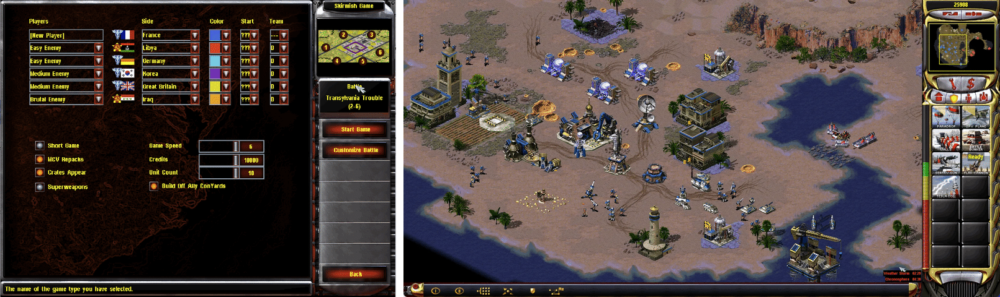

<p align="center" dir="ltr">
  <a href="README.sv.md" lang="sv">Svenska</a> · <a href="README.zh-CN.md" lang="zh-CN">简体中文</a> · <a href="README.de.md" lang="de">Deutsch</a> · <a href="README.ar.md" lang="ar" dir="rtl">العربية</a> · <a href="README.es.md" lang="es">Español</a> · <strong>日本語</strong> · <a href="README.ru.md" lang="ru">Русский</a> · <a href="README.th.md" lang="th">ไทย</a> · <a href="README.tr.md" lang="tr">Türkçe</a> · <a href="README.md" lang="en">English</a>
</p>
<p align="center" dir="ltr">
  <a href="https://github.com/YuriPlanet/vera20k/actions/workflows/macos.yml?query=branch%3Amain" title="macOS ライブラリテストの最新の実行結果（手動で実行）"></a>
  <a href="https://github.com/YuriPlanet/vera20k/actions/workflows/linux.yml?query=branch%3Amain" title="Linux ライブラリテストの最新の実行結果（手動で実行）"></a>
  <a href="https://github.com/YuriPlanet/vera20k/actions/workflows/windows.yml?query=branch%3Amain" title="Windows ライブラリテストの最新の実行結果（手動で実行）"></a>
  <a href="https://discord.gg/kmjRUn5m5F"></a>
  
</p>

# VERA20K

VERA20K は、オリジナルのエンジン `gamemd.exe` をコミュニティ主導で書き直すプロジェクトです。オリジナルのゲームファイルを使用するため、Red Alert 2: Yuri's Revenge を各自でご用意ください。

VERA20K はゲーマーによる、ゲーマーのためのプロジェクトです。その方向性を最終的に決めるのもゲーマーです。

**メンテナーを募集しています。** PR のレビュー、新しいコントリビューターのサポート、エンジンの一部の担当などに協力していただける方は、[Discord](https://discord.gg/kmjRUn5m5F) または QQ グループ（1097193563）でお知らせください。

**気軽に PR を送ってください。** 完璧である必要はありません。残りはこちらでサポートします。



## プロジェクトの目標

1. オリジナルの Red Alert 2: Yuri's Revenge のゲームプレイ、ビジュアル、雰囲気を守る。
2. より大規模な戦闘に対応する：500×500 のマップで最大 **30 人のプレイヤー**と **20,000 ユニット**。
3. RTS でおなじみの機能に加え、これまでにない機能も取り入れる。
4. マルチプレイクライアントの内蔵

現在の優先事項と今後の計画は[ロードマップ](https://github.com/orgs/YuriPlanet/projects/1)をご覧ください。

## ダウンロードとプレイ

Windows、macOS、Linux 用のインストーラーを[リリースページ](https://github.com/YuriPlanet/vera20k/releases)からダウンロードしてください。インストーラーがお手持ちの Yuri's Revenge を見つけ、新しいフォルダーに VERA20K をセットアップします。

CnCNet クライアントから YR のシングルプレイ用スカーミッシュやキャンペーンを起動するには、[オフラインクライアントのセットアップ](integrations/cncnet/README.md)を参照してください。

## 開発への参加

協力はどの分野でも歓迎しますが、特に人手が必要なのは次の分野です。各項目のリンク先はロードマップの issue で、進行中の作業と次のステップが書かれています。

- **[ゲームプレイと戦闘](https://github.com/YuriPlanet/vera20k/issues/3830)**：ユニットの挙動、ダメージ、スカーミッシュの安定性。
- **[パフォーマンス](https://github.com/YuriPlanet/vera20k/issues/3831)**：大規模な戦闘や古いハードウェアでのフレームレートと応答性。
- **[マルチプレイ](https://github.com/YuriPlanet/vera20k/issues/3832)**：オンライン対戦への参加、開始、継続と、協力プレイの安定性。
- **[UI とオーディオ](https://github.com/YuriPlanet/vera20k/issues/3833)**：メニュー、テキスト、翻訳、サウンド。
- **[キャンペーン](https://github.com/YuriPlanet/vera20k/issues/3834)**：ミッションは起動できますが、最後まで遊べるようにするにはまだ作業が必要です。目標、トリガー、スクリプトによる場面転換、セーブ／ロード、次のミッションへの移行。
- **[MOD 互換性](https://github.com/YuriPlanet/vera20k/issues/3835)**：Ares と Phobos の機能。オリジナルのゲームの既定の動作は変えません。
- **[テスト](https://github.com/YuriPlanet/vera20k/issues?q=is%3Aopen%20label%3Aparity)**：VERA20K をオリジナルと並べてプレイし、挙動が違う点を報告する。

コントリビューターはエンジンの領域ごとに責任を持つことができ、VERA20K を前進させる変更を幅広い裁量で行えます。

レビュー、統合、マージはメンテナーがサポートします。あなたの貢献のクレジットは、すべてあなたのものです。

議論は [Discord](https://discord.gg/kmjRUn5m5F) と QQ グループ（1097193563）で行っています。

## ビルドと実行

必要なもの：

- **Rust と Git**：rustup でインストールした [Rust](https://rustup.rs/) 1.97 以降と [Git](https://git-scm.com/)。
- **ビルドツール**：Windows では Visual Studio の C++ ビルドツール（Rust のインストーラーからインストールできます）、macOS では `xcode-select --install`、Debian と Ubuntu では `sudo apt install build-essential libasound2-dev libxkbcommon-x11-0 pkg-config`。

```sh
git clone https://github.com/YuriPlanet/vera20k.git
cd vera20k
cp config.toml.example config.toml
# 実行する前に config.toml を編集し、ra2_dir にゲームフォルダーを設定します：
cargo run --release --bin vera20k
```

## 開発の進め方

コードの大部分は AI コーディングエージェントが書いています。エージェントは Ghidra でオリジナルのエンジンを調べ、その挙動を Rust に移植し、[比較ツール](tools/native_oracle.md)とテストプレイで確認します。エージェントは [AGENTS.md](AGENTS.md) に従います。

## カスタマイズ

マップ容量はビルドフラグなしで自動選択されます。`Size` の幅と高さの合計は最大 1024 です。

VERA20K は、既定ではオリジナルのゲームと同じようにプレイできます。Ares などの MOD に由来する拡張を含め、その他の新しい機能はすべて、次のいずれかで有効にされるまでオフのままでなければなりません。

- **VERA のプレイヤーオプション**：**Options** にあり、`VERA.INI` の `[VERA]` に保存されます。
- **ビルドオプション**：対応する [Ares 拡張](docs/ares.md)を有効にする `--features ares` など。
- **INI キー**：MOD またはマップが設定します。

サウンド、グラフィック、操作の設定は `VERA.INI` に保存されます。ゲームプレイのルールは、ロビーの設定、MOD、マップによって決まります。

## プロジェクトの支援

<a href="https://paypal.me/vera20k"></a>

いただいた寄付はすべて、[TIBTRE 貢献台帳](https://github.com/YuriPlanet/tibtre-ledger)に基づいてコントリビューターに分配されます。

コントリビューターへの支払い方法：PayPal、China UnionPay、Alipay、Vipps、SEPA、Bitcoin。

## 謝辞と法的事項

OpenRA、XCC Mixer、ModEnc wiki、Project Perfect Mod、EA が GPL で公開した Command & Conquer と Red Alert のソースコード、World-Altering Editor、Final Alert、YRpp、Ares、Phobos、そのほか多くの皆さんに感謝します。

本プロジェクトは[追加条項](LEGAL.md#additional-terms)付きの [GPLv3](LICENSE-GPL) でライセンスされています。このリポジトリにゲームファイルは含まれていません。Command & Conquer および Red Alert は Electronic Arts Inc. の商標です。スクリーンショットとアプリアイコン（Red Alert 2 の赤い星）には、Electronic Arts が所有するゲームアートが含まれています。VERA20K は Electronic Arts と提携関係になく、同社の承認を受けたものでもありません。

**VERA20K を共有、販売、またはフォークする前に、[法的通知](LEGAL.md)をお読みください。**

## ドキュメント

- [WebAssembly プレビュー](docs/wasm.md)：ブラウザーで動作する、オプトインのシングルプレイ用ビルド。
- [INI プロファイル](docs/ini-roots.md)：ルール、アート、AI の各ファイルの選択。
- [Ares](docs/ares.md)、[Phobos](docs/phobos.md)、[NPatch](docs/npatch.md)：拡張機能への対応状況と制限事項。
- [エンジンの概要](docs/index.md)：コード構成とエンジン全体の仕組み。
- [開発者ツール](tools/README.md)：ビルド、テスト、アセットの調査。
- [マップのテスト](tools/map_observation.md)：スクリプトによるシナリオ、スクリーンショット、対戦の観察。
- [ネイティブ比較](tools/native_oracle.md)：オリジナルのゲームとの挙動の比較。
- [Ghidra ワークフロー](docs/ghidra-workflow.md)：オリジナルのエンジンの解析。

この文書は [README.md](README.md) を翻訳したものです。英語版に合わせて最新の状態に保ってください。
