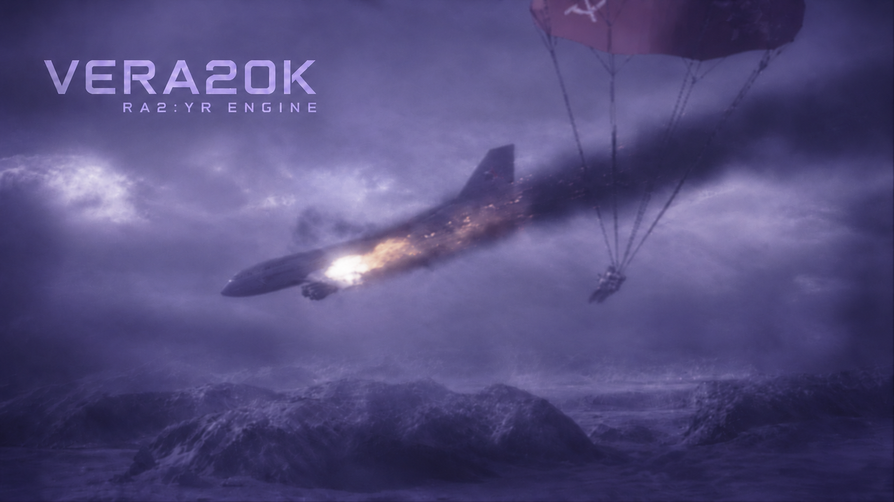
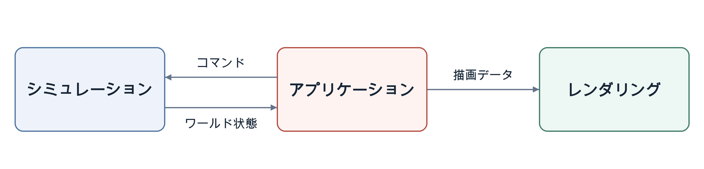

<p align="center" dir="ltr">
  <a href="README.vi.md" lang="vi">Tiếng Việt</a> · <a href="README.sv.md" lang="sv">Svenska</a> · <a href="README.zh-CN.md" lang="zh-CN">简体中文</a> · <a href="README.zh-TW.md" lang="zh-TW">繁體中文</a> · <a href="README.de.md" lang="de">Deutsch</a> · <a href="README.ar.md" lang="ar" dir="rtl">العربية</a> · <a href="README.es.md" lang="es">Español</a> · <strong>日本語</strong> · <a href="README.ru.md" lang="ru">Русский</a> · <a href="README.th.md" lang="th">ไทย</a> · <a href="README.tr.md" lang="tr">Türkçe</a> · <a href="README.md" lang="en">English</a>
</p>
<p align="center" dir="ltr">
  <a href="https://github.com/YuriPlanet/vera20k/actions/workflows/linux.yml?query=branch%3Amain" title="Linux ライブラリテストの最新の実行結果（手動で実行）"></a>
  <a href="https://github.com/YuriPlanet/vera20k/actions/workflows/windows.yml?query=branch%3Amain" title="Windows ライブラリテストの最新の実行結果（手動で実行）"></a>
  <a href="https://discord.gg/kmjRUn5m5F"></a>
  
  
</p>

# VERA20K

VERA20K は Red Alert 2: Yuri's Revenge の新しいエンジンです。ユニット、マップ、見た目はそのままで、オリジナルと同じように遊べ、Windows、macOS、Linux で動作します。より大きな戦いに向けて作られており、1 つのマップで最大 20,000 ユニットに対応します。プレイヤー枠はオフラインのスカーミッシュで最大 120、LAN 対戦とオンライン対戦で最大 30 です。

VERA20K はゲーマーによる、ゲーマーのためのプロジェクトです。その方向性を最終的に決めるのもゲーマーです。


## ダウンロードとプレイ

1. Steam または EA app から Red Alert 2: Yuri's Revenge をインストールします。
2. [リリースページ](https://github.com/YuriPlanet/vera20k/releases)から、お使いのシステム用の VERA20K をダウンロードします。
3. ダウンロードしたファイルを開きます。ゲームを見つけて、VERA20K を専用のフォルダーにセットアップします。

うまくいかないときは[ヘルプページ](https://vera20k.org/help)（英語）をご覧ください。

## プロジェクトの目標

1. オリジナルの Red Alert 2: Yuri's Revenge のゲームプレイ、ビジュアル、雰囲気を守る。
2. 500×500 のマップで最大 **20,000 ユニット**が参加する大規模な戦闘に対応する。プレイヤー枠はオフラインのスカーミッシュで最大 **120**、LAN 対戦とオンライン対戦で最大 **30**。
3. RTS でおなじみの機能に加え、これまでにない機能も取り入れる。
4. マルチプレイクライアントの内蔵

## 開発への参加

**歓迎するPR** — リファクタリング、パフォーマンス改善、経路探索、UI/UX、ランダムマップ生成。

コントリビューターはエンジンの領域ごとに責任を持つことができ、VERA20K を前進させる変更を幅広い裁量で行えます。

レビュー、統合、マージはメンテナーがサポートします。あなたの貢献のクレジットは、すべてあなたのものです。

管理者：[Halvor Nikolai Rusten](https://github.com/hrusten)、[风雨声](https://github.com/996666925)、[Kironix](https://github.com/EncoreAlpha)、[Randerion(HaoJun0823)](https://github.com/HaoJun0823)、[libi](https://github.com/libi)、[zzzzzzh123](https://github.com/zzzzzzh123)、[八音盒](https://github.com/1372704087)

議論は [Discord](https://discord.gg/kmjRUn5m5F) と QQ グループ（1097193563）で行っています。

## アーキテクチャ

エンジンは主に 3 つの部分で構成されています。

- **シミュレーション**：ゲームプレイの状態とロジックを管理します。
- **レンダリング**：オリジナルのグラフィック素材を使い、地形やユニット、建物を GPU で描画します。
- **アプリケーション**：入力、メニュー、オーディオ、プラットフォーム統合を担当し、各システムをつなぎます。

この分離が、決定論的なゲームプレイを支えています。

矢印はデータの流れを表します。



## ビルドと実行

必要なもの：

- **Rust と Git**：rustup でインストールした [Rust](https://rustup.rs/) 1.97 以降と [Git](https://git-scm.com/)。
- **ビルドツール**：Windows では Visual Studio の C++ ビルドツール（Rust のインストーラーからインストールできます）、macOS では `xcode-select --install`、Debian と Ubuntu では `sudo apt install build-essential libasound2-dev libxkbcommon-x11-0 pkg-config`。

```sh
git clone https://github.com/YuriPlanet/vera20k.git
cd vera20k
cp config.toml.example config.toml
# 実行する前に config.toml を編集し、ra2_dir にゲームフォルダーを設定します：
cargo run --release --bin vera20k
```

## 開発の進め方

コードの大部分は AI コーディングエージェントが書いています。エージェントは Ghidra でオリジナルのエンジンを調べ、その挙動を Rust に移植し、[比較ツール](tools/native_oracle.md)とテストプレイで確認します。エージェントは [AGENTS.md](AGENTS.md) に従います。

## カスタマイズ

自分の MOD、マップ、音楽なども追加できます。追加するファイルは VERA20K フォルダーに置きます。Windows ではインストール先のフォルダー、macOS では `~/Library/Application Support/VERA20k`、Linux では `~/.local/share/VERA20k` です。

VERA20K は標準で Yuri's Revenge オリジナル版のルールを使います。**Options** ではサウンド、グラフィック、操作の設定を変えたり、VERA 独自の機能を有効にしたりできます。設定は `VERA.INI` に保存され、VERA 独自の項目は `[VERA]` セクションにまとまっています。

- **MOD：** **Options → Mods** の **Add Mod** でダウンロードした MOD をインストールでき、**New Mod** で自分の MOD を作り始められます。MOD ごとに `Mods` の中にフォルダーができます。
- **マップ：** `.map`、`.mpr`、`.yrm` ファイルを `Maps` に置くと、スカーミッシュで遊べます。オンラインでダウンロードしたマップもここに保存されます。
- **音楽：** WAV または AUD ファイルを `musics` に置き、同じフォルダーに `[Music]` の下に `enable=yes` と書いた `music.ini` を追加します。試合中にゲームの音楽と一緒に流れます。`ExclusiveMode=yes` にすると自分の曲だけが流れます。
- **HD グラフィック：** [HD アートパック](docs/hd-art.md)は MOD と同じようにインストールして選びます。そのあと **Options** で **HD art** をオンにします。
- **言語：** `vera20k.<language>.ini` ファイルで言語を追加したり、ゲームのテキストを変えたりできます。[翻訳ガイド](src/i18n/README.md)をご覧ください。

対戦ルールはロビーの設定、MOD、マップで変更できます。MOD やマップの INI ファイルでは、VERA20K が対応する [Ares](docs/ares.md)、[Phobos](docs/phobos.md)、[Kratos](docs/kratos.md) の機能を有効にできます。MOD に `ares.mix` を同梱しても Ares が有効になります。Phobos の一部の機能には、引き続き `--features phobos` を指定したビルドが必要です。

自分の MOD を作るには、[MOD 制作ガイド](docs/modding.md)をご覧ください。

## プロジェクトの支援

<a href="https://paypal.me/vera20k"></a>

いただいた寄付はすべて、[TIBTRE 貢献台帳](https://github.com/YuriPlanet/tibtre-ledger)に基づいてコントリビューターに分配されます。

コントリビューターへの支払い方法：

<p>     </p>

## メディア

<p>
  <a href="https://www.youtube.com/@cncvietnam-huydeptrai"></a>
  <a href="https://www.youtube.com/@cncvietnam-huydeptrai">Command &amp; Conquer Vietnam</a> で VERA20K が紹介されています。<br>
  <a href="https://www.youtube.com/watch?v=njpQRCTZ_MY">Arctic Circle 30 で 1 対 29（難易度 Brutal の AI）</a><br>
  <a href="https://www.youtube.com/watch?v=7r_z_7w0InA&amp;t=1440s">Survival Fortress 5.0</a><br clear="all">
</p>

<p>
  <a href="https://www.youtube.com/@haojunyang2337"></a>
  <a href="https://www.youtube.com/@haojunyang2337">HaoJun Yang</a> で VERA20K が紹介されています。<br>
  <a href="https://www.youtube.com/watch?v=ucz-EiMeW88">VERA20K 0.41 で遊ぶ Red Alert 2</a><br clear="all">
</p>

## 謝辞と法的事項

OpenRA、XCC Mixer、ModEnc wiki、Project Perfect Mod、EA が GPL で公開した Command & Conquer と Red Alert のソースコード、World-Altering Editor、Final Alert、YRpp、Ares、Phobos、そのほか多くの皆さんに感謝します。

本プロジェクトは[追加条項](LEGAL.md#additional-terms)付きの [GPLv3](LICENSE-GPL) でライセンスされています。
Red Alert 2: Yuri's Revenge のゲームファイルはご自身でご用意ください。
Command & Conquer および Red Alert は Electronic Arts Inc. の商標です。スクリーンショットとアプリアイコン（Red Alert 2 の赤い星）には、Electronic Arts が所有するゲームアートが含まれています。VERA20K は Electronic Arts と提携関係になく、同社の承認を受けたものでもありません。

This product includes software developed by the [Ares Contributors](LICENSES/Ares.txt).

This product includes software developed by the [Phobos Developers](docs/phobos.md#original-project-and-authors).

**VERA20K を共有、販売、またはフォークする前に、[法的通知](LEGAL.md)をお読みください。**

## ドキュメント

- [WebAssembly プレビュー](docs/wasm.md)：ブラウザーで動作する、オプトインのシングルプレイ用ビルド。
- [MOD 制作ガイド](docs/modding.md)：MOD でできることとできないこと、VERA20K とオリジナル版の違い。
- [INI プロファイル](docs/ini-roots.md)：ルール、アート、AI の各ファイルの選択。
- [Ares](docs/ares.md)、[Phobos](docs/phobos.md)、[NPatch](docs/npatch.md)：拡張機能への対応状況と制限事項。
- [エンジンの概要](docs/index.md)：コード構成とエンジン全体の仕組み。
- [開発者ツール](tools/README.md)：ビルド、テスト、アセットの調査。
- [マップのテスト](tools/map_observation.md)：スクリプトによるシナリオ、スクリーンショット、対戦の観察。
- [ネイティブ比較](tools/native_oracle.md)：オリジナルのゲームとの挙動の比較。
- [Ghidra ワークフロー](docs/ghidra-workflow.md)：オリジナルのエンジンの解析。

この文書は [README.md](README.md) を翻訳したものです。英語版に合わせて最新の状態に保ってください。
