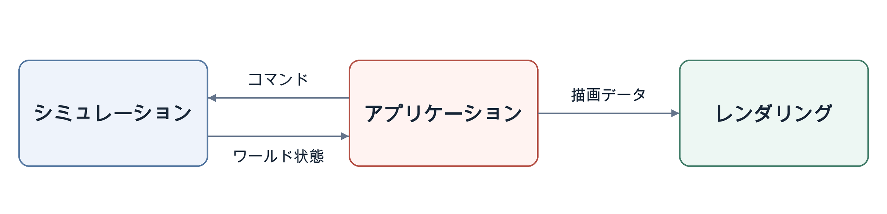

<p align="center" dir="ltr">
  <a href="README.sv.md" lang="sv">Svenska</a> · <a href="README.zh-CN.md" lang="zh-CN">简体中文</a> · <a href="README.de.md" lang="de">Deutsch</a> · <a href="README.ar.md" lang="ar" dir="rtl">العربية</a> · <a href="README.es.md" lang="es">Español</a> · <strong>日本語</strong> · <a href="README.ru.md" lang="ru">Русский</a> · <a href="README.th.md" lang="th">ไทย</a> · <a href="README.tr.md" lang="tr">Türkçe</a> · <a href="README.md" lang="en">English</a>
</p>
<p align="center" dir="ltr">
  <a href="https://github.com/YuriPlanet/vera20k/actions/workflows/macos.yml?query=branch%3Amain" title="macOS ライブラリテストの最新の実行結果（手動で実行）"></a>
  <a href="https://github.com/YuriPlanet/vera20k/actions/workflows/linux.yml?query=branch%3Amain" title="Linux ライブラリテストの最新の実行結果（手動で実行）"></a>
  <a href="https://github.com/YuriPlanet/vera20k/actions/workflows/windows.yml?query=branch%3Amain" title="Windows ライブラリテストの最新の実行結果（手動で実行）"></a>
  <a href="https://discord.gg/kmjRUn5m5F"></a>
  
</p>

# VERA20K

VERA20K は、オリジナルのエンジン `gamemd.exe` をコミュニティ主導で書き直すプロジェクトです。オリジナルのゲームファイルを使用するため、Red Alert 2: Yuri's Revenge を各自でご用意ください。

VERA20K はゲーマーによる、ゲーマーのためのプロジェクトです。その方向性を最終的に決めるのもゲーマーです。


## プロジェクトの目標

1. オリジナルの Red Alert 2: Yuri's Revenge のゲームプレイ、ビジュアル、雰囲気を守る。
2. より大規模な戦闘に対応する：500×500 のマップで最大 **30 人のプレイヤー**と **20,000 ユニット**。
3. RTS でおなじみの機能に加え、これまでにない機能も取り入れる。
4. マルチプレイクライアントの内蔵

## 現在の状況

**活発に開発中です。**

- **スカーミッシュ**：Windows、Linux、macOS でプレイできます。オリジナル版のマップとランダムマップ、基地建設、資源採掘、戦闘、セーブ／ロードに対応しています。
- **キャンペーン**：ミッションは起動できますが、対応はまだ不完全です。
- **AI**：オリジナル版の AI の一部が、基地建設とスクリプトによる攻撃を担当します。
- **進行中の作業**：ゲームプレイの再現度、ビジュアル、パフォーマンス。
- **マルチプレイ**：現在のソースビルドでは、macOS と Linux で LAN 対戦とオンライン対戦ができます。
- **規模**：連続した 2 回のオンライン対戦が、1 試合あたり 30 の独立したクライアントプロセスと 20,000 を超えるアクティブな移動ユニットで機能検証に合格しました。Linux クライアントは VM を共有していました。この検証は、滑らかなリアルタイム性能を実証するものではありません。

## ダウンロードとプレイ

Windows、macOS、Linux 用のインストーラーを[リリースページ](https://github.com/YuriPlanet/vera20k/releases)からダウンロードしてください。インストーラーがお手持ちの Yuri's Revenge を見つけ、新しいフォルダーに VERA20K をセットアップします。

CnCNet クライアントから YR のシングルプレイ用スカーミッシュやキャンペーンを起動するには、[オフラインクライアントのセットアップ](integrations/cncnet/README.md)を参照してください。

## 開発への参加

協力を歓迎します。コードを書く、エンジンをリファクタリングする、ゲームをテストする、アイデアを共有する、オリジナルと並べてプレイして違和感のある点を教えるなど、さまざまな形で参加できます。PR を送っていただければ、そこから先はこちらで対応します。

コントリビューターはエンジンの領域ごとに責任を持つことができ、VERA20K を前進させる変更を幅広い裁量で行えます。

レビュー、統合、マージはメンテナーがサポートします。あなたの貢献のクレジットは、すべてあなたのものです。

議論は [Discord](https://discord.gg/kmjRUn5m5F) と QQ グループ（1097193563）で行っています。

## 設定

サウンドと操作は **Options** で、VERA 独自の機能は **Vera Options** で設定します。プレイヤー設定、キーボードショートカット、ロビーでの選択は `VERA.INI` に保存されます。保存場所は次のとおりです。

- **Windows インストーラー版**：`vera20k.exe` と同じフォルダー。
- **macOS**：`~/Library/Application Support/VERA20k/VERA.INI`。
- **Linux**：`~/.local/share/VERA20k/VERA.INI`、または XDG データフォルダー。

`config.toml` ではゲームフォルダーを指定するほか、別の設定フォルダーを選ぶこともできます。

マウスホイールでのズームは、**Vera Options** の **Mouse Wheel Zoom** を有効にするか、`VERA.INI` で `[VERA] MouseWheelZoom=yes` を設定するとオンになります（既定値は `no`）。

`VERA.INI` がない場合、VERA はこのファイルを作成し、既存の設定を一度だけ取り込みます。以前の設定がなければファイルは空の状態で始まり、設定が保存されるまで VERA は組み込みの既定値を使います。元の `RA2MD.INI` と `KeyboardMD.ini` は取り込みのために読み込むだけで、上書きすることはありません。

同じフォルダーにある `VERARULES.INI` には、任意で適用するゲームプレイ変更を記述できます。最初はコメントアウトされた例だけが書かれており、ミッションやマップのルールが優先されます。編集方法や、ミッションやマップのルールより優先させる方法は、[個人ルール](docs/personal-rules.md)を参照してください。

## アーキテクチャ

エンジンは主に 3 つの部分で構成されています。

- **シミュレーション**：ゲームプレイの状態とロジックを管理します。
- **レンダリング**：オリジナルのゲームアセットを使い、オリジナルの見た目を保つために作られた、まったく新しい GPU レンダリングパイプラインです。
- **アプリケーション**：入力、メニュー、オーディオ、プラットフォーム統合を担当し、各システムをつなぎます。

この分離が、決定論的なゲームプレイを支えています。

矢印はデータの流れを表します。



## ビルドと実行

必要なもの：

- **Rust と Git**：rustup でインストールした [Rust](https://rustup.rs/) 1.97 以降と [Git](https://git-scm.com/)。
- **ビルドツール**：Windows では Visual Studio の C++ ビルドツール（Rust のインストーラーからインストールできます）、macOS では `xcode-select --install`、Debian と Ubuntu では `sudo apt install build-essential libasound2-dev libxkbcommon-x11-0 pkg-config`。

VERA20K は Windows、Linux、macOS でのプレイ実績があります。

```sh
git clone https://github.com/YuriPlanet/vera20k.git
cd vera20k
cp config.toml.example config.toml
# 実行する前に config.toml を編集し、ra2_dir にゲームフォルダーを設定します：
cargo run --release --bin vera20k
```

## 開発の進め方

コードの大部分は AI コーディングエージェントが書いています。エージェントは Ghidra でオリジナルのエンジンを調べ、その挙動を Rust に移植し、[比較ツール](tools/native_oracle.md)とテストプレイで確認します。エージェントは [AGENTS.md](AGENTS.md) に従います。

## カスタマイズ

VERA20K は、既定ではオリジナルのゲームと同じようにプレイできます。Ares などの MOD に由来する拡張を含め、新しい機能はすべて、次のいずれかで有効にされるまでオフのままでなければなりません。

- **VERA のプレイヤーオプション**：**Options → Vera Options** にあり、`VERA.INI` の `[VERA]` に保存されます。
- **ビルドオプション**：対応する [Ares 拡張](docs/ares.md)を有効にする `--features ares` など。
- **INI キー**：MOD またはマップが設定します。

サウンド、グラフィック、操作の設定は `VERA.INI` に保存されます。ゲームプレイのルールは、ロビーの設定、MOD、マップによって決まります。

## プロジェクトの支援

<a href="https://paypal.me/vera20k"></a>

いただいた寄付はすべて、[TIBTRE 貢献台帳](https://github.com/YuriPlanet/tibtre-ledger)に基づいてコントリビューターに分配されます。

コントリビューターへの支払い方法：

<p>     </p>

## 謝辞と法的事項

OpenRA、XCC Mixer、ModEnc wiki、Project Perfect Mod、EA が GPL で公開した Command & Conquer と Red Alert のソースコード、World-Altering Editor、Final Alert、YRpp、Ares、Phobos、そのほか多くの皆さんに感謝します。

本プロジェクトは [GPLv3](LICENSE-GPL) でライセンスされています。このリポジトリにゲームファイルは含まれていません。Command & Conquer および Red Alert は Electronic Arts Inc. の商標です。スクリーンショットとアプリアイコン（Red Alert 2 の赤い星）には、Electronic Arts が所有するゲームアートが含まれています。VERA20K は Electronic Arts と提携関係になく、同社の承認を受けたものでもありません。

## ドキュメント

- [ビルドと実行](#ビルドと実行)：必要な環境とソースからのビルド。
- [INI プロファイル](docs/ini-roots.md)：ルール、アート、AI の各ファイルの選択。
- [Ares](docs/ares.md)、[Phobos](docs/phobos.md)、[NPatch](docs/npatch.md)：拡張機能への対応状況と制限事項。
- [エンジンの概要](docs/index.md)：コード構成とエンジン全体の仕組み。
- [開発者ツール](tools/README.md)：ビルド、テスト、アセットの調査。
- [マップのテスト](tools/map_observation.md)：スクリプトによるシナリオ、スクリーンショット、対戦の観察。
- [ネイティブ比較](tools/native_oracle.md)：オリジナルのゲームとの挙動の比較。
- [Ghidra ワークフロー](docs/ghidra-workflow.md)：オリジナルのエンジンの解析。

この文書は [README.md](README.md) を翻訳したものです。英語版に合わせて最新の状態に保ってください。
