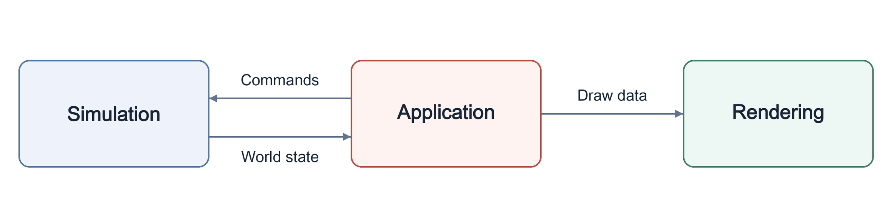

<p align="center" dir="ltr">
  <a href="README.vi.md" lang="vi">Tiếng Việt</a> · <a href="README.sv.md" lang="sv">Svenska</a> · <a href="README.zh-CN.md" lang="zh-CN">简体中文</a> · <a href="README.zh-TW.md" lang="zh-TW">繁體中文</a> · <a href="README.de.md" lang="de">Deutsch</a> · <a href="README.ar.md" lang="ar" dir="rtl">العربية</a> · <a href="README.es.md" lang="es">Español</a> · <a href="README.ja.md" lang="ja">日本語</a> · <a href="README.ru.md" lang="ru">Русский</a> · <a href="README.th.md" lang="th">ไทย</a> · <a href="README.tr.md" lang="tr">Türkçe</a> · <strong>English</strong>
</p>
<p align="center" dir="ltr">
  <a href="https://github.com/YuriPlanet/vera20k/actions/workflows/linux.yml?query=branch%3Amain" title="Latest Linux library test run (run manually)"></a>
  <a href="https://github.com/YuriPlanet/vera20k/actions/workflows/windows.yml?query=branch%3Amain" title="Latest Windows library test run (run manually)"></a>
  <a href="https://discord.gg/kmjRUn5m5F"></a>
  
  
</p>

<!-- Keep all translated READMEs in sync when changing the text below. -->

# VERA20K

VERA20K is a new engine for Red Alert 2: Yuri's Revenge. It plays like the original, with the same
units, maps and look, and runs on Windows, macOS and Linux. It supports battles with up to
20,000 units on one map. Offline Skirmish has up to 120 player slots. LAN and online matches have up to 30.

VERA20K is made by gamers, for gamers, and gamers have the final say in where it goes.


## Download and play

1. Install Red Alert 2: Yuri's Revenge from Steam or the EA app.
2. Download VERA20K for your system from the [releases page](https://github.com/YuriPlanet/vera20k/releases).
3. Open the file you downloaded. It finds your game and sets up VERA20K in its own folder.

Stuck? See the [help page](https://vera20k.org/help).

## Project goals

1. Keep the gameplay, visuals and atmosphere of the original Red Alert 2: Yuri's Revenge.
2. Support bigger battles on 500×500 maps with up to **20,000 units**, **120 player slots** in offline Skirmish and **30** on LAN or online.
3. Incorporate known RTS features and some never seen before.
4. Integrated multiplayer client

## Contributing

**Valued PRs** — refactoring, performance, pathfinding, UI/UX, random map generator.

Contributors can take responsibility for engine areas, with broad freedom to make changes that
move VERA20K forward.

Maintainers will help with review, integration and merging. You'll keep full credit for your
contribution.

Admins: [Halvor Nikolai Rusten](https://github.com/hrusten), [风雨声](https://github.com/996666925), [Kironix](https://github.com/EncoreAlpha), [Randerion(HaoJun0823)](https://github.com/HaoJun0823), [libi](https://github.com/libi), [zzzzzzh123](https://github.com/zzzzzzh123), [八音盒](https://github.com/1372704087)

Discussion is on [Discord](https://discord.gg/kmjRUn5m5F) and in the QQ group (1097193563).

## Architecture

The engine has three main parts:

- **Simulation:** Owns gameplay state and logic.
- **Rendering:** Draws terrain, units and buildings on the GPU using the original game's art.
- **Application:** Handles input, menus, audio, and platform integration, connecting the systems.

This separation supports deterministic gameplay.

Arrows show data flow:



## Build and run

You need:

- **Rust and Git:** [Rust](https://rustup.rs/) 1.97 or later, installed with rustup, and
  [Git](https://git-scm.com/).
- **Build tools:** on Windows, the Visual Studio C++ build tools, which the Rust installer offers
  to install; on macOS, `xcode-select --install`; on Debian and Ubuntu,
  `sudo apt install build-essential libasound2-dev libxkbcommon-x11-0 pkg-config`.

```sh
git clone https://github.com/YuriPlanet/vera20k.git
cd vera20k
cp config.toml.example config.toml
# Edit config.toml and set ra2_dir to your game folder before running:
cargo run --release --bin vera20k
```

## How we work

Most of the code is written by AI coding agents. They use Ghidra to study the original
engine, then port its behavior to Rust and check it with [comparison tools](tools/native_oracle.md)
and playtesting. Agents follow [AGENTS.md](AGENTS.md).

## Customization

You can add your own mods, maps, music and more. They go in the VERA20K folder: the install
folder on Windows, `~/Library/Application Support/VERA20k` on macOS and `~/.local/share/VERA20k`
on Linux.

VERA20K uses the original Yuri's Revenge rules by default. In **Options**, you can change
sound, graphics and controls or turn on VERA features. The game saves your preferences in
`VERA.INI`, with VERA-specific options under `[VERA]`.

- **Mods:** in **Options → Mods**, **Add Mod** installs a mod you downloaded and **New Mod** starts your own. Each mod gets its own folder in `Mods`.
- **Maps:** put `.map`, `.mpr` or `.yrm` files in `Maps` to play them in Skirmish. Maps you download online are saved there too.
- **Music:** put WAV or AUD files in `musics` and add a `music.ini` there with `enable=yes` under `[Music]`. Your songs then play in matches alongside the game's music; `ExclusiveMode=yes` plays only yours.
- **HD art:** an [HD art pack](docs/hd-art.md) is installed and picked like a mod. Then turn on **HD art** in **Options**.
- **Languages:** a `vera20k.<language>.ini` file adds a language or changes the game's text. See [translating](src/i18n/README.md).

Lobby settings, mods and maps can change the rules for a match. Mods and maps can enable supported
[Ares](docs/ares.md), [Phobos](docs/phobos.md) and [Kratos](docs/kratos.md) features through their
INI files. A mod can also enable Ares by including `ares.mix`. Some Phobos features still require a
build with `--features phobos`.

To create a mod, start with the [modding guide](docs/modding.md).

## Support

<a href="https://paypal.me/vera20k"></a>

All donations received are distributed
to contributors according to the [TIBTRE contribution ledger](https://github.com/YuriPlanet/tibtre-ledger).

Payouts to contributors:

<p>     </p>

## Media

<p>
  <a href="https://www.youtube.com/@cncvietnam-huydeptrai"></a>
  VERA20K is featured on <a href="https://www.youtube.com/@cncvietnam-huydeptrai">Command &amp; Conquer Vietnam</a>.<br>
  <a href="https://www.youtube.com/watch?v=njpQRCTZ_MY">1 vs 29 Brutal AI on Arctic Circle 30</a><br>
  <a href="https://www.youtube.com/watch?v=7r_z_7w0InA&amp;t=1440s">Survival Fortress 5.0</a><br clear="all">
</p>

<p>
  <a href="https://www.youtube.com/@haojunyang2337"></a>
  VERA20K is featured on <a href="https://www.youtube.com/@haojunyang2337">HaoJun Yang</a>.<br>
  <a href="https://www.youtube.com/watch?v=ucz-EiMeW88">Red Alert 2 in VERA20K 0.41</a><br clear="all">
</p>

## Map editors

<p>
  <a href="https://github.com/996666925/ra2-map-editor"></a>
  <a href="https://github.com/996666925/ra2-map-editor">YR Map Editor</a><br>
  Create Yuri’s Revenge maps and playtest them in VERA20K.<br clear="all">
</p>

## Credits and legal

Thanks to OpenRA, XCC Mixer, the ModEnc wiki, Project Perfect Mod, EA's GPL source release of
Command & Conquer and Red Alert, World-Altering Editor, Final Alert, YRpp, Ares, Phobos and
many others.

Copyright © 2026 Halvor Nikolai Rusten and VERA20K contributors.
Licensed under the [GPLv3](LICENSE-GPL) with [additional terms](LEGAL.md#additional-terms).
Players supply their own Yuri's Revenge game files. Command &
Conquer and Red Alert are trademarks of Electronic Arts Inc., and the screenshots and the app
icon, Red Alert 2's red star, show game art owned by Electronic Arts. VERA20K is not affiliated
with or endorsed by Electronic Arts.

This product includes software developed by the [Ares Contributors](LICENSES/Ares.txt).

This product includes software developed by the [Phobos Developers](docs/phobos.md#original-project-and-authors).

This product includes software developed by the [Kratos Authors](docs/kratos.md#original-project-and-authors).

**Read the [legal notice](LEGAL.md) before you share, sell or fork VERA20K.**

## Documentation

- [WebAssembly preview](docs/wasm.md): an opt-in single-player build that runs in a browser.
- [Modding guide](docs/modding.md): what mods can and can't do, and how VERA20K differs from the original game.
- [INI profiles](docs/ini-roots.md): choosing rules, art and AI files.
- [Ares](docs/ares.md), [Phobos](docs/phobos.md), [Kratos](docs/kratos.md),
  [NPatch](docs/npatch.md) and [VeraX](docs/verax.md): extension support and limitations.
- [Engine overview](docs/index.md): code layout and how the engine fits together.
- [Developer tools](tools/README.md): builds, tests and asset inspection.
- [Map testing](tools/map_observation.md): scripted scenarios, screenshots and match observations.
- [Native comparisons](tools/native_oracle.md): comparing behavior with the original game.
- [Ghidra workflow](docs/ghidra-workflow.md): inspecting the original engine.
