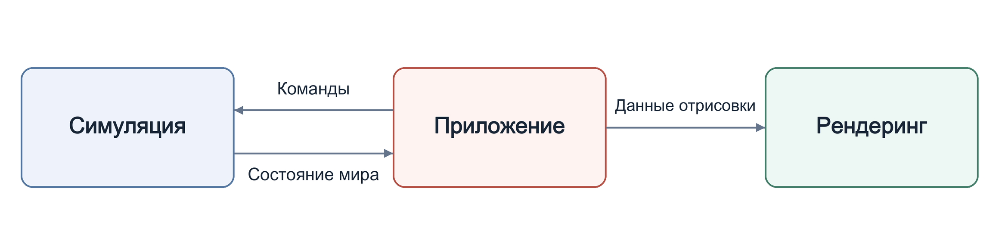

<p align="center" dir="ltr">
  <a href="README.sv.md" lang="sv">Svenska</a> · <a href="README.zh-CN.md" lang="zh-CN">简体中文</a> · <a href="README.de.md" lang="de">Deutsch</a> · <a href="README.ar.md" lang="ar" dir="rtl">العربية</a> · <strong>Русский</strong> · <a href="README.th.md" lang="th">ไทย</a> · <a href="README.tr.md" lang="tr">Türkçe</a> · <a href="README.md" lang="en">English</a>
  &nbsp;&nbsp;
  <a href="https://github.com/YuriPlanet/vera20k/actions/workflows/macos.yml?query=branch%3Amain" title="Последний запуск тестов библиотеки на macOS (запускаются вручную)"></a>
  <a href="https://github.com/YuriPlanet/vera20k/actions/workflows/linux.yml?query=branch%3Amain" title="Последний запуск тестов библиотеки на Linux (запускаются вручную)"></a>
  <a href="https://github.com/YuriPlanet/vera20k/actions/workflows/windows.yml?query=branch%3Amain" title="Последний запуск тестов библиотеки на Windows (запускаются вручную)"></a>
  <a href="https://discord.gg/kmjRUn5m5F"></a>
  
</p>

# VERA20k

VERA20k — новая реализация оригинального движка `gamemd.exe`, которую развивает сообщество.
Она использует оригинальные файлы игры, поэтому тебе понадобится собственная копия
Red Alert 2: Yuri's Revenge.

VERA20k делают игроки для игроков, и последнее слово в том, куда движется проект, остаётся за
игроками.


## Цели проекта

1. Сохранить игровой процесс, графику и атмосферу оригинальной Red Alert 2: Yuri's Revenge.
2. Поддерживать более крупные сражения: до **30 игроков** и **20 000 юнитов** на картах 500×500.
3. Добавлять известные возможности RTS, а также такие, каких ещё не было.
4. Встроенный клиент для мультиплеера

## Текущее состояние

**Активная разработка.**

- **Схватки:** Доступны на Windows, Linux и macOS: карты из оригинальной игры и случайные
  карты, строительство баз, сбор ресурсов, бои, сохранение и загрузка.
- **Кампании:** Миссии можно запускать; поддержка остаётся неполной.
- **ИИ:** Части оригинального ИИ отвечают за строительство баз и атаки по скриптам.
- **Текущая работа:** Точность игрового поведения, графика и производительность.
- **Мультиплеер:** Сетевая игра пока недоступна.
- **Масштаб:** Сражения с 30 игроками и 20 000 юнитами ещё не продемонстрированы.

## Архитектура

Движок состоит из трёх основных частей:

- **Симуляция:** Отвечает за состояние игры и игровую логику.
- **Рендеринг:** Совершенно новый конвейер отрисовки на GPU, использующий оригинальные игровые
  ресурсы и созданный для сохранения оригинального облика.
- **Приложение:** Обрабатывает ввод, меню, звук и интеграцию с платформой, связывая системы между собой.

Такое разделение поддерживает детерминированный игровой процесс.

Стрелки показывают поток данных:



## Сборка и запуск

Понадобится:

- **Игра:** Red Alert 2: Yuri's Revenge.
- **Rust и Git:** актуальная стабильная версия [Rust](https://rustup.rs/), установленная через
  rustup, и [Git](https://git-scm.com/).
- **Инструменты сборки:** на Windows — C++ Build Tools из Visual Studio, которые предложит
  установить установщик Rust; на macOS — `xcode-select --install`; в Debian и Ubuntu —
  `sudo apt install build-essential libasound2-dev pkg-config`.
- **Графика:** видеокарта с поддержкой Vulkan, DirectX 12 или Metal.

В VERA20k уже играли на Windows, Linux и macOS.

```sh
git clone https://github.com/YuriPlanet/vera20k.git
cd vera20k
cp config.toml.example config.toml
# Перед запуском отредактируй config.toml и укажи папку с игрой в ra2_dir:
cargo run --release --bin vera20k
```

Указывай путь в `ra2_dir` с прямыми слешами, например `C:/Games/RA2`. Для игры используй
`--release`; отладочные сборки слишком медленные. Лог пишется в `logs/ra2.log`.

## Как мы работаем

Большую часть кода пишут ИИ-агенты для программирования. Они изучают оригинальный движок в
Ghidra, затем переносят его поведение на Rust и проверяют его
[инструментами сравнения](tools/native_oracle.md) и игровыми тестами. Агенты следуют
[AGENTS.md](AGENTS.md).

## Настройка

Необязательные возможности (например, из Ares) должны настраиваться через INI-файлы,
с переключателями в клиенте там, где это уместно.

## Как помочь

Мы рады помощи. Можно писать код, рефакторить движок, тестировать игру, предлагать идеи или
играть параллельно с оригиналом и рассказывать, что кажется неправильным. Открой PR, а дальше
мы разберёмся сами. Обсуждение идёт в [Discord](https://discord.gg/kmjRUn5m5F) и в QQ-группе (1097193563).

Игровая логика находится в `src/sim/`, отрисовка — в `src/render/`, меню и ввод — в `src/app/` и
`src/ui/`; Python-инструменты из `tools/` тебе не понадобятся.

Чтобы проверить свои изменения в игре, запускай `cargo run --profile fast --bin vera20k`. Эта
сборка оптимизирована как `--release`, но пересобирает только то, что ты изменил, поэтому
в игру ты вернёшься быстрее. Производительность измеряй с `--release`.

Вклады распространяются под лицензией GPLv3, как и весь проект; подписывать CLA не нужно.

## Поддержка проекта <a href="https://paypal.me/vera20k"></a>

[Поддержать VERA20k через PayPal](https://paypal.me/vera20k). Все полученные пожертвования
распределяются между участниками проекта согласно
[журналу вкладов TIBTRE](https://github.com/YuriPlanet/tibtre-ledger).

Участники получают выплаты через PayPal, UnionPay (Китай), Alipay, Vipps,
банковский перевод SEPA или Bitcoin.

## Благодарности и правовая информация

Спасибо OpenRA, XCC Mixer, вики ModEnc, Project Perfect Mod, EA за публикацию исходного кода
Command & Conquer и Red Alert под GPL, World-Altering Editor, Final Alert, YRpp, Ares,
Phobos и многим другим.

Проект распространяется под лицензией [GPLv3](LICENSE-GPL). В этом репозитории нет файлов игры.
Command & Conquer и Red Alert — товарные знаки Electronic Arts Inc., а на скриншотах показана
игровая графика, принадлежащая Electronic Arts. VERA20k не связан с Electronic Arts и
не одобрен компанией.

Перевод [README.md](README.md); поддерживайте его в соответствии с английской версией.
