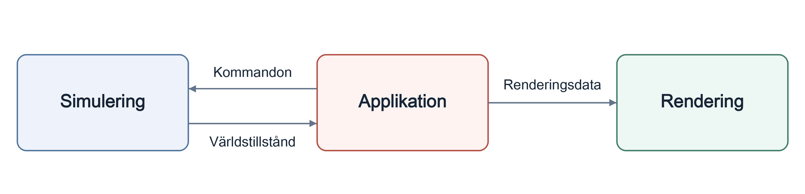

<p align="center" dir="ltr">
  <strong>Svenska</strong> · <a href="README.zh-CN.md" lang="zh-CN">简体中文</a> · <a href="README.de.md" lang="de">Deutsch</a> · <a href="README.ar.md" lang="ar" dir="rtl">العربية</a> · <a href="README.es.md" lang="es">Español</a> · <a href="README.ja.md" lang="ja">日本語</a> · <a href="README.ru.md" lang="ru">Русский</a> · <a href="README.th.md" lang="th">ไทย</a> · <a href="README.tr.md" lang="tr">Türkçe</a> · <a href="README.md" lang="en">English</a>
</p>
<p align="center" dir="ltr">
  <a href="https://github.com/YuriPlanet/vera20k/actions/workflows/macos.yml?query=branch%3Amain" title="Senaste körningen av bibliotekstesterna för macOS (startas manuellt)"></a>
  <a href="https://github.com/YuriPlanet/vera20k/actions/workflows/linux.yml?query=branch%3Amain" title="Senaste körningen av bibliotekstesterna för Linux (startas manuellt)"></a>
  <a href="https://github.com/YuriPlanet/vera20k/actions/workflows/windows.yml?query=branch%3Amain" title="Senaste körningen av bibliotekstesterna för Windows (startas manuellt)"></a>
  <a href="https://discord.gg/kmjRUn5m5F"></a>
  
</p>

# VERA20K

VERA20K är en communitydriven nyimplementation av originalmotorn, `gamemd.exe`. Den använder
de ursprungliga spelfilerna, så du behöver en egen kopia av Red Alert 2: Yuri's Revenge.

VERA20K görs av spelare, för spelare, och det är spelarna som har sista ordet om vart projektet
ska gå.


## Projektets mål

1. Bevara spelmekaniken, utseendet och stämningen i originalversionen av Red Alert 2: Yuri's Revenge.
2. Stödja större slag: upp till **30 spelare** och **20 000 enheter** på 500×500-kartor.
3. Integrera kända RTS-funktioner och några som aldrig setts förut.
4. Integrerad flerspelarklient

## Aktuellt läge

**Under aktiv utveckling.**

- **Skirmish:** Går att spela på Windows, Linux och macOS, med kartor från originalspelet
  och slumpgenererade kartor, basbygge, resursinsamling, strider samt möjlighet att spara och ladda spel.
- **Kampanjer:** Uppdrag går att starta; stödet är fortfarande ofullständigt.
- **AI:** Delar av originalets AI sköter basbygge och skriptstyrda anfall.
- **Pågående arbete:** Spelmekanikens exakthet, grafik och prestanda.
- **Flerspelarläge:** LAN- och onlinespel finns i aktuella källkodsbyggen för macOS och Linux.
- **Skala:** Två onlinematcher i följd klarade funktionsvalideringen med
  30 oberoende klientprocesser och fler än 20 000 aktiva rörliga enheter per match.
  Linux-klienterna delade virtuella maskiner; jämn prestanda i realtid är inte fastställd.

## Ladda ner och spela

Ladda ner installationsprogrammet för Windows, macOS eller Linux från
[releasesidan](https://github.com/YuriPlanet/vera20k/releases). Det hittar ditt Yuri's Revenge och
installerar VERA20K i en ny mapp.

För att starta skirmish-matcher eller kampanjer i YR för en spelare från en CnCNet-klient, se
[installationen av offlineklienten](integrations/cncnet/README.md).

## Bidra

All hjälp är välkommen. Du kan skriva kod, refaktorera motorn, testa spelet, dela idéer eller
spela det sida vid sida med originalet och berätta vad som känns fel. Öppna en PR så tar vi det
därifrån.

Medverkande kan ta ansvar för delar av motorn, med stor frihet att göra ändringar som driver
VERA20K framåt.

Underhållarna hjälper till med granskning, integrering och sammanslagning. Du får fullt
erkännande för ditt bidrag.

Diskussionen sker på [Discord](https://discord.gg/kmjRUn5m5F) och i QQ-gruppen (1097193563).

## Inställningar

Använd **Options** för ljud och kontroller och **Vera Options** för VERA-specifika funktioner.
Spelarinställningar, kortkommandon och lobbyval sparas i `VERA.INI`:

- **Windows-installationsprogrammet:** bredvid `vera20k.exe`.
- **macOS:** `~/Library/Application Support/VERA20k/VERA.INI`.
- **Linux:** `~/.local/share/VERA20k/VERA.INI` eller i din XDG-datamapp.

I `config.toml` anger du spelmappen och kan välja en annan inställningsmapp.

Aktivera **Mouse Wheel Zoom** i **Vera Options**, eller sätt `[VERA] MouseWheelZoom=yes`
i `VERA.INI` (standard `no`).

Om `VERA.INI` saknas skapar VERA filen och importerar befintliga inställningar en gång.
Om det inte finns några gamla inställningar börjar filen tom och VERA använder inbyggda
standardvärden tills inställningar sparas. Originalfilerna `RA2MD.INI` och `KeyboardMD.ini`
läses bara vid import och skrivs aldrig över.

`VERARULES.INI` i samma mapp innehåller valfria ändringar av spelreglerna. Filen innehåller från
början bortkommenterade exempel och låter uppdrags- och kartregler styra. Se
[personliga regler](docs/personal-rules.md) för hur du redigerar och åsidosätter dem.

## Arkitektur

Motorn har tre huvuddelar:

- **Simulering:** Ansvarar för speltillstånd och spellogik.
- **Rendering:** En helt ny GPU-renderingspipeline som använder originalets spelresurser,
  byggd för att bevara originalets utseende.
- **Applikation:** Hanterar inmatning, menyer, ljud och plattformsintegration och kopplar ihop systemen.

Denna uppdelning stöder deterministiskt spel.

Pilarna visar dataflödet:



## Bygg och kör

Du behöver:

- **Rust och Git:** [Rust](https://rustup.rs/) 1.97 eller senare, installerad med rustup, och
  [Git](https://git-scm.com/).
- **Byggverktyg:** på Windows Visual Studios C++-byggverktyg, som Rusts installationsprogram
  erbjuder sig att installera; på macOS `xcode-select --install`; på Debian och Ubuntu
  `sudo apt install build-essential libasound2-dev libxkbcommon-x11-0 pkg-config`.

VERA20K har spelats på Windows, Linux och macOS.

```sh
git clone https://github.com/YuriPlanet/vera20k.git
cd vera20k
cp config.toml.example config.toml
# Redigera config.toml och ange din spelmapp i ra2_dir innan du kör:
cargo run --release --bin vera20k
```

## Så arbetar vi

Större delen av koden skrivs av AI-agenter. De använder Ghidra för att studera originalmotorn,
portar sedan dess beteende till Rust och kontrollerar det med
[jämförelseverktyg](tools/native_oracle.md) och speltester. Agenterna följer
[AGENTS.md](AGENTS.md).

## Anpassning

VERA20K fungerar som standard precis som originalspelet. Varje ny funktion, även tillägg från
moddar som Ares, måste vara avstängd tills den slås på med något av följande:

- **En spelarinställning i VERA**, under **Options → Vera Options**, som sparas i avsnittet `[VERA]` i `VERA.INI`.
- **Ett byggalternativ**, till exempel `--features ares` för de [Ares-tillägg](docs/ares.md) som stöds.
- **En INI-nyckel**, som sätts av en mod eller en karta.

Inställningar för ljud, grafik och kontroller sparas i `VERA.INI`. Spelreglerna kommer från
lobbyinställningar, moddar eller kartor.

## Stöd projektet

<a href="https://paypal.me/vera20k"></a>

Alla mottagna donationer fördelas till
medverkande enligt [TIBTRE:s bidragsregister](https://github.com/YuriPlanet/tibtre-ledger).

Utbetalningar till medverkande:

<p>     </p>

## Tack och juridisk information

Tack till OpenRA, XCC Mixer, ModEnc-wikin, Project Perfect Mod, EA:s GPL-utgåva av källkoden till
Command & Conquer och Red Alert, World-Altering Editor, Final Alert, YRpp, Ares, Phobos och
många andra.

Licensierat under [GPLv3](LICENSE-GPL). Det här repot innehåller inga spelfiler. Command &
Conquer och Red Alert är varumärken som tillhör Electronic Arts Inc., och skärmbilderna och
appikonen, Red Alert 2:s röda stjärna, visar spelgrafik som ägs av Electronic Arts. VERA20K har
ingen koppling till och stöds inte av Electronic Arts.

## Dokumentation

- [Bygg och kör](#bygg-och-kör): krav och hur du bygger från källkod.
- [INI-profiler](docs/ini-roots.md): välja regel-, grafik- och AI-filer.
- [Ares](docs/ares.md), [Phobos](docs/phobos.md) och [NPatch](docs/npatch.md): stöd för tilläggen och deras begränsningar.
- [Motoröversikt](docs/index.md): kodens upplägg och hur motorns delar hänger ihop.
- [Utvecklarverktyg](tools/README.md): byggen, tester och granskning av spelresurser.
- [Karttester](tools/map_observation.md): skriptade scenarier, skärmbilder och observationer av matcher.
- [Jämförelser med originalet](tools/native_oracle.md): jämföra beteendet med originalspelet.
- [Arbetsflöde i Ghidra](docs/ghidra-workflow.md): undersöka originalmotorn.

Översättning av [README.md](README.md); håll den uppdaterad i takt med den engelska versionen.
