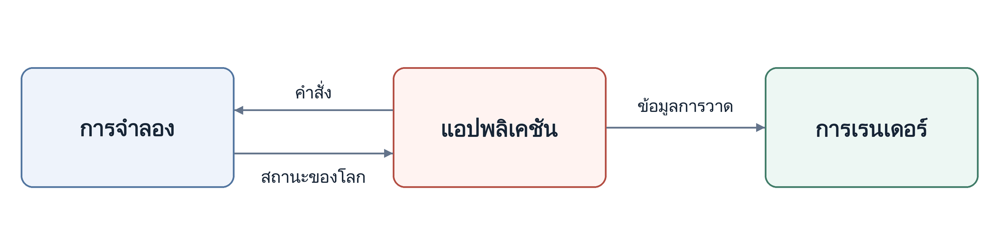

<p align="center" dir="ltr">
  <a href="README.vi.md" lang="vi">Tiếng Việt</a> · <a href="README.sv.md" lang="sv">Svenska</a> · <a href="README.zh-CN.md" lang="zh-CN">简体中文</a> · <a href="README.zh-TW.md" lang="zh-TW">繁體中文</a> · <a href="README.de.md" lang="de">Deutsch</a> · <a href="README.ar.md" lang="ar" dir="rtl">العربية</a> · <a href="README.es.md" lang="es">Español</a> · <a href="README.ja.md" lang="ja">日本語</a> · <a href="README.ru.md" lang="ru">Русский</a> · <strong>ไทย</strong> · <a href="README.tr.md" lang="tr">Türkçe</a> · <a href="README.md" lang="en">English</a>
</p>
<p align="center" dir="ltr">
  <a href="https://github.com/YuriPlanet/vera20k/actions/workflows/linux.yml?query=branch%3Amain" title="การทดสอบไลบรารีบน Linux ครั้งล่าสุด (สั่งรันด้วยตนเอง)"></a>
  <a href="https://github.com/YuriPlanet/vera20k/actions/workflows/windows.yml?query=branch%3Amain" title="การทดสอบไลบรารีบน Windows ครั้งล่าสุด (สั่งรันด้วยตนเอง)"></a>
  <a href="https://discord.gg/kmjRUn5m5F"></a>
  
  
</p>

# VERA20K

VERA20K คือเอนจินใหม่สำหรับ Red Alert 2: Yuri's Revenge เล่นได้เหมือนต้นฉบับ ทั้งยูนิต แผนที่
และหน้าตา และรันได้บน Windows, macOS และ Linux สร้างมาเพื่อการรบที่ใหญ่ขึ้น รองรับยูนิตสูงสุด 20,000 ตัวบนแผนที่เดียว
โหมด Skirmish แบบออฟไลน์มีช่องผู้เล่นสูงสุด 120 ช่อง ส่วนการเล่นผ่าน LAN หรือออนไลน์มีสูงสุด 30 ช่อง

VERA20K สร้างโดยเกมเมอร์ เพื่อเกมเมอร์ และเกมเมอร์คือผู้ตัดสินใจขั้นสุดท้ายว่าโครงการจะไปในทิศทางใด


## ดาวน์โหลดและเล่น

1. ติดตั้ง Red Alert 2: Yuri's Revenge จาก Steam หรือแอป EA
2. ดาวน์โหลด VERA20K สำหรับระบบของคุณจาก[หน้ารุ่นที่เผยแพร่](https://github.com/YuriPlanet/vera20k/releases)
3. เปิดไฟล์ที่ดาวน์โหลดมา ระบบจะค้นหาเกมของคุณและติดตั้ง VERA20K ในโฟลเดอร์ของตัวเอง

ติดปัญหาอยู่ใช่ไหม ดูที่[หน้าช่วยเหลือ](https://vera20k.org/th/help)

## เป้าหมายของโครงการ

1. คงรูปแบบการเล่น ภาพ และบรรยากาศของ Red Alert 2: Yuri's Revenge ต้นฉบับไว้
2. รองรับการต่อสู้ที่ใหญ่ขึ้นบนแผนที่ขนาด 500×500 ด้วยยูนิตสูงสุด **20,000 ตัว** โดยโหมด Skirmish แบบออฟไลน์มีช่องผู้เล่นสูงสุด **120 ช่อง** ส่วนการเล่นผ่าน LAN หรือออนไลน์มีสูงสุด **30 ช่อง**
3. เพิ่มฟีเจอร์ RTS ที่เป็นที่รู้จัก รวมถึงฟีเจอร์ที่ไม่เคยมีมาก่อน
4. ไคลเอนต์ผู้เล่นหลายคนในตัว

## ร่วมพัฒนา

**PR ที่เราให้ความสำคัญ** — การปรับโครงสร้างโค้ด, ประสิทธิภาพ, การหาเส้นทาง, UI/UX, เครื่องมือสร้างแผนที่แบบสุ่ม

ผู้ร่วมพัฒนาสามารถรับผิดชอบส่วนต่าง ๆ ของเอนจินได้ โดยมีอิสระอย่างมากในการเปลี่ยนแปลงที่ช่วยผลักดัน VERA20K ไปข้างหน้า

ผู้ดูแลโครงการจะช่วยในการรีวิว การผสานรวม และการเมิร์จ คุณจะได้รับเครดิตเต็มที่สำหรับผลงานของคุณ

ผู้ดูแล: [Halvor Nikolai Rusten](https://github.com/hrusten), [风雨声](https://github.com/996666925), [Kironix](https://github.com/EncoreAlpha), [Randerion(HaoJun0823)](https://github.com/HaoJun0823), [libi](https://github.com/libi), [zzzzzzh123](https://github.com/zzzzzzh123), [八音盒](https://github.com/1372704087)

การพูดคุยอยู่ใน [Discord](https://discord.gg/kmjRUn5m5F) และในกลุ่ม QQ (1097193563)

## สถาปัตยกรรม

เอนจินแบ่งเป็นสามส่วนหลัก:

- **การจำลอง:** ดูแลสถานะและตรรกะของเกม
- **การเรนเดอร์:** ใช้ GPU วาดภูมิประเทศ ยูนิต และสิ่งปลูกสร้างด้วยภาพจากเกมต้นฉบับ
- **แอปพลิเคชัน:** จัดการอินพุต เมนู เสียง และการทำงานร่วมกับแพลตฟอร์ม พร้อมเชื่อมระบบต่าง ๆ เข้าด้วยกัน

การแยกส่วนนี้ช่วยให้ผลการจำลองเกมคงที่เมื่อเริ่มจากสถานะและอินพุตเดียวกัน

ลูกศรแสดงการไหลของข้อมูล:



## บิลด์และรัน

สิ่งที่ต้องมี:

- **Rust และ Git:** [Rust](https://rustup.rs/) 1.97 หรือใหม่กว่า ที่ติดตั้งผ่าน rustup และ [Git](https://git-scm.com/)
- **เครื่องมือบิลด์:** บน Windows ใช้ C++ build tools ของ Visual Studio ซึ่งตัวติดตั้ง Rust จะเสนอให้ติดตั้ง
  บน macOS รัน `xcode-select --install` บน Debian และ Ubuntu รัน `sudo apt install build-essential libasound2-dev libxkbcommon-x11-0 pkg-config`

```sh
git clone https://github.com/YuriPlanet/vera20k.git
cd vera20k
cp config.toml.example config.toml
# ก่อนรัน ให้แก้ไข config.toml และตั้งค่า ra2_dir เป็นโฟลเดอร์เกมของคุณ:
cargo run --release --bin vera20k
```

## วิธีทำงานของเรา

โค้ดส่วนใหญ่เขียนโดยเอเจนต์ AI ซึ่งใช้ Ghidra ศึกษาเอนจินต้นฉบับ
แล้วนำพฤติกรรมของมันมาเขียนใน Rust และตรวจสอบด้วย[เครื่องมือเปรียบเทียบ](tools/native_oracle.md)
และการทดลองเล่น เอเจนต์ทำตาม [AGENTS.md](AGENTS.md)

## การปรับแต่ง

คุณเพิ่มม็อด แผนที่ เพลง และอื่น ๆ ของคุณเองได้ โดยวางไว้ในโฟลเดอร์ VERA20K ซึ่งบน Windows คือโฟลเดอร์ที่ติดตั้งเกม บน macOS คือ `~/Library/Application Support/VERA20k` และบน Linux คือ `~/.local/share/VERA20k`

VERA20K ใช้กติกาของ Yuri's Revenge ภาคต้นฉบับเป็นค่าเริ่มต้น คุณปรับเสียง กราฟิก และการควบคุม หรือเปิดฟีเจอร์ของ VERA ได้ในเมนู **Options** เกมจะบันทึกการตั้งค่าไว้ใน `VERA.INI` โดยเก็บตัวเลือกเฉพาะของ VERA ไว้ในส่วน `[VERA]`

- **ม็อด:** ใน **Options → Mods** ปุ่ม **Add Mod** จะติดตั้งม็อดที่คุณดาวน์โหลดมา และ **New Mod** จะเริ่มม็อดของคุณเอง ม็อดแต่ละตัวมีโฟลเดอร์ของตัวเองใน `Mods`
- **แผนที่:** วางไฟล์ `.map` `.mpr` หรือ `.yrm` ไว้ใน `Maps` เพื่อเล่นในโหมด Skirmish แผนที่ที่ดาวน์โหลดจากออนไลน์ก็จะถูกบันทึกไว้ที่นั่นด้วย
- **เพลง:** วางไฟล์ WAV หรือ AUD ไว้ใน `musics` แล้วเพิ่มไฟล์ `music.ini` ไว้ในโฟลเดอร์นั้น โดยใส่ `enable=yes` ใต้ `[Music]` เพลงของคุณจะเล่นในแมตช์ร่วมกับเพลงของเกม ถ้าตั้ง `ExclusiveMode=yes` จะเล่นเฉพาะเพลงของคุณ
- **ภาพ HD:** [แพ็กภาพ HD](docs/hd-art.md) ติดตั้งและเลือกใช้แบบเดียวกับม็อด จากนั้นเปิด **HD art** ใน **Options**
- **ภาษา:** ไฟล์ `vera20k.<language>.ini` ใช้เพิ่มภาษาหรือเปลี่ยนข้อความในเกม ดู[คู่มือการแปล](src/i18n/README.md)

การตั้งค่าล็อบบี้ ม็อด และแผนที่สามารถเปลี่ยนกติกาของแต่ละแมตช์ได้ ม็อดและแผนที่เปิดใช้ฟีเจอร์ของ [Ares](docs/ares.md), [Phobos](docs/phobos.md) และ [Kratos](docs/kratos.md) ที่ VERA20K รองรับได้ผ่านไฟล์ INI ม็อดยังเปิดใช้ Ares ได้โดยใส่ไฟล์ `ares.mix` มาด้วย ฟีเจอร์บางอย่างของ Phobos ยังต้องใช้เกมที่บิลด์ด้วย `--features phobos`

ถ้าอยากสร้างม็อดเอง เริ่มได้จาก[คู่มือการทำม็อด](docs/modding.md)

## สนับสนุนโครงการ

<a href="https://paypal.me/vera20k"></a>

เงินบริจาคทั้งหมดที่ได้รับจะจัดสรรให้
ผู้มีส่วนร่วมตาม[บัญชีบันทึกผลงาน TIBTRE](https://github.com/YuriPlanet/tibtre-ledger)

ผู้มีส่วนร่วมรับเงินได้ผ่าน:

<p>     </p>

## สื่อ

<p>
  <a href="https://www.youtube.com/@cncvietnam-huydeptrai"></a>
  ช่อง <a href="https://www.youtube.com/@cncvietnam-huydeptrai">Command &amp; Conquer Vietnam</a> นำเสนอ VERA20K<br>
  <a href="https://www.youtube.com/watch?v=njpQRCTZ_MY">1 ปะทะ AI ระดับ Brutal 29 ฝ่ายบน Arctic Circle 30</a><br>
  <a href="https://www.youtube.com/watch?v=7r_z_7w0InA&amp;t=1440s">Survival Fortress 5.0</a><br clear="all">
</p>

<p>
  <a href="https://www.youtube.com/@haojunyang2337"></a>
  ช่อง <a href="https://www.youtube.com/@haojunyang2337">HaoJun Yang</a> นำเสนอ VERA20K<br>
  <a href="https://www.youtube.com/watch?v=ucz-EiMeW88">Red Alert 2 ใน VERA20K 0.41</a><br clear="all">
</p>

## เครื่องมือแก้ไขแผนที่

<p>
  <a href="https://github.com/996666925/ra2-map-editor"></a>
  <a href="https://github.com/996666925/ra2-map-editor">YR Map Editor</a><br>
  สร้างแผนที่สำหรับ Yuri’s Revenge แล้วทดลองเล่นใน VERA20K<br clear="all">
</p>

## เครดิตและข้อกฎหมาย

ขอบคุณ OpenRA, XCC Mixer, วิกิ ModEnc, Project Perfect Mod, EA ที่เผยแพร่ซอร์สโค้ดของ
Command & Conquer และ Red Alert ภายใต้ GPL, World-Altering Editor, Final Alert, YRpp, Ares, Phobos
และอีกหลายโครงการ

ลิขสิทธิ์ © 2026 Halvor Nikolai Rusten และผู้ร่วมพัฒนา VERA20K
เผยแพร่ภายใต้สัญญาอนุญาต [GPLv3](LICENSE-GPL) พร้อม[ข้อกำหนดเพิ่มเติม](LEGAL.md#additional-terms)
ผู้เล่นต้องใช้ไฟล์เกมจาก Red Alert 2: Yuri's Revenge ฉบับที่ตนเป็นเจ้าของ
Command & Conquer และ Red Alert เป็นเครื่องหมายการค้าของ Electronic Arts Inc.
ภาพหน้าจอและไอคอนแอป (ดาวแดงของ Red Alert 2) แสดงงานภาพจากเกมที่เป็นของ Electronic Arts
VERA20K ไม่มีความเกี่ยวข้องกับ Electronic Arts และไม่ได้รับการรับรองจาก Electronic Arts

This product includes software developed by the [Ares Contributors](LICENSES/Ares.txt).

This product includes software developed by the [Phobos Developers](docs/phobos.md#original-project-and-authors).

**โปรดอ่าน[ประกาศทางกฎหมาย](LEGAL.md)ก่อนแชร์ ขาย หรือ fork VERA20K**

## เอกสาร

- [รุ่นทดลอง WebAssembly](docs/wasm.md): บิลด์สำหรับผู้เล่นคนเดียวแบบเลือกใช้ได้ ซึ่งทำงานในเบราว์เซอร์
- [คู่มือการทำม็อด](docs/modding.md): สิ่งที่ม็อดทำได้และทำไม่ได้ และ VERA20K แตกต่างจากเกมต้นฉบับอย่างไร
- [โปรไฟล์ INI](docs/ini-roots.md): การเลือกไฟล์กฎ ไฟล์ art และไฟล์ AI
- [Ares](docs/ares.md), [Phobos](docs/phobos.md) และ [NPatch](docs/npatch.md): การรองรับส่วนขยายและข้อจำกัด
- [ภาพรวมของเอนจิน](docs/index.md): โครงสร้างโค้ดและการทำงานร่วมกันของส่วนต่าง ๆ ในเอนจิน
- [เครื่องมือสำหรับนักพัฒนา](tools/README.md): การบิลด์ การทดสอบ และการตรวจสอบทรัพยากรเกม
- [การทดสอบแผนที่](tools/map_observation.md): ฉากทดสอบที่ใช้สคริปต์ ภาพหน้าจอ และการสังเกตการณ์แมตช์
- [การเปรียบเทียบกับต้นฉบับ](tools/native_oracle.md): การเปรียบเทียบพฤติกรรมกับเกมต้นฉบับ
- [ขั้นตอนการทำงานกับ Ghidra](docs/ghidra-workflow.md): การศึกษาเอนจินต้นฉบับ

แปลจาก [README.md](README.md) โปรดปรับปรุงให้ตรงกับฉบับภาษาอังกฤษเสมอ
