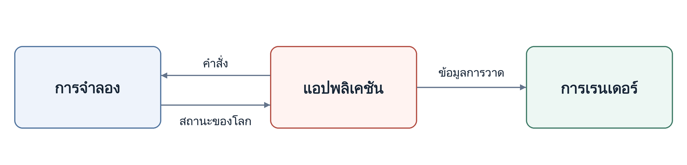

<p align="center" dir="ltr">
  <a href="README.sv.md" lang="sv">Svenska</a> · <a href="README.zh-CN.md" lang="zh-CN">简体中文</a> · <a href="README.de.md" lang="de">Deutsch</a> · <a href="README.ar.md" lang="ar" dir="rtl">العربية</a> · <a href="README.es.md" lang="es">Español</a> · <a href="README.ja.md" lang="ja">日本語</a> · <a href="README.ru.md" lang="ru">Русский</a> · <strong>ไทย</strong> · <a href="README.tr.md" lang="tr">Türkçe</a> · <a href="README.md" lang="en">English</a>
</p>
<p align="center" dir="ltr">
  <a href="https://github.com/YuriPlanet/vera20k/actions/workflows/macos.yml?query=branch%3Amain" title="การทดสอบไลบรารีบน macOS ครั้งล่าสุด (สั่งรันด้วยตนเอง)"></a>
  <a href="https://github.com/YuriPlanet/vera20k/actions/workflows/linux.yml?query=branch%3Amain" title="การทดสอบไลบรารีบน Linux ครั้งล่าสุด (สั่งรันด้วยตนเอง)"></a>
  <a href="https://github.com/YuriPlanet/vera20k/actions/workflows/windows.yml?query=branch%3Amain" title="การทดสอบไลบรารีบน Windows ครั้งล่าสุด (สั่งรันด้วยตนเอง)"></a>
  <a href="https://github.com/YuriPlanet/vera20k/actions/workflows/wasm.yml?query=branch%3Amain" title="การบิลด์ WebAssembly ครั้งล่าสุด (สั่งรันด้วยตนเอง)"></a>
  <a href="https://discord.gg/kmjRUn5m5F"></a>
  
</p>

# VERA20K

VERA20K คือโครงการที่ขับเคลื่อนโดยชุมชนเพื่อเขียนเอนจินเกมต้นฉบับ `gamemd.exe` ขึ้นใหม่
โดยใช้ไฟล์จากเกมต้นฉบับ คุณจึงต้องมี Red Alert 2: Yuri's Revenge ของตัวเอง

VERA20K สร้างโดยเกมเมอร์ เพื่อเกมเมอร์ และเกมเมอร์คือผู้ตัดสินใจขั้นสุดท้ายว่าโครงการจะไปในทิศทางใด


## เป้าหมายของโครงการ

1. คงรูปแบบการเล่น ภาพ และบรรยากาศของ Red Alert 2: Yuri's Revenge ต้นฉบับไว้
2. รองรับการต่อสู้ที่ใหญ่ขึ้น: สูงสุด **30 ผู้เล่น** และ **20,000 ยูนิต** บนแผนที่ขนาด 500×500
3. เพิ่มฟีเจอร์ RTS ที่เป็นที่รู้จัก รวมถึงฟีเจอร์ที่ไม่เคยมีมาก่อน
4. ไคลเอนต์ผู้เล่นหลายคนในตัว

ดูงานที่ให้ความสำคัญในตอนนี้และแผนในอนาคตได้ใน[แผนการพัฒนา](https://github.com/orgs/YuriPlanet/projects/1)

## ดาวน์โหลดและเล่น

ดาวน์โหลดตัวติดตั้งสำหรับ Windows, macOS หรือ Linux
ได้จาก[หน้ารุ่นที่เผยแพร่](https://github.com/YuriPlanet/vera20k/releases) ตัวติดตั้งจะค้นหา
Yuri's Revenge ของคุณ แล้วติดตั้ง VERA20K ไว้ในโฟลเดอร์ใหม่

หากต้องการเริ่มการต่อสู้ภายในเครื่องหรือแคมเปญของ YR แบบผู้เล่นคนเดียวผ่านไคลเอนต์ CnCNet
โปรดดู[การตั้งค่าไคลเอนต์แบบออฟไลน์](integrations/cncnet/README.md)

## ร่วมพัฒนา

**ไม่ต้องกลัวที่จะส่ง PR** ไม่จำเป็นต้องสมบูรณ์แบบ ที่เหลือเราช่วยคุณเอง

ยินดีรับความช่วยเหลือทุกด้าน แต่ด้านต่อไปนี้ต้องการคนช่วยมากที่สุด แต่ละด้านลิงก์ไปยังหน้าของด้านนั้นในแผนการพัฒนา ซึ่งบอกงานที่กำลังทำและขั้นตอนถัดไป:

- **[รูปแบบการเล่นและการต่อสู้](https://github.com/YuriPlanet/vera20k/issues/3830):** พฤติกรรมของยูนิต ความเสียหาย และความเสถียรของการต่อสู้ภายในเครื่อง
- **[ประสิทธิภาพ](https://github.com/YuriPlanet/vera20k/issues/3831):** อัตราเฟรมและการตอบสนองในการต่อสู้ขนาดใหญ่และบนฮาร์ดแวร์รุ่นเก่า
- **[โหมดผู้เล่นหลายคน](https://github.com/YuriPlanet/vera20k/issues/3832):** การเข้าร่วม เริ่ม และเล่นแมตช์ออนไลน์ต่อเนื่อง รวมถึงความเสถียรของการเล่นแบบร่วมมือ
- **[UI และเสียง](https://github.com/YuriPlanet/vera20k/issues/3833):** เมนู ข้อความ [การแปล](src/i18n/README.md) และเสียง
- **[แคมเปญ](https://github.com/YuriPlanet/vera20k/issues/3834):** เริ่มภารกิจได้แล้ว แต่การเล่นให้จบยังต้องพัฒนาต่อ: เป้าหมาย ทริกเกอร์ การเปลี่ยนฉากตามสคริปต์ การบันทึก/โหลด และการไปภารกิจถัดไป
- **[ความเข้ากันได้กับม็อด](https://github.com/YuriPlanet/vera20k/issues/3835):** ฟีเจอร์ของ Ares และ Phobos โดยไม่เปลี่ยนค่าเริ่มต้นของเกมต้นฉบับ
- **[การทดสอบ](https://github.com/YuriPlanet/vera20k/issues?q=is%3Aopen%20label%3Aparity):** เล่น VERA20K เทียบกับเกมต้นฉบับ แล้วรายงานส่วนที่เล่นต่างไป

ผู้ร่วมพัฒนาสามารถรับผิดชอบส่วนต่าง ๆ ของเอนจินได้ โดยมีอิสระอย่างมากในการเปลี่ยนแปลงที่ช่วยผลักดัน VERA20K ไปข้างหน้า

ผู้ดูแลโครงการจะช่วยในการรีวิว การผสานรวม และการเมิร์จ คุณจะได้รับเครดิตเต็มที่สำหรับผลงานของคุณ

การพูดคุยอยู่ใน [Discord](https://discord.gg/kmjRUn5m5F) และในกลุ่ม QQ (1097193563)

## สถาปัตยกรรม

เอนจินแบ่งเป็นสามส่วนหลัก:

- **การจำลอง:** ดูแลสถานะและตรรกะของเกม
- **การเรนเดอร์:** ไปป์ไลน์การเรนเดอร์ด้วย GPU ที่สร้างขึ้นใหม่ทั้งหมด ใช้ทรัพยากรเกมต้นฉบับ
  และสร้างขึ้นเพื่อคงรูปลักษณ์เดิมไว้
- **แอปพลิเคชัน:** จัดการอินพุต เมนู เสียง และการทำงานร่วมกับแพลตฟอร์ม พร้อมเชื่อมระบบต่าง ๆ เข้าด้วยกัน

การแยกส่วนนี้ช่วยให้ผลการจำลองเกมคงที่เมื่อเริ่มจากสถานะและอินพุตเดียวกัน

ลูกศรแสดงการไหลของข้อมูล:



## บิลด์และรัน

สิ่งที่ต้องมี:

- **Rust และ Git:** [Rust](https://rustup.rs/) 1.97 หรือใหม่กว่า ที่ติดตั้งผ่าน rustup และ [Git](https://git-scm.com/)
- **เครื่องมือบิลด์:** บน Windows ใช้ C++ build tools ของ Visual Studio ซึ่งตัวติดตั้ง Rust จะเสนอให้ติดตั้ง
  บน macOS รัน `xcode-select --install` บน Debian และ Ubuntu รัน `sudo apt install build-essential libasound2-dev libxkbcommon-x11-0 pkg-config`

```sh
git clone https://github.com/YuriPlanet/vera20k.git
cd vera20k
cp config.toml.example config.toml
# ก่อนรัน ให้แก้ไข config.toml และตั้งค่า ra2_dir เป็นโฟลเดอร์เกมของคุณ:
cargo run --release --bin vera20k
```

## วิธีทำงานของเรา

โค้ดส่วนใหญ่เขียนโดยเอเจนต์ AI ซึ่งใช้ Ghidra ศึกษาเอนจินต้นฉบับ
แล้วนำพฤติกรรมของมันมาเขียนใน Rust และตรวจสอบด้วย[เครื่องมือเปรียบเทียบ](tools/native_oracle.md)
และการทดลองเล่น เอเจนต์ทำตาม [AGENTS.md](AGENTS.md)

## การปรับแต่ง

ระบบเลือกความจุแผนที่อัตโนมัติโดยไม่ต้องใช้แฟล็กบิลด์: ผลรวมความกว้างและความสูงของ `Size` สูงสุดคือ 1024

โดยค่าเริ่มต้น VERA20K จะเล่นได้เหมือนเกมต้นฉบับ ฟีเจอร์ใหม่อื่น ๆ รวมถึงส่วนขยายจากม็อดอย่าง Ares
ต้องปิดไว้จนกว่าจะเปิดด้วยวิธีใดวิธีหนึ่งต่อไปนี้:

- **ตัวเลือกของผู้เล่นใน VERA** อยู่ใน **Options** และบันทึกในส่วน `[VERA]` ของ `VERA.INI`
- **ตัวเลือกตอนบิลด์** เช่น `--features ares` สำหรับ[ส่วนขยาย Ares](docs/ares.md)ที่รองรับ
- **คีย์ INI** ที่ม็อดหรือแผนที่กำหนด

การตั้งค่าเสียง กราฟิก และการควบคุมจะบันทึกไว้ใน `VERA.INI` กฎการเล่นมาจากการตั้งค่าล็อบบี้
ม็อด หรือแผนที่

[คู่มือการทำม็อด](docs/modding.md)อธิบายวิธีสร้างม็อดของคุณเอง

## สนับสนุนโครงการ

<a href="https://paypal.me/vera20k"></a>

เงินบริจาคทั้งหมดที่ได้รับจะจัดสรรให้
ผู้มีส่วนร่วมตาม[บัญชีบันทึกผลงาน TIBTRE](https://github.com/YuriPlanet/tibtre-ledger)

ผู้มีส่วนร่วมรับเงินได้ผ่าน:

<p>     </p>

## เครดิตและข้อกฎหมาย

ขอบคุณ OpenRA, XCC Mixer, วิกิ ModEnc, Project Perfect Mod, EA ที่เผยแพร่ซอร์สโค้ดของ
Command & Conquer และ Red Alert ภายใต้ GPL, World-Altering Editor, Final Alert, YRpp, Ares, Phobos
และอีกหลายโครงการ

ลิขสิทธิ์ © 2026 Halvor Nikolai Rusten และผู้ร่วมพัฒนา VERA20K
เผยแพร่ภายใต้สัญญาอนุญาต [GPLv3](LICENSE-GPL) พร้อม[ข้อกำหนดเพิ่มเติม](LEGAL.md#additional-terms) ที่เก็บโค้ดนี้ไม่มีไฟล์เกม
Command & Conquer และ Red Alert เป็นเครื่องหมายการค้าของ Electronic Arts Inc.
ภาพหน้าจอและไอคอนแอป (ดาวแดงของ Red Alert 2) แสดงงานภาพจากเกมที่เป็นของ Electronic Arts
VERA20K ไม่มีความเกี่ยวข้องกับ Electronic Arts และไม่ได้รับการรับรองจาก Electronic Arts

This product includes software developed by the [Ares Contributors](LICENSES/Ares.txt).

**โปรดอ่าน[ประกาศทางกฎหมาย](LEGAL.md)ก่อนแชร์ ขาย หรือ fork VERA20K**

## เอกสาร

- [รุ่นทดลอง WebAssembly](docs/wasm.md): บิลด์สำหรับผู้เล่นคนเดียวแบบเลือกใช้ได้ ซึ่งทำงานในเบราว์เซอร์
- [คู่มือการทำม็อด](docs/modding.md): สิ่งที่ม็อดทำได้และทำไม่ได้ และ VERA20K แตกต่างจากเกมต้นฉบับอย่างไร
- [โปรไฟล์ INI](docs/ini-roots.md): การเลือกไฟล์กฎ ไฟล์ art และไฟล์ AI
- [Ares](docs/ares.md), [Phobos](docs/phobos.md) และ [NPatch](docs/npatch.md): การรองรับส่วนขยายและข้อจำกัด
- [ภาพรวมของเอนจิน](docs/index.md): โครงสร้างโค้ดและการทำงานร่วมกันของส่วนต่าง ๆ ในเอนจิน
- [เครื่องมือสำหรับนักพัฒนา](tools/README.md): การบิลด์ การทดสอบ และการตรวจสอบทรัพยากรเกม
- [การทดสอบแผนที่](tools/map_observation.md): ฉากทดสอบที่ใช้สคริปต์ ภาพหน้าจอ และการสังเกตการณ์แมตช์
- [การเปรียบเทียบกับต้นฉบับ](tools/native_oracle.md): การเปรียบเทียบพฤติกรรมกับเกมต้นฉบับ
- [ขั้นตอนการทำงานกับ Ghidra](docs/ghidra-workflow.md): การศึกษาเอนจินต้นฉบับ

แปลจาก [README.md](README.md) โปรดปรับปรุงให้ตรงกับฉบับภาษาอังกฤษเสมอ
