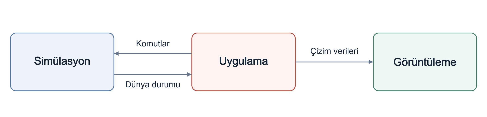

<p align="center" dir="ltr">
  <a href="README.sv.md" lang="sv">Svenska</a> · <a href="README.zh-CN.md" lang="zh-CN">简体中文</a> · <a href="README.de.md" lang="de">Deutsch</a> · <a href="README.ar.md" lang="ar" dir="rtl">العربية</a> · <a href="README.es.md" lang="es">Español</a> · <a href="README.ru.md" lang="ru">Русский</a> · <a href="README.th.md" lang="th">ไทย</a> · <strong>Türkçe</strong> · <a href="README.md" lang="en">English</a>
</p>
<p align="center" dir="ltr">
  <a href="https://github.com/YuriPlanet/vera20k/actions/workflows/macos.yml?query=branch%3Amain" title="Son macOS kütüphane testi çalıştırması (elle başlatılır)"></a>
  <a href="https://github.com/YuriPlanet/vera20k/actions/workflows/linux.yml?query=branch%3Amain" title="Son Linux kütüphane testi çalıştırması (elle başlatılır)"></a>
  <a href="https://github.com/YuriPlanet/vera20k/actions/workflows/windows.yml?query=branch%3Amain" title="Son Windows kütüphane testi çalıştırması (elle başlatılır)"></a>
  <a href="https://discord.gg/kmjRUn5m5F"></a>
  
</p>

# VERA20K

VERA20K, özgün oyun motoru `gamemd.exe`'nin topluluk öncülüğünde geliştirilen yeniden
yazımıdır. Orijinal oyun dosyalarını kullandığı için kendi Red Alert 2: Yuri's Revenge
kopyanıza ihtiyacınız var.

VERA20K oyuncular tarafından, oyuncular için yapılıyor ve projenin nereye gideceğine son sözü
oyuncular söylüyor.


## Projenin hedefleri

1. Orijinal Red Alert 2: Yuri's Revenge'in oynanışını, görsellerini ve atmosferini korumak.
2. 500×500 haritalarda **30 oyuncuya** ve **20.000 birime** kadar daha büyük savaşları desteklemek.
3. Bilinen RTS özelliklerini ve daha önce hiç görülmemiş bazı özellikleri eklemek.
4. Entegre çok oyunculu istemci

## Mevcut durum

**Aktif geliştirme aşamasında.**

- **Çatışma:** Windows, Linux ve macOS'ta oynanabiliyor. Orijinal ve rastgele oluşturulan
  haritalar, üs kurma, kaynak toplama, çatışma ve kaydetme/yükleme mevcut.
- **Senaryolar:** Görevler başlatılabiliyor; destek henüz tamamlanmış değil.
- **Yapay zekâ:** Orijinal yapay zekânın bazı bölümleri üs kurma ve betiklerle yönetilen saldırıları yürütüyor.
- **Devam eden çalışmalar:** Oynanışın aslına uygunluğu, görseller ve performans.
- **Çok oyunculu mod:** Ağ üzerinden oyun henüz mevcut değil.
- **Ölçek:** 30 oyunculu, 20.000 birimli savaşlar henüz gösterilmiş değil.

## Mimari

Motorun üç ana bölümü vardır:

- **Simülasyon:** Oyun durumunu ve mantığını yönetir.
- **Görüntüleme:** Orijinal oyun kaynaklarını kullanan, orijinal görünümü korumak için
  oluşturulmuş tamamen yeni bir GPU görüntüleme hattı.
- **Uygulama:** Girdi, menüler, ses ve platform entegrasyonunu yönetir, sistemleri birbirine bağlar.

Bu ayrım deterministik oynanışı destekler.

Oklar veri akışını gösterir:



## Sistem gereksinimleri

- **Oyun:** Red Alert 2: Yuri's Revenge 1.001.
- **İşletim sistemi:** Windows 10+, Linux (glibc 2.35+, ör. Ubuntu 22.04 veya Steam Deck) ya da
  Apple Silicon üzerinde macOS 11+.
- **Grafik:** Vulkan, DirectX 12 ya da Metal.

## Derleme ve çalıştırma

Gerekenler:

- **Rust ve Git:** rustup ile kurulmuş [Rust](https://rustup.rs/) 1.97 veya üzeri ve
  [Git](https://git-scm.com/).
- **Derleme araçları:** Windows'ta, Rust kurulum programının kurmayı önerdiği Visual Studio C++
  derleme araçları; macOS'te `xcode-select --install`; Debian ve Ubuntu'da
  `sudo apt install build-essential libasound2-dev pkg-config`.

VERA20K, Windows, Linux ve macOS üzerinde oynandı.

```sh
git clone https://github.com/YuriPlanet/vera20k.git
cd vera20k
cp config.toml.example config.toml
# Çalıştırmadan önce config.toml dosyasını düzenleyip ra2_dir değerini oyun klasörünüz olarak ayarlayın:
cargo run --release --bin vera20k
```

Derleme `target/` içinde birkaç GB yer kaplar.

## Nasıl çalışıyoruz

Kodun büyük bölümünü yapay zekâ kodlama ajanları yazıyor. Ajanlar özgün motoru Ghidra ile
inceliyor, ardından davranışını Rust'a aktarıyor ve [karşılaştırma araçları](tools/native_oracle.md)
ile oyun testleri kullanarak kontrol ediyor. Ajanlar [AGENTS.md](AGENTS.md) dosyasını izler.

## Özelleştirme

VERA20K varsayılan olarak orijinal oyun gibi oynanır. Ares gibi modlardan gelen eklentiler dahil
her yeni özellik, şu yollardan biriyle açılana kadar kapalı kalmalıdır:

- **Bir derleme seçeneği**: örneğin desteklenen [Ares eklentileri](docs/ares.md) için `--features ares`.
- **Bir oyun içi lobi seçeneği**: her maç için seçilir.
- **Bir INI anahtarı**: bir mod ya da harita tarafından ayarlanır.

Tek oyunculu YR çatışmalarını veya senaryolarını bir CnCNet istemcisinden başlatmak için
[çevrimdışı istemci kurulumuna](integrations/cncnet/README.md) bakın.

## Katkıda bulunma

Yardımlarınızı bekliyoruz. Kod yazabilir, motoru yeniden düzenleyebilir, oyunu test edebilir,
fikirlerinizi paylaşabilir veya orijinal oyunla yan yana oynayıp neyin yanlış hissettirdiğini
bize anlatabilirsiniz. Bir PR açın, gerisini biz hallederiz.
Tartışmalar [Discord](https://discord.gg/kmjRUn5m5F) üzerinden ve QQ grubunda (1097193563) yürür.

## Destek

<a href="https://paypal.me/vera20k"></a>

Alınan tüm bağışlar,
[TIBTRE katkı defterine](https://github.com/YuriPlanet/tibtre-ledger) göre katkıda
bulunanlara dağıtılır.

Katkıda bulunanlara ödeme yöntemleri:

<p>     </p>

## Teşekkürler ve yasal bilgiler

OpenRA, XCC Mixer, ModEnc wiki, Project Perfect Mod, Command & Conquer ve Red Alert'in
kaynak kodlarını GPL lisansıyla yayımlayan EA, World-Altering Editor, Final Alert, YRpp,
Ares, Phobos ve daha nicelerine teşekkürler.

[GPLv3](LICENSE-GPL) ile lisanslanmıştır. Bu depo hiçbir oyun dosyası içermez.
Command & Conquer ve Red Alert, Electronic Arts Inc. şirketinin ticari markalarıdır.
Ekran görüntülerindeki oyun grafikleri Electronic Arts'a aittir. VERA20K, Electronic Arts
ile bağlantılı değildir ve Electronic Arts tarafından desteklenmemektedir.

[README.md](README.md) dosyasının çevirisidir; lütfen İngilizce sürümle güncel tutun.
