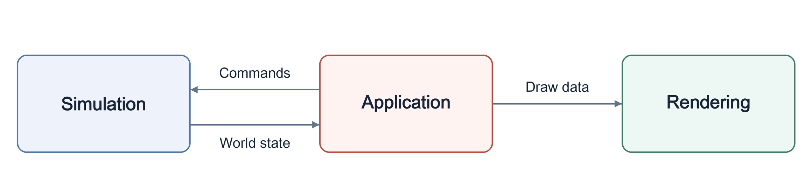

<p align="center" dir="ltr">
  <strong>Tiếng Việt</strong> · <a href="README.sv.md" lang="sv">Svenska</a> · <a href="README.zh-CN.md" lang="zh-CN">简体中文</a> · <a href="README.zh-TW.md" lang="zh-TW">繁體中文</a> · <a href="README.de.md" lang="de">Deutsch</a> · <a href="README.ar.md" lang="ar" dir="rtl">العربية</a> · <a href="README.es.md" lang="es">Español</a> · <a href="README.ja.md" lang="ja">日本語</a> · <a href="README.ru.md" lang="ru">Русский</a> · <a href="README.th.md" lang="th">ไทย</a> · <a href="README.tr.md" lang="tr">Türkçe</a> · <a href="README.md" lang="en">English</a>
</p>
<p align="center" dir="ltr">
  <a href="https://github.com/YuriPlanet/vera20k/actions/workflows/linux.yml?query=branch%3Amain" title="Lần chạy gần nhất của bài kiểm thử thư viện trên Linux (chạy thủ công)"></a>
  <a href="https://github.com/YuriPlanet/vera20k/actions/workflows/windows.yml?query=branch%3Amain" title="Lần chạy gần nhất của bài kiểm thử thư viện trên Windows (chạy thủ công)"></a>
  <a href="https://discord.gg/kmjRUn5m5F"></a>
  
  
</p>

# VERA20K

VERA20K là một engine mới cho Red Alert 2: Yuri's Revenge. Nó chơi giống bản gốc, với cùng đơn vị,
bản đồ và hình ảnh, và chạy trên Windows, macOS và Linux. Nó được làm cho những trận đánh lớn hơn,
với tối đa 20.000 đơn vị trên một bản đồ. Chế độ Skirmish ngoại tuyến có tối đa 120 ô người chơi,
còn các trận qua mạng LAN hoặc Internet có tối đa 30 ô.

VERA20K do game thủ làm ra, dành cho game thủ, và game thủ có tiếng nói cuối cùng về hướng đi của
dự án.


## Tải về và chơi

1. Cài Red Alert 2: Yuri's Revenge từ Steam hoặc ứng dụng EA.
2. Tải VERA20K cho hệ điều hành của bạn từ [trang phát hành](https://github.com/YuriPlanet/vera20k/releases).
3. Mở tệp bạn vừa tải về. Nó sẽ tìm trò chơi của bạn và cài VERA20K vào một thư mục riêng.

Gặp khó khăn? Xem [trang trợ giúp](https://vera20k.org/help) (tiếng Anh).

## Mục tiêu dự án

1. Giữ nguyên lối chơi, hình ảnh và không khí của Red Alert 2: Yuri's Revenge gốc.
2. Hỗ trợ những trận đánh lớn hơn trên bản đồ 500×500 với tối đa **20.000 đơn vị**, **120 ô người chơi** trong chế độ Skirmish ngoại tuyến và **30 ô** khi chơi qua mạng LAN hoặc Internet.
3. Đưa vào các tính năng RTS quen thuộc và cả một số tính năng chưa từng có.
4. Client chơi mạng tích hợp sẵn

## Đóng góp

**Các PR được đánh giá cao** — tái cấu trúc mã, hiệu năng, tìm đường, UI/UX, trình tạo bản đồ ngẫu nhiên.

Người đóng góp có thể nhận phụ trách các phần của engine, với nhiều tự do để thực hiện những thay
đổi giúp VERA20K tiến lên.

Những người bảo trì sẽ hỗ trợ xem xét, tích hợp và sát nhập. Bạn vẫn được ghi công đầy đủ cho đóng góp
của mình.

Quản trị viên: [Halvor Nikolai Rusten](https://github.com/hrusten), [风雨声](https://github.com/996666925), [Kironix](https://github.com/EncoreAlpha), [Randerion(HaoJun0823)](https://github.com/HaoJun0823), [libi](https://github.com/libi), [zzzzzzh123](https://github.com/zzzzzzh123), [八音盒](https://github.com/1372704087)

Thảo luận diễn ra trên [Discord](https://discord.gg/kmjRUn5m5F) và trong nhóm QQ (1097193563).

## Kiến trúc

Engine có ba phần chính:

- **Mô phỏng (Simulation):** Nắm giữ trạng thái và nguyên lý của lối chơi.
- **Kết xuất (Rendering):** Dùng GPU để vẽ địa hình, đơn vị và công trình bằng đồ họa của trò chơi gốc.
- **Ứng dụng (Application):** Xử lý đầu vào, menu, âm thanh và tích hợp nền tảng, kết nối các hệ
  thống với nhau.

Sự tách biệt này giúp lối chơi mang tính tất định (deterministic).

Mũi tên thể hiện luồng dữ liệu:



## Build và chạy

Bạn cần:

- **Rust và Git:** [Rust](https://rustup.rs/) 1.97 trở lên, cài bằng rustup, và
  [Git](https://git-scm.com/).
- **Công cụ build:** trên Windows là Visual Studio C++ build tools, mà trình cài Rust sẽ đề nghị
  cài; trên macOS là `xcode-select --install`; trên Debian và Ubuntu là
  `sudo apt install build-essential libasound2-dev libxkbcommon-x11-0 pkg-config`.

```sh
git clone https://github.com/YuriPlanet/vera20k.git
cd vera20k
cp config.toml.example config.toml
# Sửa config.toml và đặt ra2_dir thành thư mục trò chơi của bạn trước khi chạy:
cargo run --release --bin vera20k
```

## Cách chúng tôi làm việc

Phần lớn mã được viết bởi các AI coding agent. Chúng dùng Ghidra để nghiên cứu engine gốc, sau đó
port hành vi của nó sang Rust và kiểm tra bằng [công cụ so sánh](tools/native_oracle.md) và chơi
thử. Các agent tuân theo [AGENTS.md](AGENTS.md).

## Tùy biến

Bạn có thể thêm mod, bản đồ, nhạc của riêng mình và nhiều thứ khác. Chúng được đặt trong thư mục
VERA20K: thư mục cài đặt trên Windows, `~/Library/Application Support/VERA20k` trên macOS và
`~/.local/share/VERA20k` trên Linux.

Mặc định, VERA20K dùng luật chơi của bản Yuri's Revenge gốc. Trong **Options**, bạn có thể chỉnh
âm thanh, đồ họa và cách điều khiển hoặc bật các tính năng của VERA. Trò chơi lưu các tùy chọn
trong `VERA.INI`. Các tùy chọn riêng của VERA nằm trong mục `[VERA]`.

- **Mod:** trong **Options → Mods**, **Add Mod** cài một mod bạn đã tải về, còn **New Mod** bắt đầu một mod của riêng bạn. Mỗi mod có thư mục riêng trong `Mods`.
- **Bản đồ:** đặt tệp `.map`, `.mpr` hoặc `.yrm` vào `Maps` để chơi trong Skirmish. Bản đồ bạn tải về khi chơi trực tuyến cũng được lưu ở đó.
- **Nhạc:** đặt tệp WAV hoặc AUD vào `musics` và thêm tệp `music.ini` vào đó với `enable=yes` trong mục `[Music]`. Nhạc của bạn sẽ phát trong trận cùng với nhạc của trò chơi; với `ExclusiveMode=yes`, chỉ nhạc của bạn được phát.
- **Đồ họa HD:** [gói đồ họa HD](docs/hd-art.md) được cài và chọn giống như một mod. Sau đó bật **HD art** trong **Options**.
- **Ngôn ngữ:** tệp `vera20k.<language>.ini` thêm một ngôn ngữ hoặc thay đổi chữ trong trò chơi. Xem [hướng dẫn dịch](src/i18n/README.md).

Thiết lập phòng chờ, mod và bản đồ có thể thay đổi luật chơi của từng trận. Mod và bản đồ có thể
dùng tệp INI để bật các tính năng của [Ares](docs/ares.md), [Phobos](docs/phobos.md) và [Kratos](docs/kratos.md) mà VERA20K
hỗ trợ. Mod cũng có thể bật Ares bằng cách kèm theo tệp `ares.mix`. Một số tính năng của Phobos
vẫn cần phiên bản VERA20K được biên dịch với `--features phobos`.

Để tự làm mod, hãy bắt đầu với [hướng dẫn làm mod](docs/modding.md).

## Ủng hộ

<a href="https://paypal.me/vera20k"></a>

Toàn bộ tiền ủng hộ nhận được sẽ được chia cho những người đóng góp theo
[sổ đóng góp TIBTRE](https://github.com/YuriPlanet/tibtre-ledger).

Các hình thức chi trả cho người đóng góp:

<p>     </p>

## Truyền thông

<p>
  <a href="https://www.youtube.com/@cncvietnam-huydeptrai"></a>
  VERA20K được giới thiệu trên kênh <a href="https://www.youtube.com/@cncvietnam-huydeptrai">Command &amp; Conquer Vietnam</a>.<br>
  <a href="https://www.youtube.com/watch?v=njpQRCTZ_MY">1 đấu 29 AI độ khó Brutal trên Arctic Circle 30</a><br>
  <a href="https://www.youtube.com/watch?v=7r_z_7w0InA&amp;t=1440s">Survival Fortress 5.0</a><br clear="all">
</p>

<p>
  <a href="https://www.youtube.com/@haojunyang2337"></a>
  VERA20K được giới thiệu trên kênh <a href="https://www.youtube.com/@haojunyang2337">HaoJun Yang</a>.<br>
  <a href="https://www.youtube.com/watch?v=ucz-EiMeW88">Red Alert 2 trên VERA20K 0.41</a><br clear="all">
</p>

## Trình chỉnh sửa bản đồ

<p>
  <a href="https://github.com/996666925/ra2-map-editor"></a>
  <a href="https://github.com/996666925/ra2-map-editor">YR Map Editor</a><br>
  Tạo bản đồ cho Yuri’s Revenge rồi chơi thử trong VERA20K.<br clear="all">
</p>

## Ghi công và pháp lý

Cảm ơn OpenRA, XCC Mixer, wiki ModEnc, Project Perfect Mod, bản phát hành mã nguồn GPL của
Command & Conquer và Red Alert từ EA, World-Altering Editor, Final Alert, YRpp, Ares, Phobos và
nhiều dự án khác.

Copyright © 2026 Halvor Nikolai Rusten và những người đóng góp cho VERA20K.
Được cấp phép theo [GPLv3](LICENSE-GPL) kèm [các điều khoản bổ sung](LEGAL.md#additional-terms).
Người chơi phải dùng tệp trò chơi từ bản
Red Alert 2: Yuri's Revenge của mình. Command & Conquer và Red Alert là thương hiệu của
Electronic Arts Inc., còn ảnh chụp màn hình và biểu tượng ứng dụng, ngôi sao đỏ của Red Alert 2,
thể hiện hình ảnh trò chơi thuộc sở hữu của Electronic Arts. VERA20K không liên kết với Electronic
Arts và không được Electronic Arts chứng thực.

This product includes software developed by the [Ares Contributors](LICENSES/Ares.txt).

This product includes software developed by the [Phobos Developers](docs/phobos.md#original-project-and-authors).

**Hãy đọc [thông báo pháp lý](LEGAL.md) trước khi chia sẻ, bán hoặc fork VERA20K.**

## Tài liệu

- [Bản xem trước WebAssembly](docs/wasm.md): bản build một người chơi tùy chọn, chạy trong trình duyệt.
- [Hướng dẫn modding](docs/modding.md): mod làm được và không làm được gì, và VERA20K khác trò chơi gốc ra sao.
- [Hồ sơ INI](docs/ini-roots.md): chọn các tệp rules, art và AI.
- [Ares](docs/ares.md), [Phobos](docs/phobos.md), [NPatch](docs/npatch.md) và [VeraX](docs/verax.md): hỗ trợ phần mở rộng và các giới hạn.
- [Tổng quan engine](docs/index.md): bố cục mã và cách các phần của engine kết hợp với nhau.
- [Công cụ cho nhà phát triển](tools/README.md): build, kiểm thử và xem tài nguyên.
- [Kiểm thử bản đồ](tools/map_observation.md): kịch bản dựng sẵn, ảnh chụp màn hình và quan sát trận đấu.
- [So sánh với bản gốc](tools/native_oracle.md): so sánh hành vi với trò chơi gốc.
- [Quy trình Ghidra](docs/ghidra-workflow.md): xem xét engine gốc.
