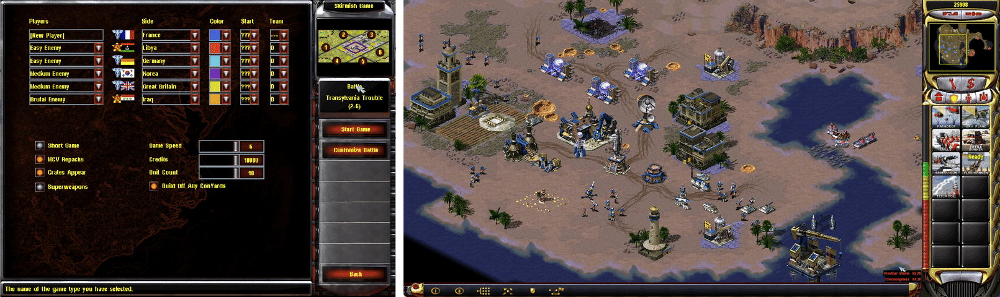

<p align="center" dir="ltr">
  <strong>Tiếng Việt</strong> · <a href="README.sv.md" lang="sv">Svenska</a> · <a href="README.zh-CN.md" lang="zh-CN">简体中文</a> · <a href="README.de.md" lang="de">Deutsch</a> · <a href="README.ar.md" lang="ar" dir="rtl">العربية</a> · <a href="README.es.md" lang="es">Español</a> · <a href="README.ja.md" lang="ja">日本語</a> · <a href="README.ru.md" lang="ru">Русский</a> · <a href="README.th.md" lang="th">ไทย</a> · <a href="README.tr.md" lang="tr">Türkçe</a> · <a href="README.md" lang="en">English</a>
</p>
<p align="center" dir="ltr">
  <a href="https://github.com/YuriPlanet/vera20k/actions/workflows/linux.yml?query=branch%3Amain" title="Lần chạy gần nhất của bài kiểm thử thư viện trên Linux (chạy thủ công)"></a>
  <a href="https://github.com/YuriPlanet/vera20k/actions/workflows/windows.yml?query=branch%3Amain" title="Lần chạy gần nhất của bài kiểm thử thư viện trên Windows (chạy thủ công)"></a>
  <a href="https://discord.gg/kmjRUn5m5F"></a>
  
  
</p>

# VERA20K

VERA20K là một engine mới cho Red Alert 2: Yuri's Revenge. Nó chơi giống bản gốc, với cùng đơn vị,
bản đồ và hình ảnh, và chạy trên Windows, macOS và Linux. Nó được làm cho những trận đánh lớn hơn,
với tối đa 30 người chơi và 20.000 đơn vị trên một bản đồ.

VERA20K do game thủ làm ra, dành cho game thủ, và game thủ có tiếng nói cuối cùng về hướng đi của
dự án.



## Tải về và chơi

1. Cài Red Alert 2: Yuri's Revenge từ Steam hoặc ứng dụng EA.
2. Tải VERA20K cho hệ điều hành của bạn từ [trang phát hành](https://github.com/YuriPlanet/vera20k/releases).
3. Mở tệp bạn vừa tải về. Nó sẽ tìm trò chơi của bạn và cài VERA20K vào một thư mục riêng.

Gặp khó khăn? Xem [trang trợ giúp](https://vera20k.org/help) (tiếng Anh).

Dự án đang được phát triển tích cực: chế độ skirmish đã chơi được trên Windows, macOS và Linux,
chiến dịch chạy được một phần, và chế độ chơi mạng trực tuyến (thử nghiệm) nay đã có. Các phiên bản
trước và những thay đổi trong từng phiên bản có trên
[trang phát hành](https://github.com/YuriPlanet/vera20k/releases).

Để chạy các trận skirmish hoặc chiến dịch YR một người chơi từ client CnCNet, xem
[hướng dẫn cài client ngoại tuyến](integrations/cncnet/README.md).

## Mục tiêu dự án

1. Giữ nguyên lối chơi, hình ảnh và không khí của Red Alert 2: Yuri's Revenge gốc.
2. Hỗ trợ những trận đánh lớn hơn: tối đa **30 người chơi** và **20.000 đơn vị** trên bản đồ 500×500.
3. Đưa vào các tính năng RTS quen thuộc và cả một số tính năng chưa từng có.
4. Client chơi mạng tích hợp sẵn

Xem [lộ trình](https://github.com/orgs/YuriPlanet/projects/1) để biết các ưu tiên hiện tại và kế
hoạch sắp tới.

## Đóng góp

Người đóng góp có thể nhận phụ trách các phần của engine, với nhiều tự do để thực hiện những thay
đổi giúp VERA20K tiến lên.

Những người bảo trì sẽ hỗ trợ review, tích hợp và merge. Bạn vẫn được ghi công đầy đủ cho đóng góp
của mình.

Thảo luận diễn ra trên [Discord](https://discord.gg/kmjRUn5m5F) và trong nhóm QQ (1097193563).

## Kiến trúc

Engine có ba phần chính:

- **Mô phỏng (Simulation):** Nắm giữ trạng thái và logic của lối chơi.
- **Kết xuất (Rendering):** Một pipeline kết xuất GPU hoàn toàn mới, dùng tài nguyên gốc của trò
  chơi và được xây dựng để giữ nguyên vẻ ngoài ban đầu.
- **Ứng dụng (Application):** Xử lý đầu vào, menu, âm thanh và tích hợp nền tảng, kết nối các hệ
  thống với nhau.

Sự tách biệt này giúp lối chơi mang tính tất định (deterministic).

Mũi tên thể hiện luồng dữ liệu:


## Build và chạy

Bạn cần:

- **Rust và Git:** [Rust](https://rustup.rs/) 1.97 trở lên, cài bằng rustup, và
  [Git](https://git-scm.com/).
- **Công cụ build:** trên Windows là Visual Studio C++ build tools, mà trình cài Rust sẽ đề nghị
  cài; trên macOS là `xcode-select --install`; trên Debian và Ubuntu là
  `sudo apt install build-essential libasound2-dev libxkbcommon-x11-0 pkg-config`.

```sh
git clone https://github.com/YuriPlanet/vera20k.git
cd vera20k
cp config.toml.example config.toml
# Sửa config.toml và đặt ra2_dir thành thư mục trò chơi của bạn trước khi chạy:
cargo run --release --bin vera20k
```

## Cách chúng tôi làm việc

Phần lớn mã được viết bởi các AI coding agent. Chúng dùng Ghidra để nghiên cứu engine gốc, sau đó
port hành vi của nó sang Rust và kiểm tra bằng [công cụ so sánh](tools/native_oracle.md) và chơi
thử. Các agent tuân theo [AGENTS.md](AGENTS.md).

## Tùy biến

Theo mặc định, VERA20K chơi giống trò chơi gốc. Các tính năng mới, kể cả phần mở rộng từ các mod
như Ares, sẽ tắt cho đến khi được bật bằng một trong các cách sau:

- **Tùy chọn người chơi của VERA**, trong **Options**, được lưu dưới `[VERA]` trong `VERA.INI`.
- **Tùy chọn build**, chẳng hạn `--features phobos` cho các [phần mở rộng Phobos](docs/phobos.md) được hỗ trợ.
- **Khóa INI**, do mod hoặc bản đồ đặt.

Âm thanh, đồ họa và điều khiển được lưu trong `VERA.INI`. Luật chơi đến từ thiết lập phòng chờ,
mod hoặc bản đồ.

[Hướng dẫn modding](docs/modding.md) giải thích cách tự làm mod.

## Ủng hộ

<a href="https://paypal.me/vera20k"></a>

Toàn bộ tiền ủng hộ nhận được sẽ được chia cho những người đóng góp theo
[sổ đóng góp TIBTRE](https://github.com/YuriPlanet/tibtre-ledger).

Các hình thức chi trả cho người đóng góp:

<p>     </p>

## Ghi công và pháp lý

Cảm ơn OpenRA, XCC Mixer, wiki ModEnc, Project Perfect Mod, bản phát hành mã nguồn GPL của
Command & Conquer và Red Alert từ EA, World-Altering Editor, Final Alert, YRpp, Ares, Phobos và
nhiều dự án khác.

Copyright © 2026 Halvor Nikolai Rusten và những người đóng góp cho VERA20K.
Được cấp phép theo [GPLv3](LICENSE-GPL) kèm [các điều khoản bổ sung](LEGAL.md#additional-terms).
Kho mã này không chứa tệp nào của trò chơi. Command & Conquer và Red Alert là thương hiệu của
Electronic Arts Inc., còn ảnh chụp màn hình và biểu tượng ứng dụng, ngôi sao đỏ của Red Alert 2,
thể hiện hình ảnh trò chơi thuộc sở hữu của Electronic Arts. VERA20K không liên kết với Electronic
Arts và không được Electronic Arts chứng thực.

This product includes software developed by the [Ares Contributors](LICENSES/Ares.txt).
This product includes software developed by the [Phobos Developers](docs/phobos.md#original-project-and-authors).

**Hãy đọc [thông báo pháp lý](LEGAL.md) trước khi chia sẻ, bán hoặc fork VERA20K.**

## Tài liệu

- [Bản xem trước WebAssembly](docs/wasm.md): bản build một người chơi tùy chọn, chạy trong trình duyệt.
- [Hướng dẫn modding](docs/modding.md): mod làm được và không làm được gì, và VERA20K khác trò chơi gốc ra sao.
- [Hồ sơ INI](docs/ini-roots.md): chọn các tệp rules, art và AI.
- [Ares](docs/ares.md), [Phobos](docs/phobos.md), [NPatch](docs/npatch.md) và [VeraX](docs/verax.md): hỗ trợ phần mở rộng và các giới hạn.
- [Tổng quan engine](docs/index.md): bố cục mã và cách các phần của engine kết hợp với nhau.
- [Công cụ cho nhà phát triển](tools/README.md): build, kiểm thử và xem tài nguyên.
- [Kiểm thử bản đồ](tools/map_observation.md): kịch bản dựng sẵn, ảnh chụp màn hình và quan sát trận đấu.
- [So sánh với bản gốc](tools/native_oracle.md): so sánh hành vi với trò chơi gốc.
- [Quy trình Ghidra](docs/ghidra-workflow.md): xem xét engine gốc.
