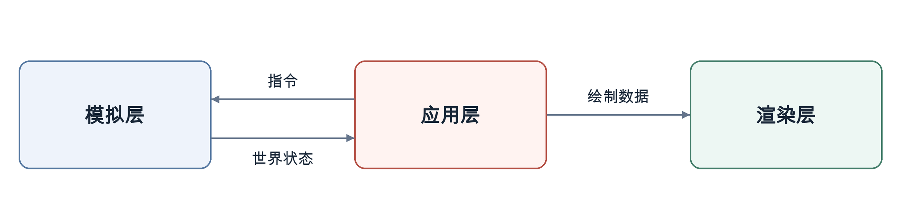

<p align="center" dir="ltr">
  <a href="README.sv.md" lang="sv">Svenska</a> · <strong>简体中文</strong> · <a href="README.de.md" lang="de">Deutsch</a> · <a href="README.ar.md" lang="ar" dir="rtl">العربية</a> · <a href="README.ru.md" lang="ru">Русский</a> · <a href="README.th.md" lang="th">ไทย</a> · <a href="README.tr.md" lang="tr">Türkçe</a> · <a href="README.md" lang="en">English</a>
  &nbsp;&nbsp;
  <a href="https://github.com/YuriPlanet/vera20k/actions/workflows/macos.yml?query=branch%3Amain" title="最近一次手动运行的 macOS 库测试"></a>
  <a href="https://github.com/YuriPlanet/vera20k/actions/workflows/linux.yml?query=branch%3Amain" title="最近一次手动运行的 Linux 库测试"></a>
  <a href="https://github.com/YuriPlanet/vera20k/actions/workflows/windows.yml?query=branch%3Amain" title="最近一次手动运行的 Windows 库测试"></a>
  <a href="https://discord.gg/kmjRUn5m5F"></a>
  
</p>

# VERA20k

VERA20k 是一个由社区主导、对原版引擎 `gamemd.exe` 进行重写的项目。它使用原版游戏文件，因此你需要自行准备一份《红色警戒2：尤里的复仇》。

VERA20k 由玩家打造、为玩家而做，项目的方向由玩家说了算。


## 项目目标

1. 保留原版《红色警戒2：尤里的复仇》的玩法、画面和氛围。
2. 支持更大规模的战斗：在 500×500 的地图上，容纳最多 **30 名玩家**和 **20,000 个单位**。
3. 加入 RTS 游戏中已有的功能，以及一些前所未见的功能。
4. 内置多人游戏客户端

## 当前进度

**积极开发中。**

- **遭遇战：** Windows、Linux 和 macOS 上均可游玩，支持原版地图和随机地图、
  基地建设、采矿、战斗以及存档和读档。
- **战役：** 任务已可启动，支持尚不完整。
- **AI：** 部分原版 AI 已能处理基地建设和脚本攻击。
- **持续完善：** 游戏行为与原版的一致性、画面和性能。
- **多人模式：** 尚不支持联机游玩。
- **规模：** 尚未展示过 30 名玩家、20,000 个单位的对战。

## 架构

引擎分为三个主要部分：

- **模拟层：** 负责游戏状态和逻辑。
- **渲染层：** 为保留原版画面风格而构建的全新 GPU 渲染管线，使用原版游戏资源。
- **应用层：** 处理输入、菜单、音频和平台集成，并连接各个系统。

这种分离有助于保持游戏行为的确定性。

箭头表示数据流向：



## 编译与运行

你需要：

- **游戏：**《红色警戒2：尤里的复仇》。
- **Rust 和 Git：** 通过 rustup 安装的最新稳定版 [Rust](https://rustup.rs/)，以及 [Git](https://git-scm.com/)。
- **构建工具：** Windows 上需要 Visual Studio 的 C++ 生成工具，Rust 安装程序会提示安装；macOS 上运行
  `xcode-select --install`；Debian 和 Ubuntu 上运行 `sudo apt install build-essential libasound2-dev pkg-config`。
- **显卡：** 支持 Vulkan、DirectX 12 或 Metal 的 GPU。

VERA20k 已在 Windows、Linux 和 macOS 上运行游玩过。

```sh
git clone https://github.com/YuriPlanet/vera20k.git
cd vera20k
cp config.toml.example config.toml
# 运行前，编辑 config.toml，将 ra2_dir 设为你的游戏文件夹：
cargo run --release --bin vera20k
```

`ra2_dir` 请使用正斜杠，例如 `C:/Games/RA2`。游玩时请使用 `--release`；调试构建运行太慢。日志保存在 `logs/ra2.log`。

## 我们如何开发

大部分代码由 AI 编程助手编写。它们用 Ghidra 研究原版引擎，再将其行为移植到 Rust，
通过[对比工具](tools/native_oracle.md)和实际游玩进行检查。AI 助手遵循 [AGENTS.md](AGENTS.md)。

<!-- Chinese-only section: intentionally absent from README.md and the other translations. -->
## 致中国玩家和开发者

VERA20k 的开发者都是你们的朋友。我们希望把庞大的中国红警玩家群体与世界各地的玩家联系在一起，让大家可以一起对战。

我们非常希望中国的开发者和玩家加入进来，和我们一起开发、一起游玩！
欢迎在 GitHub 上[提交 issue](https://github.com/YuriPlanet/vera20k/issues)，或者来 [Discord](https://discord.gg/kmjRUn5m5F) 或 QQ 群（群号 1097193563）找我们。
用中文写 issue 也完全没问题。

## 自定义

可选功能（例如 Ares 的功能）应能通过 INI 文件配置，并在适当情况下提供客户端开关。

## 参与贡献

欢迎帮忙。你可以编写代码、重构引擎、测试游戏、提出想法，或对照原版游玩，告诉我们哪些地方感觉不对。
直接提交 PR 即可，剩下的交给我们。讨论在 [Discord](https://discord.gg/kmjRUn5m5F) 和 QQ 群（1097193563）进行。

游戏逻辑在 `src/sim/`，渲染在 `src/render/`，菜单和输入在 `src/app/` 和 `src/ui/`；
你不需要 `tools/` 中的 Python 工具。

要在游戏中试玩你的改动，请运行 `cargo run --profile fast --bin vera20k`。它和 `--release` 一样经过优化，
但只重新编译你改动的部分，让你更快回到游戏。测量性能时请使用 `--release`。

贡献内容与项目其余部分一样采用 GPLv3 许可证；无需签署 CLA。

## 支持项目 <a href="https://paypal.me/vera20k"></a>

[通过 PayPal 支持 VERA20k](https://paypal.me/vera20k)。所有收到的捐款都将根据
[TIBTRE 贡献账本](https://github.com/YuriPlanet/tibtre-ledger)分配给贡献者。

贡献者可通过 PayPal、中国银联、支付宝、Vipps、SEPA 银行转账或比特币收款。

## 致谢与法律声明

感谢 OpenRA、XCC Mixer、ModEnc wiki、Project Perfect Mod、EA 以 GPL 许可证发布的
《命令与征服》和《红色警戒》源码、World-Altering Editor、Final Alert、YRpp、Ares、Phobos，
以及其他为此做出贡献的项目和社区。

本项目采用 [GPLv3](LICENSE-GPL) 许可证。本仓库不包含游戏文件。
Command & Conquer 和 Red Alert 是 Electronic Arts Inc. 的商标，截图中的游戏美术资源归 Electronic Arts 所有。
VERA20k 与 Electronic Arts 无隶属关系，也未获其认可。

本文件译自 [README.md](README.md)，请与英文版保持同步。
