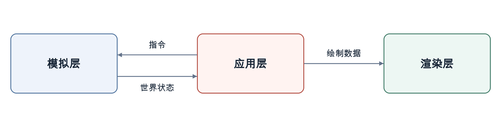

<p align="center" dir="ltr">
  <a href="README.vi.md" lang="vi">Tiếng Việt</a> · <a href="README.sv.md" lang="sv">Svenska</a> · <a href="README.zh-CN.md" lang="zh-CN">简体中文</a> · <strong>繁體中文</strong> · <a href="README.de.md" lang="de">Deutsch</a> · <a href="README.ar.md" lang="ar" dir="rtl">العربية</a> · <a href="README.es.md" lang="es">Español</a> · <a href="README.ja.md" lang="ja">日本語</a> · <a href="README.ru.md" lang="ru">Русский</a> · <a href="README.th.md" lang="th">ไทย</a> · <a href="README.tr.md" lang="tr">Türkçe</a> · <a href="README.md" lang="en">English</a>
</p>
<p align="center" dir="ltr">
  <a href="https://github.com/YuriPlanet/vera20k/actions/workflows/linux.yml?query=branch%3Amain" title="最近一次手動執行的 Linux 庫測試"></a>
  <a href="https://github.com/YuriPlanet/vera20k/actions/workflows/windows.yml?query=branch%3Amain" title="最近一次手動執行的 Windows 庫測試"></a>
  <a href="https://discord.gg/kmjRUn5m5F"></a>
  
  
</p>

# VERA20K

VERA20K 是《紅色警戒2：尤里的復仇》的全新引擎。玩起來和原版一樣，單位、地圖和畫面都相同，可在 Windows、macOS 和 Linux 上執行。它支援更大規模的戰鬥，一張地圖最多可容納 20,000 個單位。離線遭遇戰最多有 120 個玩家席位，區域網路與線上對戰最多有 30 個。

VERA20K 由玩家打造、為玩家而做，專案的方向由玩家說了算。


## 下載與遊玩

1. 從 Steam 或 EA app 安裝《紅色警戒2：尤里的復仇》。
2. 從[釋出頁面](https://github.com/YuriPlanet/vera20k/releases)下載適合你系統的 VERA20K。
3. 開啟下載的檔案。它會找到你的遊戲，並把 VERA20K 安裝到單獨的資料夾。

遇到問題？請看[幫助頁面](https://vera20k.org/zh/help)。

## 專案目標

1. 保留原版《紅色警戒2：尤里的復仇》的玩法、畫面和氛圍。
2. 支援在 500×500 的地圖上進行更大規模的戰鬥，最多容納 **20,000 個單位**。離線遭遇戰最多有 **120 個玩家席位**，區域網路與線上對戰最多有 **30 個**。
3. 加入 RTS 遊戲中已有的功能，以及一些前所未見的功能。
4. 內建多人遊戲客戶端

## 參與貢獻

**我們重視的 PR** — 程式碼重構、效能改善、尋路、UI/UX、隨機地圖產生器。

貢獻者可以負責引擎的某些部分，並有很大的自由度去做推動 VERA20K 發展的改動。

維護者會協助審查、整合和合併。你的貢獻會完整保留你的署名。

管理員：[Halvor Nikolai Rusten](https://github.com/hrusten)、[风雨声](https://github.com/996666925)、[Kironix](https://github.com/EncoreAlpha)、[Randerion(HaoJun0823)](https://github.com/HaoJun0823)、[libi](https://github.com/libi)、[zzzzzzh123](https://github.com/zzzzzzh123)、[八音盒](https://github.com/1372704087)

討論在 [Discord](https://discord.gg/kmjRUn5m5F) 和 QQ 群（1097193563）進行。

## 架構

引擎分為三個主要部分：

- **模擬層：** 負責遊戲狀態和邏輯。
- **渲染層：** 使用原版遊戲的美術素材，在 GPU 上繪製地形、單位和建築。
- **應用層：** 處理輸入、選單、音訊和平臺整合，並連線各個系統。

這種分離有助於保持遊戲行為的確定性。

箭頭表示資料流向：



## 編譯與執行

你需要：

- **Rust 和 Git：** 通過 rustup 安裝的 [Rust](https://rustup.rs/) 1.97 或更高版本，以及
  [Git](https://git-scm.com/)。
- **構建工具：** Windows 上需要 Visual Studio 的 C++ 生成工具，Rust 安裝程式會提示安裝；macOS 上執行
  `xcode-select --install`；Debian 和 Ubuntu 上執行 `sudo apt install build-essential libasound2-dev libxkbcommon-x11-0 pkg-config`。

```sh
git clone https://github.com/YuriPlanet/vera20k.git
cd vera20k
cp config.toml.example config.toml
# 執行前，編輯 config.toml，將 ra2_dir 設為你的遊戲資料夾：
cargo run --release --bin vera20k
```

## 我們如何開發

大部分程式碼由 AI 程式設計助手編寫。它們用 Ghidra 研究原版引擎，再將其行為移植到 Rust，
通過[對比工具](tools/native_oracle.md)和實際遊玩進行檢查。AI 助手遵循 [AGENTS.md](AGENTS.md)。

<!-- Chinese-only section: intentionally absent from README.md and the other translations. -->
## 致中國玩家和開發者

VERA20K 的開發者都是你們的朋友。我們希望把龐大的中國紅警玩家群體與世界各地的玩家聯絡在一起，讓大家可以一起對戰。

我們非常希望中國的開發者和玩家加入進來，和我們一起開發、一起遊玩！
歡迎在 GitHub 上[提交 issue](https://github.com/YuriPlanet/vera20k/issues)，或者來 [Discord](https://discord.gg/kmjRUn5m5F) 或 QQ 群（群號 1097193563）找我們。
用中文寫 issue 也完全沒問題。

## 自定義

你可以加入自己的模組、地圖、音樂等內容。這些檔案放在 VERA20K 資料夾中：Windows 上是安裝資料夾，macOS 上是 `~/Library/Application Support/VERA20k`，Linux 上是 `~/.local/share/VERA20k`。

VERA20K 預設使用《尤里的復仇》原版規則。你可以在 **Options** 選單中調整聲音、畫面和操作設定，也可以開啟 VERA 專屬功能。遊戲會將設定儲存在 `VERA.INI` 中，其中 VERA 專屬選項位於 `[VERA]` 節。

- **模組：** 在 **Options → Mods** 中，**Add Mod** 可以安裝你下載的模組，**New Mod** 可以開始製作你自己的模組。每個模組在 `Mods` 中都有自己的資料夾。
- **地圖：** 把 `.map`、`.mpr` 或 `.yrm` 檔案放進 `Maps`，即可在遭遇戰中遊玩。線上下載的地圖也會儲存在這裡。
- **音樂：** 把 WAV 或 AUD 檔案放進 `musics`，並在其中加入 `music.ini`，在 `[Music]` 下寫入 `enable=yes`。你的音樂會在對局中與遊戲音樂一起播放；設定 `ExclusiveMode=yes` 則只播放你的音樂。
- **高畫質美術：** [高畫質美術包](docs/hd-art.md)的安裝和選擇方式與模組相同。之後在 **Options** 中開啟 **HD art**。
- **語言：** `vera20k.<language>.ini` 檔案可以加入語言或修改遊戲文字。參見[翻譯指南](src/i18n/README.md)。

大廳設定、模組和地圖都能改變對局規則。模組和地圖可以通過 INI 檔案啟用 VERA20K 支援的 [Ares](docs/ares.md)、[Phobos](docs/phobos.md) 和 [Kratos](docs/zh-CN/kratos.md) 功能。模組也可以通過附帶 `ares.mix` 來啟用 Ares。部分 Phobos 功能仍需在編譯時加上 `--features phobos`。

想製作自己的模組，可以從[模組製作指南](docs/modding.md)開始。

## 支援專案

<a href="https://paypal.me/vera20k"></a>

所有收到的捐款都將根據
[TIBTRE 貢獻帳本](https://github.com/YuriPlanet/tibtre-ledger)分配給貢獻者。

貢獻者收款方式：

<p>     </p>

## 媒體

<p>
  <a href="https://www.youtube.com/@cncvietnam-huydeptrai"></a>
  <a href="https://www.youtube.com/@cncvietnam-huydeptrai">Command &amp; Conquer Vietnam</a> 頻道介紹了 VERA20K。<br>
  <a href="https://www.youtube.com/watch?v=njpQRCTZ_MY">Arctic Circle 30：1 對 29 個冷酷 AI</a><br>
  <a href="https://www.youtube.com/watch?v=7r_z_7w0InA&amp;t=1440s">Survival Fortress 5.0</a><br clear="all">
</p>

<p>
  <a href="https://www.youtube.com/@haojunyang2337"></a>
  <a href="https://www.youtube.com/@haojunyang2337">HaoJun Yang</a> 頻道介紹了 VERA20K。<br>
  <a href="https://www.youtube.com/watch?v=ucz-EiMeW88">在 VERA20K 0.41 中玩《紅色警戒 2》</a><br clear="all">
</p>

## 地圖編輯器

<p>
  <a href="https://github.com/996666925/ra2-map-editor"></a>
  <a href="https://github.com/996666925/ra2-map-editor">YR Map Editor</a><br>
  製作《尤里的復仇》地圖，並在 VERA20K 中試玩。<br clear="all">
</p>

## 致謝與法律宣告

感謝 OpenRA、XCC Mixer、ModEnc wiki、Project Perfect Mod、EA 以 GPL 許可證釋出的
《命令與征服》和《紅色警戒》原始碼、World-Altering Editor、Final Alert、YRpp、Ares、Phobos，
以及其他為此做出貢獻的專案和社群。

版權所有 © 2026 Halvor Nikolai Rusten 及 VERA20K 貢獻者。本專案採用 [GPLv3](LICENSE-GPL) 許可證，並附有[附加條款](LEGAL.md#additional-terms)。
玩家需自行提供《紅色警戒2：尤里的復仇》的遊戲檔案。
Command & Conquer 和 Red Alert 是 Electronic Arts Inc. 的商標，截圖和應用圖示（《紅色警戒2》的紅星）中的遊戲美術資源歸 Electronic Arts 所有。
VERA20K 與 Electronic Arts 無隸屬關係，也未獲其認可。

This product includes software developed by the [Ares Contributors](LICENSES/Ares.txt).

This product includes software developed by the [Phobos Developers](docs/phobos.md#original-project-and-authors).

**在分享、出售或復刻（fork）VERA20K 之前，請先閱讀[法律宣告](LEGAL.md)。**

## 文件

- [WebAssembly 預覽版](docs/wasm.zh-CN.md)：在瀏覽器中執行的可選單人版本。
- [模組製作指南](docs/modding.md)：模組能做什麼、不能做什麼，以及 VERA20K 與原版遊戲的區別。
- [INI 配置方案](docs/ini-roots.md)：選擇規則、美術和 AI 檔案。
- [Ares](docs/ares.md)、[Phobos](docs/phobos.md) 和 [NPatch](docs/npatch.md)：擴充套件的支援情況與限制。
- [引擎概覽](docs/index.md)：程式碼結構以及引擎各部分如何協同工作。
- [開發者工具](tools/README.md)：構建、測試和資源檢查。
- [地圖測試](tools/map_observation.md)：指令碼化場景、截圖和對局觀察。
- [原版對比](tools/native_oracle.md)：將行為與原版遊戲進行對比。
- [Ghidra 工作流程](docs/ghidra-workflow.md)：分析原版引擎。

本檔案譯自 [README.md](README.md)，請與英文版保持同步。
