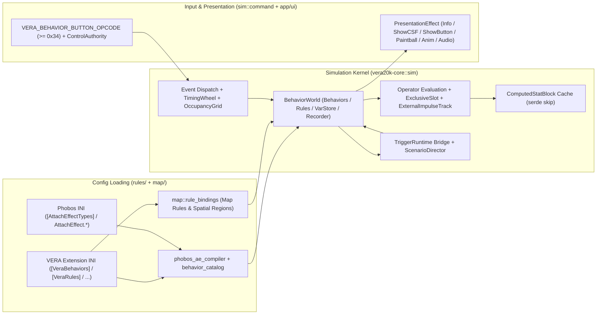
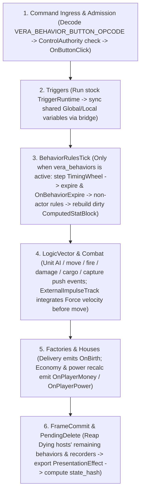

# VERA20k Behavior and Rule Engine Design

**English** · [简体中文](zh-CN/behavior-rule-engine-roadmap.md)

This document covers the design, INI syntax, Phobos and stock trigger integration, and phased implementation plan (`Phase 0 – Phase 6`, steps `B01–B20`) for VERA20k's native Behavior and Rule Engine. It solves two problems: letting mods compose timed effects, event triggers, recorders, and parameter overrides through INI rules, and extending trigger hosts beyond single objects to the world, houses, map regions, and object groups.

In current `main`, the related code sits in two places: Phobos `AttachEffect` lives in [rules/attach_effect.rs](../src/rules/attach_effect.rs) (`1,644` lines), [sim/attach_effect.rs](../src/sim/attach_effect.rs) (`6,087` lines), and [game_entity/attach_effect.rs](../src/sim/game_entity/attach_effect.rs) (`1,095` lines), referenced by `59` files across `src/` (`43` production files); stock and Ares map triggers live in [trigger_runtime.rs](../src/sim/trigger_runtime.rs) (`6,508` lines). Rules and constraints come from [AGENTS.md](../AGENTS.md), [Networking.md](Networking.md), [wasm.md](wasm.md), [capabilities.md](capabilities.md), and [architecture_guards.rs](../src/architecture_guards.rs).

---

## 1. Scope and Module Layout

### 1.1 Relationship to Stock Play, Phobos, and Map Triggers

1. **Compiled into every build, switched on by data**  
   All engine code lives in the default build (including release and Wasm) with no `cfg(feature = "...")` gating. During rules and map loading, `RuleSet::vera_behaviors()` records whether any `[VeraBehaviors]`, `[VeraRules]`, or `Vera.*=` key was present (following [phobos_switch.rs](../src/rules/phobos_switch.rs) and [ares_switch.rs](../src/rules/ares_switch.rs)), and also honors rule packs enabled via `MatchSpec` / `RulePolicy` ([Mode Rework Plan](zh-CN/mode-core-plan.md)). The three stock presets (`stock_campaign`, `stock_multiplayer`, `stock_cooperative`) and retail maps without those keys leave the switch off, simulation loops skip the engine entirely, memory overhead is zero, and `state_hash()` does not change.
2. **One runtime for unit behaviors and Phobos `[AttachEffectTypes]`**  
   A rules-boundary compiler `rules::phobos_ae_compiler` translates Phobos `[AttachEffectTypes]`, unit `AttachEffect.*`, and weapon gating keys into the same internal definitions. Once existing Phobos AE tests match the old results on the new engine, the `6,087`-line duplicate runtime in [sim/attach_effect.rs](../src/sim/attach_effect.rs) and the AE `#[cfg(feature = "phobos")]` gate are removed, leaving one owner across the repo.
3. **Keep stock map triggers, bridge three touchpoints**  
   [trigger_runtime.rs](../src/sim/trigger_runtime.rs) reproduces many quirks of `gamemd.exe` (`strtok` tokenization, destroyed objects not decrementing `Tag.refs`, shared `TEvent+54` forwarding, prepended event lists). It stays in place for retail campaign and skirmish compatibility, sharing only three narrow touchpoints with the new engine: common simulation event emission points, shared Global/Local scenario variables, and action calls across the two systems.

### 1.2 Crate Layer Placement

Module placement follows [architecture_guards.rs](../src/architecture_guards.rs) (`rules/` must not depend on `sim/` or `map/`; `map/` must not depend on `sim/`, `render/`, or `app/`; `sim/` must not depend on `render/`, `ui/`, `audio/`, or `net/`):

| Crate Layer | Module Path | Responsibility |
|---|---|---|
| `vera20k-core::rules` | `rules::behavior_catalog`<br>`rules::vera_behavior_switch`<br>`rules::phobos_ae_compiler` | Reads seven open INI catalog sections through [ini_value.rs](../src/rules/ini_value.rs) into `BehaviorDef`, `RuleDef`, `EffectDef`, `ConditionDef`, `RecorderDef`, `OperatorDef`, `ButtonDef`, and `ParamSlot`; lowers Phobos AE definitions into the same types; exposes read-only catalogs and `vera_behaviors()` on `RuleSet`. |
| `vera20k-core::map` | `map::rule_bindings` | Parses `[VeraMapRules]`, `[VeraGroups]`, and `[VeraSpatialRegions]` from map files, validates coordinates and references, and emits static bindings without touching `sim/`, `render/`, or `app/`. |
| `vera20k-core::sim` | `sim::behavior_engine` (`world.rs`, `bus.rs`, `wheel.rs`, `vars.rs`, `recorder.rs`, `operator.rs`, `slots.rs`, `impulse.rs`, `stat_block.rs`, `bridge.rs`) | Owns all authoritative state: `LiveBehavior`, `LiveRule`, group aggregation counters, five-scope `VarStore`, on-demand `RecorderStore`, `ExclusiveSlotTable`, and `ExternalImpulseTrack`; maintains derived (`#[serde(skip)]`) caches (`ComputedStatBlock`, event subscription index, `TimingWheel`); emits read-only `PresentationEffect` entries for UI, VFX, and audio. |
| `sim::command` + `net` | [command.rs](../src/sim/command.rs) and `net` | Adds lockstep command `VERA_BEHAVIOR_BUTTON_OPCODE` (assigned at `>= 0x34` to avoid `0x33 TARGET_HOUSE_OPCODE` already used on `main`), routed through `ControlAuthority` and room agreement checks. |
| `app/` + `ui/` | `app::presentation`<br>[added_parts.rs](../src/ui/added_parts.rs) and `app/input/` | Consumes per-frame `PresentationEffect` items to render tinting, attached anims, `Info` counters, `ShowCSF` labels, and `ShowButton` widgets; encodes active button clicks as lockstep commands. |



---

## 2. Core Design

### 2.1 Five Host Scopes (`HostScope`)

Rules and behaviors can attach to any of five host kinds via `HostScope`:

* **`World`**: single scenario-wide host for elapsed time, global variables, timers, and match outcomes.
* **`House(HouseId)`**: faction-level host for credits, power state, tech state, and superweapon events.
* **`Spatial(SpatialRegionId)`**: map geometry host supporting single cells, horizontal/vertical trigger lines, cell sets/rectangles, and waypoint radii, wired into [occupancy.rs](../src/sim/occupancy.rs) movement and bridge state changes.
* **`Group(GroupId, AggregatePolicy)`**: aggregates multiple actors, teams, or spatial regions under one rule using three trigger policies (covering stock `Tag.repeat = 0 / 1 / 2`):
  * `AnyOnce`: fires once when any member triggers, then detaches all members and retires.
  * `AllOnce { initial_refs }`: each satisfied member detaches and decrements the remaining count; the rule actions run only when the last active member finishes.
  * `EachRepeat`: fires independently each time any member triggers.
* **`Actor(EntityId)`**: an individual unit, building, or projectile holding unit behaviors, local counters, and recorders.

### 2.2 Splitting Rules (`RuleDef`) and Sustained State (`BehaviorDef`)

Trigger logic and timed state containers are separate objects rather than one combined struct:

* **`RuleDef / LiveRule`**: defines when events fire actions. Holds rule ID, default enabled state, difficulty mask, repeat mode (`Once`, `AllGroupOnce`, `Repeat`, or `MaxCount`), `LinkedNext` chaining, and an event expression **`EventExpr = Single | AllOf { items, latch_mask } | AnyOf`**. Each sub-event in `AllOf` may set `latch: bool` so events occurring on earlier frames stay recorded in `LiveRule.completed_bits` until the rule fires or resets.
* **`BehaviorDef / LiveBehavior`**: timed container attached to a host, covering all 13 intrinsic behavior attributes plus conflict arbitration:
  1. **Stacking** (`Cumulative`): refresh duration on reapply, stack separate instances (up to `MaxCount` total and `PerSourceMaxCount` per invoker), or increment internal stack counters.
  2. **Duration** (`Duration`): frame countdown, or indefinite while attached when `HoldDuration=yes`; supports external duration overrides and multipliers.
  3. **Timer refresh** (`RefreshDuration`): none, reset all timers, refresh same-source only, or extend remaining frames.
  4. **Source tracking** (`SourcePolicy`): `SelfActor`, `Invoker`, `Producer`, or `InheritFromParent`, storing both source entity ID and source house ID.
  5. **Inheritance** (`Inheritable`): bitflags selecting whether behaviors transfer on `CreateUnit`, `Transform`, transport `Entry`/`Exit`, or type conversion.
  6. **Shield bypass** (`PenetratesIronCurtain` / `PenetratesForceShield`): controls whether Iron Curtain or Force Shield blocks attachment.
  7. **Trigger cap** (`MaxTriggerCount=` / `max_trigger_count: Option<u32>`): expires and detaches once its trigger count reaches the cap (`Discarded`).
  8. **Type groups** (`Groups`): group IDs used by conditions and `DropBehavior` removal rules.
  9. **Tags** (`Mark.Names`): interned tag IDs granted to the host while the behavior is active and online, removed when offline or expired.
  10. **Reapply cooldown** (`ReapplyCooldown`): blocks reattaching the same type or group for N frames after removal.
  11. **Activation delay** (`InitialDelay`): frames to wait after attachment before entering active state and raising `OnBehaviorStart`.
  12. **Tick interval** (`Interval`): frame cadence for periodic callbacks, scheduled via `TimingWheel`.
  13. **Counters** (`Counters`): local integer slots allocated with the `LiveBehavior` and freed on expiry.
  14. **Exclusive slot and priority** (`ExclusiveSlot` + `priority`): resolves conflicts between mutually exclusive states such as `Transform`, `OverrideWeapon`, and `Teleport`.

A `BehaviorDef` can carry `child_rules` that activate with the behavior, pause if it goes offline (for instance when `Powered=yes` loses power), and clean up when it expires. Map-level rules attach directly to `World`, `House`, `Spatial`, or `Group` without spawning hidden dummy units.

### 2.3 `EventContext` and Trigger Catalog

Every trigger passes one immutable value structure `EventContext`:

```text
EventContext
 ├── event_kind: EventKind                        (trigger type ID)
 ├── host: HostScope                              (attached rule host)
 ├── actor: Option<EntityId>                      (primary subject: damaged unit, firer, mover)
 ├── target_or_other: Option<TargetRef>           (interactive object: Entity / Cell / Coord)
 ├── source: Option<EntityId>                     (attacker / producer / behavior invoker)
 ├── source_house: Option<HouseId>                (source or latched entering house)
 ├── projectile: Option<EntityId>                 (associated projectile)
 ├── location: Option<(i16, i16, MovementLayer)>  (cell coordinate and ground/bridge/air layer)
 └── payload: EventPayload                        (typed per-event values)
```

For cross-platform determinism and zero heap allocations in hot loops, simulation quantities use **`SimFixed` (`I16F16`, [fixed_math.rs](../src/util/fixed_math.rs)) or integers**, nullable integers use `Option<u16>` / `Option<i32>`, targets that may not be units use `TargetRef::Entity | Cell | Coord`, and string identifiers are interned as `InternedId` ([intern.rs](../src/sim/intern.rs)).

#### A. Actor and General Triggers (39 Entries)

To avoid scanning 20,000 entities every frame, state-based conditions subscribe to mutations at the owning setter rather than polling every tick:

| Trigger | Host Scope | Payload | Dispatch Path | Notes |
|---|---|---|---|---|
| `OnTakeDamage` | `Actor` | `source: Option<EntityId>`, `damage: SimFixed`, `source_total: SimFixed`, `all_total: SimFixed` | Push on damage apply | Historical totals include the current hit; history storage allocates only when subscribed |
| `OnHitBy` | `Actor` | `warhead: InternedId`, `final_damage: SimFixed` | Push on hit resolution | Fires after attacker `OnHitTarget`; skipped when `ImmuneTo` or armor makes the unit ignore the warhead |
| `OnAttackedBy` | `Actor` | `attacker: EntityId`, `weapon_slot: Option<u16>`, `projectile: Option<EntityId>` | Push on weapon fire | Detects the attacker's shot; can filter by weapon slot index |
| `OnTimer` | Any | `last_trigger_frame: u64` | `TimingWheel` | Fires every N game frames |
| `OnAimed` | `Actor` | `target: Option<TargetRef>` | Push on target write | Target may be an entity, cell, or coordinate |
| `OnProjectileComing` | `Actor` | `projectile: EntityId`, `launcher: Option<EntityId>` | Push on projectile spawn | Only for projectiles targeting this entity |
| `OnBirth` | `Actor` | `producer: Option<EntityId>`, `source_behavior: Option<BehaviorDefId>`, `build_frames: Option<i32>` | Push on spawn/delivery | Intrinsic spawn behaviors can set source to self or producer; factory units have no source behavior |
| `OnKilled` | `Actor` | `killer: Option<EntityId>`, `killing_warhead: Option<InternedId>` | Push before Dying drain | `killer` may be `None` (self-destruct, environment) |
| `OnFire` | `Actor` | `target: Option<TargetRef>`, `weapon_slot: Option<u16>`, `projectile: Option<EntityId>` | Push on weapon fire | Can attach on the weapon or on the unit filtered by weapon index |
| `OnSpawnFire` | `Actor` | `spawnee: Option<EntityId>`, `target: Option<TargetRef>`, `weapon_slot: Option<u16>`, `projectile: Option<EntityId>` | Push on spawnee fire | Notifies the carrier via `SpawnerId` when a spawned aircraft/missile fires |
| `OnMission` | `Actor` | `mission: Option<i32>`, `target: Option<TargetRef>` | Push on mission change | Fires on transition; optional interval via `TimingWheel` if re-triggering is configured |
| `OnEntry` | `Actor` | `carrier: EntityId`, `passengers: SmallVec<[EntityId; 8]>`, `used_space: i32`, `native_passenger_cap: bool`, `is_garrison: bool` | Push on board/garrison | Covers both vehicle transports and garrisoned buildings |
| `OnExit` | `Actor` | `carrier: EntityId`, `remaining_passengers: SmallVec<[EntityId; 8]>`, `used_space: i32`, `native_passenger_cap: bool`, `is_garrison: bool` | Push on unload/evacuate | Supplies remaining passenger list and volume |
| `OnEntryBy` | `Actor` | `passenger: EntityId`, `passengers: SmallVec<[EntityId; 8]>`, `used_space: i32`, `native_passenger_cap: bool`, `is_garrison: bool` | Push on board/garrison | Carrier-side counterpart of `OnEntry` |
| `OnExitBy` | `Actor` | `passenger: EntityId`, `remaining_passengers: SmallVec<[EntityId; 8]>`, `used_space: i32`, `native_passenger_cap: bool`, `is_garrison: bool` | Push on unload/evacuate | Carrier-side counterpart of `OnExit` |
| `OnBehaviorStart` | Container | `behavior: BehaviorDefId` | Push on activation | Fires once `InitialDelay` finishes; chains into `Interval` or `Next` effects |
| `OnBehavior` | Container | `behavior: BehaviorDefId` | `TimingWheel` | Runs every `Interval` frames while active; warn authors against tiny intervals on large armies |
| `OnBehaviorExpire` | Container | `behavior: BehaviorDefId`, `reason: ExpireReason` | Push on teardown | Distinguishes `NaturalExpire`, `Removed`, `HostDeath`, and `Discarded` |
| `OnBehaviorStack` | `Actor` | `behavior: BehaviorDefId`, `stack_count: i32` | Push on stack change | Checked only when layers of `behavior` are added or removed |
| `OnHitTarget` | `Actor` | `target: TargetRef`, `damage: SimFixed`, `projectile: Option<EntityId>` | Push on hit resolution | Fires before target `OnHitBy` |
| `OnFatalDamage` | `Actor` | `attacker: Option<EntityId>`, `damage: SimFixed` | Push before lethal check | Fires ahead of `PreventDeath` clamping |
| `OnTransportSpace` | `Actor` | `used_space: i32`, `total_space: i32` | Push on cargo change | Checked only when transport contents change |
| `OnLandType` | `Actor` | `land_type: InternedId` | Push on cell/land change | Checked when entering a new cell or when underlying `LandType` mutates |
| `OnCrush` | `Actor` | `crusher: EntityId` | Push on crush event | Fired directly by crush resolution |
| `OnHealthCondition` | `Actor` | `hp: i32`, `max_hp: i32`, `ratio: SimFixed` | Push on HP change | Supports flat HP and percentage thresholds with optional edge-triggering |
| `HoldDuration=yes` | Any | None | Passive (zero ticks) | Keeps passive modifiers alive indefinitely without waking rules every frame |
| `OnHouseTransfer` | `Actor` | `new_house: HouseId`, `is_mind_control: bool` | Push before owner write | Fires before the entity's house pointer updates so rules see the old owner |
| `OnAmmoCount` | `Actor` | `ammo: i32`, `max_ammo: i32` | Push on ammo change | Fired on shot consumption and reload |
| `OnCounterCondition` | Any | Boolean `And`/`Or`/`Not` predicates with source filter | Push on counter write | Evaluated when matching counters change |
| `OnPlayerMoney` | `House` / `Actor` | `house: HouseId`, `credits: i64` | Push on economy ledger change | Subscribes to house `Credits` changes ([economy.rs](../src/sim/economy.rs)) |
| `OnPlayerPower` | `House` / `Actor` | `house: HouseId`, `power_output: i32`, `power_drain: i32`, `ratio: SimFixed` | Push on power recalc | Evaluated only when house power production or drain changes |
| `OnPassengerCount` | `Actor` | `count: i32` | Push on cargo change | Evaluated when passenger vector length changes |
| `OnStartMoving` | `Actor` | Split into `OnMoveStart`, `OnMoveStop`, and `OnMovingInterval` | Transition push + moving interval | Idle units incur zero checks |
| `OnStorage` | `Actor` | `stored_ore: i32`, `capacity: i32` | Push on ore storage change | Fired on harvest, unload, or dump |
| `WarheadDetonate` | `Spatial` / `Actor` | `launcher: Option<EntityId>`, `hit_target: Option<TargetRef>`, `cell: (i16, i16, MovementLayer)` | Warhead detonation hook | Fixed warhead behavior: attach/remove behaviors by `Mark`, run detonation effects |
| `Compare` | Two subjects | `lhs_val: SimFixed`, `rhs_val: SimFixed` | Bounded interval / change push | Compares distance, HP delta, ammo sum, etc. Requires a check interval cap or explicit partner handle; no full-map N-squared loops |
| `OnSelect` | `Actor` | `selecting_house: HouseId` | Local presentation only | Selection is client-local; rules loader rejects any `SimEffect` bound to `OnSelect` |
| `OnButtonClick` | `Actor` / `House` | `button_id: ButtonDefId`, `target: Option<TargetRef>`, `sender_house: HouseId` | Lockstep command | Sends a network command, checked by `ControlAuthority`, and executes on the same simulation frame for all peers |
| `RecorderCondition` | Any | `var_key: VarKey`, numeric or `TypeId`/`TypeList` check | Push on variable flush | Matches interned `TypeId` or `Mark` sets rather than substring scans |

#### B. Non-Actor Host Events (4 Domains)

| Host Scope | Events | Payload and Trigger Site |
|---|---|---|
| `Spatial` | `OnCellEnter`, `OnCrossLine`, `OnZoneEnter`, `OnBridgeCollapsed`, `OnTerrainMutated` | Fired when matching units enter cells/lines/regions (`actor`, `house`, `cell`, `layer`), or when craters/bridge damage change cells ([terrain_deformation.rs](../src/sim/world/terrain_deformation.rs)) |
| `House` | `OnHouseBuilt`, `OnHouseLostAll`, `OnHouseSuperWeaponFired`, `OnHouseSuperWeaponReady`, `OnHouseDiscovered`, `OnHouseDiplomacyChanged` | Fired on unit/building completion, loss of all units/buildings/navy, superweapon ready/fire, first shroud discovery, and alliance changes |
| `World` | `OnMatchStart`, `OnScenarioTime`, `OnGlobalTimerExpired`, `OnVarChanged`, `OnAmbientLight`, `OnCratePicked`, `OnTypeCountChanged` | Fired on scenario start, elapsed seconds, global timer zero, variable updates, lighting thresholds, crate pickups, and live unit-type count crossings |
| `Group` | `OnGroupAny`, `OnGroupAll`, `OnGroupMemberChanged` | Fired when a group resolves `AnyOnce` / `AllOnce`, or when members join/leave |

### 2.4 Effects and Sustained States

#### A. Instant Effects (24 Unit Effects + Scenario Control)

| Group | Effect Names | Behavior and Constraints |
|---|---|---|
| Behavior control | `AddBehavior` (`AddEffect`), `DropBehavior` (`DropEffect`) | Adds or drops behaviors by ID, group, or `Mark` on host, source, interactive object, or cell; supports chained effects |
| Weapons & superweapons | `LaunchWeapon`, `LaunchSuperWeapon` | `LaunchWeapon` fires a named or slot weapon between any chosen source and target/cell; `LaunchSuperWeapon` fires via the existing superweapon owner |
| Visual & lifecycle | `SpawnAnimation`, `Remove`, `Suicide` | Spawns an anim at a target cell/offset; `Remove` despawns silently; `Suicide` goes through normal `OnKilled` and end-of-tick cleanup |
| Health, spawn, credits | `ModifyHealth`, `CreateUnit`, `CounterModifier`, `GetEXP`, `GetMoney` | `ModifyHealth` applies fixed damage/heal, percent, or set HP; `CreateUnit` honors `Inheritable` for behaviors and rules; `GetMoney` modifies house `Credits` ([economy.rs](../src/sim/economy.rs)); `CounterModifier` writes `VarStore` and pushes changes |
| Movement & orders | `ForceMoveTo`, `CommandMoveTo`, `ClearDisguise`, `ClearTarget`, `Mission` | `ForceMoveTo` relocates to a fixed or random cell/coord after passability/occupancy checks; `CommandMoveTo` issues a pathfinding move mission; `ClearDisguise`, `ClearTarget`, and `Mission` invoke the unit order owner |
| Area scan | `SearchArea` | Scans cells, units, or projectiles within radius/shape and applies child effects. Must query [occupancy.rs](../src/sim/occupancy.rs) spatial buckets instead of scanning all entities |
| Ownership & cargo | `TechModifier`, `TransferOwnership`, `ClearMindControl`, `AmmoModifier`, `PassengerModifier` | `TechModifier` adjusts house prerequisites; `TransferOwnership` explicitly handles behavior ownership via `KeepInvoker`, `RetargetNewOwner`, or `TransferOnlyIfMarked`; `ClearMindControl` restores original house; `AmmoModifier` and `PassengerModifier` update ammo/cargo and emit events |
| Audio | `PlayAudio` | Appends a sound cue to `PresentationEffect` without altering `world_hash` |
| Scenario & bridge | `EnableRule`, `DisableRule`, `ForceRule`, `AttachToGroup`, `DetachFromGroup`, `DestroyGroup`, `SetVar`, `ControlTimer`, `SetDiplomacy`, `SpawnTeam`, `EndMatch`, `BridgeLegacyTrigger` | Controls named rules and groups, variables, scenario timers, house alliances, team spawns, match outcomes, and calls into stock [trigger_runtime.rs](../src/sim/trigger_runtime.rs) |

#### B. Sustained States (21 States + `Mark`)

| Category | Sustained State | Implementation and Conflict Handling |
|---|---|---|
| Stat & combat modifiers | `Status`, `DamageModifier`, `ImmuneTo`, `Silence`, `DisableThreatSearch`, `SearchOnAllies` | Combat, movement, and targeting read these on every unit, so walking behavior lists per frame would hurt 20k battles. Instead, each entity caches a compact **`ComputedStatBlock`** rebuilt only when behaviors attach, detach, or toggle online/powered state: firepower/armor/speed/ROF/range multipliers, extra range, crit modifiers, cloakable, `Silence`, `DisableThreatSearch`, `SearchOnAllies`, warhead/category immunities, and `DamageModifier` flat add/clamp/override rules. |
| Survival & input locks | `PreventDeath`, `NoSelect`, `NoCommand`, `NoLegalTarget`, `PowerOff` | `PreventDeath` clamps HP to at least `1` after `OnFatalDamage`; `NoSelect` and `NoCommand` gate both client input and `ControlAuthority` validation; `NoLegalTarget` hides from target scans; `PowerOff` forces low power on the owning house. |
| Stand entities | `Stand` | Spawns a linked `EntityId` (`is_stand = true`), syncs relative offset and facing each frame, supports independent targeting/damage, and despawns when the behavior ends or the master dies. |
| Mutually exclusive states | `Transform`, `OverrideWeapon`, `Teleport` | Multiple morphs, weapon overrides, or teleports cannot both be active at once. They register in **`ExclusiveSlotTable`** sorted by `(priority, attach_seq)`: only the top entry takes effect, and removing or expiring it automatically restores the next stack entry or the unit's base type/weapon. `Transform` carries over behaviors/counters according to `Inheritable`. |
| 3D physical impulse | `Force` | Never writes raw coordinates directly. Controlled entities allocate an on-demand fixed-point **`ExternalImpulseTrack`** (`vel_xyz`, `accel_xyz`, `gravity` in `SimFixed`). Multiple `Force` behaviors add vectors together, integrate once per frame before movement, and query [resolved_terrain.rs](../src/map/resolved_terrain.rs), [cell_map.rs](../src/sim/cell_map.rs), and [occupancy.rs](../src/sim/occupancy.rs) for ground height and valid landing cells. |
| Presentation & UI | `Paintball`, `AttachAnimation`, `Info`, `ShowCSF`, `ShowButton` | Stored only as light handles in `LiveBehavior`; each frame emits read-only `PresentationEffect` items: `Paintball` drives unit tinting, `AttachAnimation` tracks follow anims, `Info` and `ShowCSF` feed floating readouts or [added_parts.rs](../src/ui/added_parts.rs) UI widgets, and `ShowButton` exposes clickable action buttons. |
| Tags | `Mark` | Maintains reference-counted `InternedId` tags on the host for `ConditionDef` and warhead removal filters. |

### 2.5 Variables, Recorders (`Recorder`), and Operators (`Operator`)

* **Five-scope variable store (`VarScope`)**: addressed by `Campaign` (indices `0..50` alias stock scenario globals), `Match` (indices `0..100` alias stock locals), `House`, `Group`, or `Actor`. Values (`VarValue`) are strictly typed: `Fixed(SimFixed)`, `Int(i64)`, `Bool(bool)`, `Entity(Option<EntityId>)`, `TypeId(InternedId)`, `TypeList(SmallVec<[InternedId; 8]>)`, or `EntityList(SmallVec<[EntityId; 8]>)`, with hard size caps (such as `32` items) and no heap-allocated arbitrary strings.
* **On-demand `Recorder`**: idle units allocate zero history buffers. Only when an entity carries a `Recorder` or subscribes to historical `OnTakeDamage` totals does `RecorderStore` allocate an `EntityRecorderSlot`. Per-source damage maps use bounded `BTreeMap<EntityId, SimFixed>` (capped at `64` sources with deterministic eviction). `FlushMode` supports `OnExpire` (reads default value until flushed), `Periodic(frames)`, and `Immediate`, pushing updates to `RecorderCondition` subscribers on write.
* **Typed `Operator` pipeline**: modifying INI text lines at runtime is slow and brittle across multiplayer clients. Instead, operators bind at load time to a strongly typed enum **`ParamSlot`** (e.g., `EffectParam::CreateUnitTypes`, `EffectParam::ModifyHealthAmount`, `EffectParam::LaunchWeaponRange`, `BehaviorParam::Duration`) with two directions: **`Inbound`** (modifies effects about to land on the host) and **`Outbound`** (modifies effects emitted by the host). Active operators sort deterministically by `(priority, attach_seq)` and fold `Override | Add | Sub | Mul | ClampMin | ClampMax | AppendList`.

### 2.6 Constraints (`ConditionDef`) and Memory Budget

#### A. Built-in Constraints (`ConditionDef`)

Conditions compile at load time into flat short-circuit boolean bytecode evaluated against entity fields and `ComputedStatBlock`:

1. Current cell `LandType` ([resolved_terrain.rs](../src/map/resolved_terrain.rs))
2. Techno category (`Infantry`, `Vehicle`, `Building`, `Aircraft` 4-bit mask)
3. Spatial location and movement layer (air, ground, water, `MovementLayer`)
4. House relation (`Owner`, `Allies`, `Enemies`, `Neutral`)
5. House power state (green, yellow, red)
6. House `Credits` amount comparison
7. Target holds behavior (optional min/max stack count)
8. Target does not hold behavior
9. Target holds `Mark` tag
10. Target does not hold `Mark` tag
11. Target matches ID whitelist
12. Target does not match ID blacklist
13. Target is a projectile
14. Target matches projectile type or guidance class
15. Target belongs to a civilian/passive house
16. Target is a `Stand` entity (`is_stand`)
17. Target armor type
18. Target HP amount or percentage
19. Distance to interactive target within range (compared via `SimFixed` squared distance)
20. Behavior source matches requirement (`Self`, `Invoker`, `OwnerHouse`, `SameSource`)
21. Additional checks: under Iron Curtain / Force Shield, in Limbo / buildup, `VarStore` predicate

#### B. Memory Budget at 20,000 Units

| Scenario | Storage Strategy | Peak Memory |
|---|---|---|
| Retail match without VERA behavior keys | Empty header; all stores length zero | **`0 B`** |
| 20,000 units with 2,000 active AE carriers (3 stacks avg) | Entities add only an `Option<NonZeroU32>` slot index (`4 B`); active carriers allocate `ComputedStatBlock` (~64 B) and packed `LiveBehavior` (~56 B) | **`< 4 MiB`** |
| All 20,000 units carrying 4 active stacks + 2,000 `Recorder` carriers | Flat contiguous `SlotVec` storage, no heap strings, on-demand `RecorderStore` and `ExclusiveSlotTable` | **`< 24 MiB`** |

---

## 3. Frame Execution, Multiplayer Sync, and Snapshots

### 3.1 Placement in `master_frame.rs`

The engine plugs into [master_frame.rs](../src/sim/world/master_frame.rs) in a fixed order without altering stock `LOGIC_STEPS` relative ordering:



### 3.2 Combat Damage Event Order

1. Weapon fire emits `OnFire` / `OnSpawnFire`; target receives `OnAttackedBy`; targeted projectiles emit `OnProjectileComing` on spawn.
2. Impact resolution emits attacker `OnHitTarget`, then evaluates `Outbound` and `Inbound` operators for damage and attached behavior overrides.
3. Target checks `ImmuneTo`: if immune or ignored, skip `OnHitBy`; otherwise emit `OnHitBy(warhead, final_damage)`.
4. Apply armor, `ComputedStatBlock`, and `DamageModifier` multipliers/clamps; deduct HP and emit `OnHealthCondition` and `OnTakeDamage` (recording history if subscribed).
5. When HP drops to zero, emit `OnFatalDamage`; if `PreventDeath` is present, clamp HP to at least `1`.
6. If fatal, emit `OnKilled` and `OnBehaviorExpire(HostDeath)`, process `Inheritable` transfers, and leave cleanup to the end-of-tick `PendingDelete` drain.

### 3.3 `OnSelect` and `OnButtonClick` in Multiplayer

* **`OnSelect` stays strictly local**: unit selection belongs to `LocalViewIdentity` client-local view state, stays excluded from `fold_identity()` and `state_hash()`, and is never sent over the network. Rules bound to `OnSelect` are checked at load time to allow only `PresentationEffect` entries (text hints, local sounds, UI highlights); binding a simulation-mutating `SimEffect` fails validation immediately.
* **`OnButtonClick` goes through lockstep commands**:
  1. `ShowButton` lives on `LiveBehavior` inside simulation state and tells the UI which active buttons, icons, and cooldown overlays to draw.
  2. Clicking a button sends a new lockstep command **`VERA_BEHAVIOR_BUTTON_OPCODE`** (assigned at **`>= 0x34`**, keeping clear of `0x33 TARGET_HOUSE_OPCODE` on `main`), encoding host handle, button ID, and target reference.
  3. On the target simulation tick, every client decodes the record, passes it through `ControlAuthority` ([world_commands.rs](../src/sim/world/world_commands.rs), also respecting `NoCommand`) where each button maps explicitly in the exhaustive `CommandCapability` match to `UnitsOnly` (unit tactical abilities) or `FullControl` (house/economy abilities) rather than falling into `_ => false`, validates credits/cooldowns/conditions, and dispatches `OnButtonClick` deterministically.
  4. The new opcode and feature flag register in `MultiplayerAgreement` and [Networking.md](Networking.md) so older clients receive a clear localized rejection message rather than silently desyncing.

### 3.4 Recursion Limits and Snapshot Layout

* **Recursion and instance caps**: following `MAX_TRIGGER_SPRING_DEPTH` in [trigger_runtime.rs](../src/sim/trigger_runtime.rs), four hard bounds prevent infinite loops and runaway memory: `MAX_DISPATCH_DEPTH = 16`, `MAX_EFFECTS_PER_DISPATCH = 1024`, `MAX_BEHAVIORS_PER_ENTITY = 64`, and a per-rule reentrancy flag `dispatch_guard`. Hitting a cap stops further expansion at the exact same deterministic point on all clients and logs a warning.
* **Positional binary snapshots**: follows `save_codec` and `traced_snapshot_layout()` in [snapshot.rs](../src/sim/snapshot.rs):
  * All authoritative state (`LiveBehavior`, `LiveRule`, group counters, `VarStore`, `RecorderStore`, cooldown maps, `ExclusiveSlotTable`, `ExternalImpulseTrack`, `next_seq`) is serialized and folded into [world_hash.rs](../src/sim/world/world_hash.rs) with no `#[serde(flatten)]` or `#[serde(skip_serializing_if)]`.
  * Derived caches (`EventSubscriptionIndex`, `TimingWheel`, `ComputedStatBlock`) carry `#[serde(skip)]` and rebuild deterministically on load, verified in debug builds via `debug_assert!`.

---

## 4. INI Configuration Syntax and Examples

### 4.1 Sections and Attachment Keys

Config loading preserves the stock `RULESMD.INI` → `LANGRULE.INI` → Mode INI → Map INI layering and `[Child]:[Base]` inheritance, adding seven open catalog sections parsed via [ini_value.rs](../src/rules/ini_value.rs) (missing keys use constructor defaults; out-of-range or malformed values clamp or log a diagnostic and skip safely without `unwrap`):

* **Catalog sections**: `[VeraBehaviors]`, `[VeraRules]`, `[VeraEffects]`, `[VeraConditions]`, `[VeraRecorders]`, `[VeraOperators]`, `[VeraButtons]`
* **Attachment keys**: TechnoTypes `Vera.InitialBehaviors=`, `Vera.Rules=`, `Vera.ButtonSlots=`; WarheadTypes `Vera.AttachBehaviors=`, `Vera.RemoveByMark=`, `Vera.DetonateEffects=`; WeaponTypes `Vera.FireConditions=`, `Vera.FireEffects=`, `Vera.SpawnFireEffects=`; Map sections `[VeraMapRules]`, `[VeraGroups]`, `[VeraSpatialRegions]`

Any rules or map layer containing these sections or keys switches `RuleSet::vera_behaviors()` on automatically.

### 4.2 Four Examples

#### Example 1: Record Hit Targets and Spawn Matching Units on Expiry

```ini
[VeraRecorders]
1=RecHitTargets

[RecHitTargets]
Recorder.Type=HitTargetTypes
Recorder.TargetVar=Actor.VarTargetList
Recorder.Flush=OnExpire

[VeraBehaviors]
1=BH_RecordHitTargets
2=BH_GiftBoxOperator

[BH_RecordHitTargets]
Duration=100
Recorder=RecHitTargets
Rules=R_OnExpireGiftBox

[VeraRules]
1=R_OnExpireGiftBox

[R_OnExpireGiftBox]
Event0=OnBehaviorExpire
Condition0=ActorHasNoMark:GiftLocked
Effects=EF_AddGiftOperator,EF_CreateGiftUnit

[VeraOperators]
1=OP_OverrideGiftTypes

[OP_OverrideGiftTypes]
Direction=Outbound
Priority=100
TargetEffect=EF_CreateGiftUnit
TargetSlot=CreateUnit.Types
Op=Override
SourceVar=Actor.VarTargetList

[BH_GiftBoxOperator]
Duration=5
Operators=OP_OverrideGiftTypes

[VeraEffects]
1=EF_AddGiftOperator
2=EF_CreateGiftUnit

[EF_AddGiftOperator]
Type=AddBehavior
Behaviors=BH_GiftBoxOperator
Target=Host

[EF_CreateGiftUnit]
Type=CreateUnit
CreateUnit.Types=HTNK              ; Default fallback if VarTargetList is empty
CreateUnit.InheritMarks=yes
Target=Host
```

#### Example 2: Record Damage Taken and Reflect "Total + 114" in an Area

```ini
[VeraRecorders]
1=RecDamageTaken

[RecDamageTaken]
Recorder.Type=DamageTakenTotal
Recorder.TargetVar=Actor.MyTakenDamageAmount
Recorder.Flush=OnExpire

[VeraBehaviors]
1=BH_StoreDamageAndBurst
2=BH_EnemyDamageOperator

[BH_StoreDamageAndBurst]
Duration=100
Recorder=RecDamageTaken
Rules=R_BurstOnExpire

[VeraRules]
1=R_BurstOnExpire

[R_BurstOnExpire]
Event0=OnBehaviorExpire
Effects=EF_BurstSearchEnemies

[VeraOperators]
1=OP_AddTakenDamage

[OP_AddTakenDamage]
Direction=Inbound
TargetEffect=EF_DoBurstDamage
TargetSlot=ModifyHealth.Amount
Op=Add
; Compiled at load time to fixed-point linear expression: invoker total + 114
ValueExpr=Invoker.MyTakenDamageAmount + 114

[BH_EnemyDamageOperator]
Duration=2
Operators=OP_AddTakenDamage

[VeraEffects]
1=EF_BurstSearchEnemies
2=EF_ApplyBurstToEnemy
3=EF_DoBurstDamage

[EF_BurstSearchEnemies]
Type=SearchArea
Radius=5.0
AffectsHouse=Enemies
SearchTargetEffects=EF_ApplyBurstToEnemy

[EF_ApplyBurstToEnemy]
Type=Sequence
Effects=EF_AttachBurstOp,EF_DoBurstDamage

[EF_AttachBurstOp]
Type=AddBehavior
Behaviors=BH_EnemyDamageOperator

[EF_DoBurstDamage]
Type=ModifyHealth
ModifyHealth.Mode=Damage
ModifyHealth.Amount=0              ; Base 0 damage; inbound operator adds MyTakenDamageAmount + 114
Warhead=SSAOT
```

#### Example 3: Destroy Two Bridges AND Enter a Zone to Fire a Stock Trigger

```ini
[VeraGroups]
GRP_KeyBridges=Spatial:WP_BridgeA,Spatial:WP_BridgeB

[VeraSpatialRegions]
REG_SecretZone=CellRadius:WP_LZ,3.0

[VeraMapRules]
1=MR_SabotageComplete

[MR_SabotageComplete]
Host=World
Difficulty=Easy,Medium,Hard
EventLogic=AllOf
Event0=Group:GRP_KeyBridges:AllOnce:OnBridgeCollapsed   ; Fires when both bridges collapse, latched
Latch0=yes
Event1=Spatial:REG_SecretZone:OnZoneEnter               ; Waits across frames for unit entry, latched
Latch1=yes
Condition0=TargetHouse:Allies
Effects=EF_BridgeStockReinforce

[VeraEffects]
1=EF_BridgeStockReinforce

[EF_BridgeStockReinforce]
Type=BridgeLegacyTrigger                                ; Forces stock trigger in TriggerRuntime
LegacyAction=ForceTrigger
TriggerId=01000012
```

#### Example 4: Unit Active Ability Button

```ini
[VeraButtons]
1=BTN_Overdrive

[BTN_Overdrive]
UILabel=GUI:BtnOverdrive
Cameo=OVERDRIV
Cursor=SelectSelf
CooldownVar=Actor.CD_Overdrive
CooldownFrames=150
Cost=500                             ; Deducts Credits from the ordering house

[VeraBehaviors]
1=BH_OverdriveHost
2=BH_OverdriveBuff

[BH_OverdriveHost]
HoldDuration=yes
ShowButtons=BTN_Overdrive
Rules=R_CastOverdrive

[VeraRules]
1=R_CastOverdrive

[R_CastOverdrive]
Event0=OnButtonClick:BTN_Overdrive
Condition0=ActorHasNoMark:OverdriveActive
Effects=EF_ApplyOverdriveBuff

[BH_OverdriveBuff]
Duration=90
Mark.Names=OverdriveActive
Status.ROFMultiplier=1.5
Status.SpeedMultiplier=1.35
Paintball.Color=0,200,255
Paintball.Intensity=0.4
```

---

## 5. Phobos, Stock Trigger, and Mode System Integration

### 5.1 Compiling Phobos `[AttachEffectTypes]` into the Unified Runtime

`rules::phobos_ae_compiler` lowers [attach_effect.rs](../src/rules/attach_effect.rs) definitions into the engine IR at load time:

| Phobos Keys | Engine Target | Notes |
|---|---|---|
| `Duration`, `Duration.ApplyFirepowerMult`, `Duration.ApplyArmorMultOnTarget` | `BehaviorDef.duration` + attach scaling | Resolves final integer duration at attach time |
| `Cumulative`, `Cumulative.MaxCount`, `AttachEffect.CumulativeSourceMaxCount`, `CumulativeRefreshAll*`, `ReplaceLongerDuration` | `BehaviorDef.cumulative` + `RefreshTimerPolicy` | Preserves global/source stack caps and refresh filtering |
| `InitialDelays`, `Delays`, `RecreationDelays`, `DurationOverrides` | Delay & recreate timings | Preserves Phobos four-step `AttachEffectClass::AI()` order |
| `Powered`, `PenetratesIronCurtain`, `PenetratesForceShield` | Online power gate + `penetrates` | Suspends when owner loses power, resumes on restore |
| `AffectTypes`, `IgnoreTypes`, `AffectsTarget`, `Groups`, `AllowTransfer*` | `attach_condition` + `groups` + `inheritable` | Checked before attachment and transfer |
| `Animation*`, `CumulativeAnimations*`, `Tint.*` | `AttachAnimation` / `Paintball` | Exported as `PresentationEffect` honoring `Hides`/`Temporal`/`Paused` |
| `FirepowerMultiplier`, `ArmorMultiplier*`, `SpeedMultiplier`, `ROFMultiplier*`, `WeaponRange.*`, `Crit.*`, `Cloakable`, `ForceDecloak`, `DisableWeapons`, `Unkillable` | Folded into `ComputedStatBlock`; conditional `ArmorMultiplier` hit anim maps to `OnHitBy` + cooldown; `Unkillable` maps to `PreventDeath` | Converts `f64` factors to `SimFixed` at compile time and verifies against existing regression fixtures; preserves `ROFMultiplier.ApplyOnCurrentTimer` |
| All 18 `DiscardOn` flags (`Entry`, `Move`, `Stationary`, `Drain`, `InRange`, `OutOfRange`, `Firing`, `Selling`, `Undeploying`, `Harvesting`, `InvokerDie`, `Ammo`, `Health`, `Mission`, `LandType`, `Sequence`, `ReceivedDamage`, `OwnerChange`) | Compiled into child **`DiscardRule`** entries | Converts polling flags into event-driven `DropBehavior(Self, Discarded)` triggers |
| `ExpireWeapon*`, `RevengeWeapon*`, `ReflectDamage*` | Compiled into inline `RuleDef` entries | Trigger `LaunchWeapon` on `OnBehaviorExpire`, `OnKilled`, and `OnTakeDamage`/`OnHitBy` |
| Weapon gates `AttachEffect.Required*` / `Disallowed*` | Compiled into weapon `ConditionDef` | Checked through [fire_error.rs](../src/sim/combat/fire_error.rs) |

`LaserTrail.Type` stays read-only as documented in [phobos-attach-effect.md](phobos-attach-effect.md) until a trail owner exists. Once all existing Phobos AE tests pass with identical outcomes on the new backend, a single PR removes the old `sim/attach_effect.rs` runtime and lifts the `#[cfg(feature = "phobos")]` gate from AE.

### 5.2 Three Bridge Points with Stock `TriggerRuntime`

1. **Shared simulation event emission**: damage, kill, cell entry, production, capture, and superweapon hooks emit once in their owning module; whichever engine is enabled subscribes to them.
2. **Shared scenario variables**: `VarScope::Campaign(0..50)` and `VarScope::Match(0..100)` map directly onto `globals_set` and `locals_set` in [trigger_runtime.rs](../src/sim/trigger_runtime.rs), allowing new rules to watch stock flag changes via `OnVarChanged`.
3. **Cross-calls**: `BridgeLegacyTrigger` can enable, disable, or force a stock trigger, and extended script actions can apply new behaviors or effects to entities, houses, or regions.

### 5.3 Integration with the Mode Rework

Working alongside [Mode Rework Plan](zh-CN/mode-core-plan.md), this engine plugs into the mode core at three points:

1. **Activation via `MatchSpec` / `RulePolicy`**: game modes and multiplayer campaign manifests can declare enabled rule sets through `MatchSpec` / `RulePolicy` without adding hardcoded mode enums to `sim/`.
2. **Backing `ScenarioDirector`**: acts as the execution backend for the planned mode-level `ScenarioDirector` hook, handling custom victory conditions, wave logic, and mode-specific gameplay rules through `HostScope`, `RuleDef`, and `BehaviorDef`, with all authoritative state saved and hashed inside `BehaviorWorld` and `GameSnapshot`.
3. **Sharing `ControlAuthority` and `LocalViewIdentity`**: `OnButtonClick` uses `ControlAuthority`'s three-step validation and exhaustive `CommandCapability` mapping (`UnitsOnly` vs `FullControl`), while `OnSelect` and UI projections read only from `LocalViewIdentity`.

---

## 6. Phased Implementation Plan (Phase 0 – Phase 6, B01–B20)

```mermaid
flowchart LR
    P0["Phase 0: Catalogs, Data Switch & Snapshots (B01-B03)"]
    P1["Phase 1: Single-Actor Lifecycle & Basic States (B04-B06)"]
    P2["Phase 2: Event Bus, 24 Effects, Force & SearchArea (B07-B09)"]
    P3["Phase 3: 5 Host Scopes, AllOf Latch, Recorder & Operators (B10-B12)"]
    P4["Phase 4: Presentation UI & Button Lockstep Protocol (B13-B15)"]
    P5["Phase 5: Phobos AE Compiler & Retire Old Runtime (B16-B18)"]
    P6["Phase 6: TriggerRuntime Bridge & 20k Bench Verification (B19-B20)"]

    P0 --> P1 --> P2 --> P3 --> P4 --> P5 --> P6
```



| Phase | Goal | Steps | Prerequisite | Est. PRs | Unlocked Capabilities |
|---|---|---|---|---|---|
| **Phase 0** | Catalog types, data switch, snapshots, guards & baseline | `B01–B03` | None | 1 | `rules::behavior_catalog`, `RuleSet::vera_behaviors()`, `BehaviorWorld`, snapshot layout, `--release` 20k baseline |
| **Phase 1** | Single-actor lifecycle, `TimingWheel`, `ComputedStatBlock`, initial sustained states | `B04–B06` | `Phase 0` | 1–2 | `Duration/HoldDuration/Delay/Interval/Cooldown/Cumulative/Mark`, 21 constraints, `Status/ImmuneTo/Silence/DamageModifier/PreventDeath` |
| **Phase 2** | Push event bus, all actor triggers, 24 instant effects, `Force` & `SearchArea` | `B07–B09` | `Phase 1` | 2 | Zero-poll event indexing, full unit triggers, 24 effects, `ExclusiveSlotTable`, `Stand`, `ExternalImpulseTrack` |
| **Phase 3** | Five host scopes, `AllOf` latch, five-scope vars, `Recorder` & typed `Operator` | `B10–B12` | `Phase 2` | 1–2 | `World/House/Spatial/Group`, `AllOf+Latch`, on-demand `RecorderStore`, typed `Operator` pipeline |
| **Phase 4** | Read-only `PresentationEffect`, UI projections & button lockstep command | `B13–B15` | `Phase 3` | 1 | `Paintball/AttachAnimation/Info/ShowCSF/ShowButton`, `OnSelect` validation, `VERA_BEHAVIOR_BUTTON_OPCODE` |
| **Phase 5** | Phobos AE compiler & delete duplicate runtime | `B16–B18` | `Phase 4` | 1–2 | `rules::phobos_ae_compiler` passing all Phobos AE tests, removing `sim/attach_effect.rs` and AE feature gates |
| **Phase 6** | Stock trigger bridge, mode hookup & 20k verification | `B19–B20` | `Phase 5` | 1 | Three-point `TriggerRuntime` bridge, `MatchSpec`/`RulePolicy`/`ScenarioDirector` integration, 20k x 30 `--release` benchmark, Wasm & retail checks |

### Step Breakdown

| Step | Work | Owner / Target Files | Prereq | Out of Scope | Done When |
|---|---|---|---|---|---|
| **B01** | Add the 7 catalog tables and `ParamSlot` in `src/rules/behavior_catalog.rs` and `vera_behavior_switch.rs`, parsed with `ini_value.rs`, exposing `vera_behaviors()` on `RuleSet`. | `rules`, [ruleset.rs](../src/rules/ruleset.rs) | None | No `cfg(feature)` gates; no `sim/` or `map/` imports in `rules/`; no `unwrap`. | Retail INI leaves `vera_behaviors() == false`; malformed INI logs section/key errors and clamps/skips safely. |
| **B02** | Add `BehaviorWorld` in `src/sim/behavior_engine/mod.rs` and wire it into [world/mod.rs](../src/sim/world/mod.rs), [snapshot.rs](../src/sim/snapshot.rs), and [world_hash.rs](../src/sim/world/world_hash.rs). | `sim::behavior_engine` | `B01` | No `#[serde(flatten)]`; disabled matches must allocate `0 B` and match existing hashes. | [snapshot-layout.rs](../src/bin/snapshot-layout.rs) builds; save/load preserves exact `state_hash()`. |
| **B03** | Add layer and no-float guards in [architecture_guards.rs](../src/architecture_guards.rs); record `--release` 20k x 30 [sim-bench.rs](../src/bin/sim-bench.rs) baseline; register test group via `group_tests tag`. | [architecture_guards.rs](../src/architecture_guards.rs) | `B02` | Do not reorder active object updates. | Retail benchmark hash matches pre-change baseline with no frame slowdown. |
| **B04** | Implement `LiveBehavior` lifecycle, `TimingWheel`, `InitialDelay`, `ReapplyCooldown`, stack limits, `Groups`/`Mark`, `OnBehaviorStart`, `OnBehavior`, and `OnBehaviorExpire`. | `sim::behavior_engine` | `B03` | Entities without behaviors must not enter the wheel or allocate buffers. | Regression tests verify delays, cooldowns, expiry reasons, and stack caps. |
| **B05** | Implement the 21-item `ConditionDef` evaluator and `ComputedStatBlock` cache rebuilt only on behavior add/remove/power toggles. | `sim::behavior_engine` | `B04` | No per-frame behavior list walks inside movement or targeting hot loops. | All conditions and offline/online power cache rebuilds pass focused tests. |
| **B06** | Wire initial sustained states: `Status`, `Mark`, `Silence`, `DisableThreatSearch`, `SearchOnAllies`, `ImmuneTo`, `DamageModifier`, `PreventDeath`, `NoSelect`, `NoCommand`, `NoLegalTarget`, `PowerOff`. | `sim` combat & orders | `B05` | Do not alter damage math for entities without active behaviors. | Failing-first tests cover `PreventDeath` at 1 HP, `ImmuneTo` skipping `OnHitBy`, `DamageModifier`, and `PowerOff`. |
| **B07** | Build two-level `EventSubscriptionIndex` and wire all remaining actor triggers: `OnTakeDamage`, `OnHitBy`, `OnAttackedBy`, `OnAimed`, `OnProjectileComing`, `OnBirth`, `OnKilled`, `OnFire`, `OnSpawnFire`, `OnMission`, `OnEntry`/`OnExit`/`OnEntryBy`/`OnExitBy`, `OnBehaviorStack`, `OnHitTarget`, `OnTransportSpace`, `OnLandType`, `OnCrush`, `OnHealthCondition`, `OnHouseTransfer`, `OnAmmoCount`, `OnPlayerMoney`, `OnPlayerPower`, `OnPassengerCount`, `OnStartMoving`, `OnStorage`, `WarheadDetonate`. | `sim::behavior_engine::bus` | `B06` | Never replace change notifications with full-map periodic sweeps. | At least one production-path test per trigger firing only on actual state transitions. |
| **B08** | Implement effect dispatch with depth/count caps and all 24 instant effects (including `OccupancyGrid`-indexed `SearchArea` and 3-mode `TransferOwnership`). | `sim::behavior_engine::effects`, [occupancy.rs](../src/sim/occupancy.rs) | `B07` | `SearchArea` must not scan all world entities; recursion must never overflow the stack. | Recursive rule cycle fixture stops cleanly at caps; multi-layer `SearchArea` and ownership transfer tests pass. |
| **B09** | Implement `ExclusiveSlotTable` (`Transform`, `OverrideWeapon`, `Teleport`), `ExternalImpulseTrack` (`Force`), and `Stand` linked entities. | `sim::behavior_engine` | `B08` | `Force` must not teleport through obstacles or skip terrain height checks. | Double-vector `Force` launch lands cleanly; stacked `OverrideWeapon` and `Transform` unwind in priority order. |
| **B10** | Implement five `HostScope` kinds (`World`, `House`, `Spatial`, `Group`), `AnyOnce`/`AllOnce`/`EachRepeat`, `AllOf(latch_mask)`/`AnyOf`, and `LinkedNext`. | `sim::behavior_engine::host` | `B09` | Do not spawn hidden dummy units to host spatial or world rules. | Multi-frame `AllOf+Latch`, 3-member `AllOnce` aggregation, and difficulty filters pass. |
| **B11** | Implement five-scope `VarStore`, `OnCounterCondition`, `Compare`, on-demand `RecorderStore` with bounded source eviction, and `RecorderCondition`. | `sim::behavior_engine::vars`, `recorder` | `B10` | No unbounded string maps; idle 20k matches allocate zero recorder slots. | Source cap eviction and save/load variable round-trips match hashes. |
| **B12** | Implement typed `OperatorPipeline` (`Inbound` / `Outbound`, `ParamSlot`, fixed-point expressions); validate Example 1 and Example 2 end-to-end. | `sim::behavior_engine::operator` | `B11` | No runtime INI-line string rewriting. | Example 1 (`CreateUnit` override) and Example 2 (`MyTakenDamageAmount + 114`) pass failing-first tests. |
| **B13** | Wire read-only `PresentationEffect` (`Paintball`, `AttachAnimation`, `PlayAudio`, local `OnSelect`, `Info`, `ShowCSF`) to presentation and [added_parts.rs](../src/ui/added_parts.rs). | `app::presentation`, [added_parts.rs](../src/ui/added_parts.rs) | `B12` | `PresentationEffect` and `OnSelect` cannot mutate simulation state. | Selection/UI changes leave `state_hash()` untouched; binding `SimEffect` to `OnSelect` errors on load. |
| **B14** | Add `ShowButton` projection, `VERA_BEHAVIOR_BUTTON_OPCODE` (`>= 0x34`, clear of `0x33 TARGET_HOUSE_OPCODE`), `ControlAuthority` validation, and `OnButtonClick`. | [command.rs](../src/sim/command.rs), [world_commands.rs](../src/sim/world/world_commands.rs), `app/input/` | `B13` | No button effect execution without `ControlAuthority` authorization. | Two-peer test: unauthorized packets rejected; valid clicks deduct `Credits` and trigger identically on the same frame. |
| **B15** | Register the new opcode and feature flag in `MultiplayerAgreement` and [Networking.md](Networking.md); test mixed-version rooms and rollbacks. | `net`, [Networking.md](Networking.md) | `B14` | Never alter wire opcodes without testing mixed-version handling. | Mixed-version room rejects cleanly with localized player-visible message. |
| **B16** | Implement `rules::phobos_ae_compiler` covering all 18 `DiscardOn` flags, `ExpireWeapon`, `RevengeWeapon`, `ReflectDamage`, conditional `ArmorMultiplier` anims, and weapon gates. | `rules::phobos_ae_compiler` | `B15` | Preserve Phobos INI fallback parsing tolerances. | All existing Phobos AE tests run equivalently through the unified engine. |
| **B17** | Point all combat and entity consumers to `BehaviorWorld`; delete old `src/sim/attach_effect.rs` (`6,087` lines) and duplicate state in `game_entity/attach_effect.rs`. | `sim::behavior_engine`, [world_receiver.rs](../src/sim/combat/world_receiver.rs) | `B16` | Do not leave duplicate AE runtimes in the tree. | Old runtime deleted, [snapshot-layout.rs](../src/bin/snapshot-layout.rs) passes, all AE regressions stay green. |
| **B18** | Remove `#[cfg(feature = "phobos")]` gates from AE paths so [phobos_switch.rs](../src/rules/phobos_switch.rs) activates AE from INI data in default builds; update [phobos-attach-effect.md](phobos-attach-effect.md). | [ruleset.rs](../src/rules/ruleset.rs), [phobos_switch.rs](../src/rules/phobos_switch.rs) | `B17` | Retail rules must keep Phobos AE off. | Default build without `--features phobos` passes the full AE suite; retail tests stay unaffected. |
| **B19** | Implement the three bridge points with [trigger_runtime.rs](../src/sim/trigger_runtime.rs) (events, `globals_set`/`locals_set`, `BridgeLegacyTrigger`), and connect `MatchSpec` / `RulePolicy` and the `ScenarioDirector` backend. | `sim::behavior_engine::bridge`, [trigger_runtime.rs](../src/sim/trigger_runtime.rs) | `B18` | Do not break any existing retail campaign or skirmish trigger regression. | Hybrid map test (stock Global firing new rule, new rule forcing stock trigger) and `ScenarioDirector` mode rules pass. |
| **B20** | Add cycle/diagnostics checks to [headless_scenario.rs](../src/headless_scenario.rs); run 20k x 30 `--release` [sim-bench.rs](../src/bin/sim-bench.rs), [wasm.yml](../.github/workflows/wasm.yml) build check, and retail INI suite. | Full integration | `B19` | No `SKIPPED` retail checks or missed frame budgets. | All Section 7 metrics and constraints pass. |

---

## 7. Performance Targets, Core Rules, and Workflow

### 7.1 `--release` Benchmark Targets (20,000 Units, 30 Houses)

Measured via [sim-bench.rs](../src/bin/sim-bench.rs) with fixed seeds:

| Benchmark | Workload | Target |
|---|---|---|
| Disabled baseline | Retail rules, 20,000 units x 30 houses | **`0.00 ms/frame`** extra CPU, **`0 B`** extra RAM, identical end hash |
| Cache & wheel step | 20,000 units reading `ComputedStatBlock` + 2,000 units ticking `TimingWheel` | **`< 0.8 ms/frame`** total |
| Combat event bursts | 500 hits in one tick firing `OnTakeDamage` / `OnHitBy` / operators, rest idle | **`< 0.6 ms/frame`**, zero work on idle units |
| Area searches | 200 `SearchArea` calls (5-cell radius) in one frame | **`< 0.5 ms/frame`** via `OccupancyGrid` |
| Resident memory | 2,000 active units (3 stacks) / all 20,000 units (4 stacks + 2,000 recorders) | **`< 4 MiB`** / **`< 24 MiB`** |
| Cyclic rule graph | 100-node self-triggering cycle | Deterministic cutoff at depth/action cap, zero stack overflow |

### 7.2 Core Constraints

1. Ship everything in default builds gated at runtime by `RuleSet::vera_behaviors()`, never `cfg(feature = "...")`.
2. Use only `SimFixed` and `InternedId` inside simulation; clamp/log malformed INI values safely instead of `unwrap`/`expect`.
3. Drive updates from state transitions and spatial indexes; never add full-map per-tick unit scans.
4. Keep `LAYER_RULES` intact and keep a single behavior/AE state machine across the whole codebase.
5. Serialize all authoritative state in `save_codec` and `world_hash`; mark derived caches `#[serde(skip)]` and validate rebuilds on load.
6. Restrict `OnSelect` to local presentation; route `OnButtonClick` through `VERA_BEHAVIOR_BUTTON_OPCODE`, `ControlAuthority`, and [Networking.md](Networking.md).
7. Keep Linux, macOS, Windows, and [wasm.yml](../.github/workflows/wasm.yml) builds green throughout.

### 7.3 Development Workflow

1. Branch small slices from fetched `origin/main`, following [AGENTS.md](../AGENTS.md): write 1–3 failing regression tests before implementing each slice.
2. Run Cargo only via `python -m tools.cargo_run -- <args>`, and register new test modules with `python -m tools.group_tests tag` in [Cargo.toml](../src/Cargo.toml).
3. Verify [snapshot-layout.rs](../src/bin/snapshot-layout.rs) on snapshot edits, run `--release` `sim-bench` before/after on hot-path edits, and run retail checks with `VERA20K_REQUIRE_RETAIL_INI=1` and `VERA20K_REQUIRE_RETAIL_ASSETS=1` with zero `SKIPPED`.
