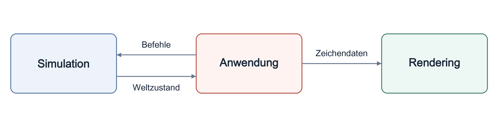

# VERA20k

[Svenska](../sv/) · [简体中文](../zh-CN/) · **Deutsch** · [العربية](../ar/) · [Русский](../ru/) · [ไทย](../th/) · [Türkçe](../tr/) · [English](../)

Red Alert 2: Yuri's Revenge — in Rust von Grund auf neu entwickelt.

Eine kurze Übersicht über den Code. Wenn sie dem Code widerspricht, hat der Code recht. Der `//!`-Kommentar am Anfang jedes Moduls beschreibt, was es tut und wovon es abhängen darf.

## Der Code

- `sim/` — der gesamte Spielzustand und die deterministische Spiellogik.
- `render/` — der Renderer auf Basis von wgpu.
- `app/` — Fenster, Eingabe, Laden und Speichern; verbindet sim, render, ui, audio und net.
- `ui/` — Menüs, Dialoge, Bildschirme im Spiel und die Seitenleiste.
- `audio/` — Soundeffekte und Musik.
- `net/` — deterministischer Lockstep. Einen Netzwerktransport gibt es noch nicht.
- `rules/` — die INI-Dateien des Originalspiels und ihre Ebenen.
- `map/` — Karten, Umgebungen (Theater), Gelände, Trigger und der Zufallskartengenerator.
- `assets/` — Parser für die Dateiformate des Originals (`.mix`, `.shp`, `.vxl`, `.pal`, Bink-Videos und mehr).
- `util/`, `asset_tools/` und `bin/` — gemeinsame Hilfsfunktionen, Asset-Inspektion und zusätzliche Programme.

## Wie alles zusammenpasst

Der gesamte veränderliche Spielzustand liegt in einer einzigen Struktur, `Simulation` (`src/sim/world/mod.rs`). `SimRuntime::advance_frame()` führt einen Frame in der Reihenfolge des Originalspiels aus.

Die App setzt Spielereingaben in Befehle für die Simulation um. Nach jedem Frame übergibt sie den neuen Zustand an den Renderer und spielt die Sounds ab, die der Frame erzeugt hat. Das Rendering liest den Simulationszustand nur, und `sim/` hängt nie von `render/`, `ui/`, `audio/` oder `net/` ab.

## Determinismus

Gleicher Zustand, gleiche Eingaben und gleicher Zufalls-Seed müssen auf jeder Plattform und jeder CPU dasselbe Ergebnis liefern.

- Die Simulationsmathematik bevorzugt den Festkommatyp `SimFixed` gegenüber Gleitkommazahlen.
- Drei Zufallszahlenströme entsprechen den drei Generatoren des Originals. Eine Ziehung aus dem falschen Strom verändert jede spätere Ziehung.
- Objekte kommen in der Reihenfolge der aktiven Objekte des Originals an die Reihe.

Im normalen Spiel wird der gesamte Zustand alle 15 Frames für das Diagnose-Replay-Log gehasht; Tests und Benchmarks können jeden Frame hashen. Der Lockstep-Mehrspielermodus wird stattdessen auf die Synchronisations-Prüfsumme angewiesen sein, die das Original in jedem Frame berechnet.
