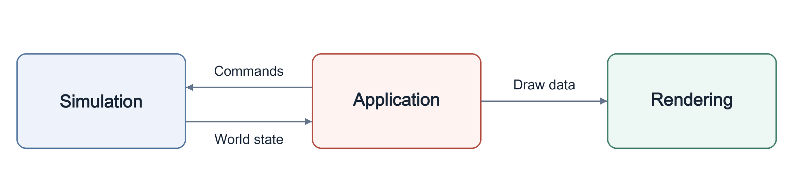

# VERA20k

[Svenska](sv/) · [简体中文](zh-CN/) · [Deutsch](de/) · [العربية](ar/) · [Русский](ru/) · [ไทย](th/) · [Türkçe](tr/) · **English**

Red Alert 2: Yuri's Revenge — rebuilt from scratch in Rust.

A short map of the code. If it disagrees with the code, the code is right. Each module's `//!` header says what it does and what it may depend on.

## The code

Source paths below are under `src/`. The workspace has two crates:

- `vera20k-core` (`src/Cargo.toml`) contains assets, rules, maps, simulation,
  networking, shared utilities and the headless/skirmish entry points.
- `vera20k` (`Cargo.toml`) contains the app, renderer, UI, audio, asset tools and
  game executable. It re-exports core's modules.

- `sim/` — all game state and deterministic gameplay.
- `render/` — the wgpu renderer.
- `app/` — window, input, loading and saving; wires sim, render, ui, audio and net together.
- `ui/` — menus, dialogs, in-game screens and the sidebar.
- `audio/` — sound effects and music.
- `net/` — LAN and online UDP transport, reliable delivery and synchronized command exchange.
  [Networking.md](Networking.md) describes how LAN and online play work.
- `rules/` — the retail INI files and their layers.
- `map/` — maps, theaters, terrain, triggers and the random map generator.
- `assets/` — parsers for the original file formats (`.mix`, `.shp`, `.vxl`, `.pal`, Bink video and more).
- `util/`, `asset_tools/` and `bin/` — shared helpers, asset inspection and extra programs.

## How it fits together

`Simulation` (`src/sim/world/mod.rs`) owns mutable gameplay state.
`SimRuntime` binds it to match resources; `SimRuntime::advance_frame()` advances
the deterministic frame phases.

The app turns player input into commands for the simulation. After each frame it hands the new state to the renderer and plays the sounds the frame produced. Rendering only reads simulation state, and `sim/` never depends on `render/`, `ui/`, `audio/` or `net/`.

## Determinism

The same state, inputs and random seed must give the same result on every platform and CPU.

- Simulation math prefers `SimFixed` fixed-point over floats.
- Three random streams match the original's three generators. A draw on the wrong stream changes every later draw.
- Objects take their turns in the original's active-object order.

Normal play hashes the whole state once every 15 frames for its diagnostic replay
log; tests and benchmarks can hash every frame. Multiplayer has a separate
per-frame sync checksum, with calculation, exchange and comparison handled by the
simulation, session and network command owners.

## Feature docs

- [Auto Repair](auto-repair.md): tick it in Options and your damaged buildings start repairing by themselves.
- [Colour-vision filter](color-vision-config.md): the `[VERA] ColorVisionMode=` whole-viewport daltonization option.
- [End-game screens](ini-end-game-screens.md): the verdict card, its theme and the score page's own art.
- [Ferry order](ferry.md): press J and click a drop spot to have a transport carry units there and come back for more.
- [Formation line](formation-line.md): hold F and drag with the left button to line a group up along a drawn line.
- [Health-strip modes](health-bars.md): the `[VERA] HealthBars=` client option.
- [Lobby player colours](skirmish-colors.md): the thirty colours a lobby lists, and `[SkirmishColors]` for a mod's own.
- [Interface layout](interface-layout.md): `veraui.ini`, a mod's own places for the sidebar, the command bar and the sidebar's parts.
- [Jumpjets land beside a taken cell](jumpjet-land-nearby.md): the `[JumpjetControls] LandNearby=` rules key that sends a Nighthawk refused its landing cell to the nearest clear one.
- [Smooth Jumpjet facing](jumpjet-smooth-facing.md): the `[JumpjetControls] SmoothFacing=` rules key that stops a Nighthawk's body snapping at take-off and unload.
- [Primary rotation](primary-rotation.md): select several factories and press I to have them take turns being the primary.
- [Random map Extras](random-map-extras.md): share codes, presets and choices that add to a generated map, and `RMGMD.INI [Extras]` for a mod's own.
- [Relation colours](relation-colours.md): press Alt+A to draw your side blue, your allies green and your enemies red.
- [SHP building turrets](ini-shp-turret-anims.md): the rules keys for a building turret drawn as a 32-frame animation.
- [Terrain deformation](terrain-deformation.md): the Options box that lets explosions dent the ground and nukes leave craters.
- [Stock rules retail leaves off](dormant-stock-rules.md): `Assaulter=`, `CanDetonateTimeBomb=` and other gamemd keys only a mod or map switches on.
