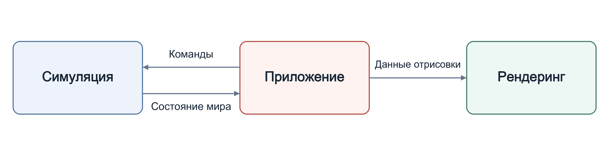

# VERA20k

[Svenska](../sv/) · [简体中文](../zh-CN/) · [Deutsch](../de/) · [العربية](../ar/) · **Русский** · [ไทย](../th/) · [Türkçe](../tr/) · [English](../)

Red Alert 2: Yuri's Revenge — переписанная с нуля на Rust.

Краткий путеводитель по коду. Если он расходится с кодом, прав код. Комментарий `//!` в начале каждого модуля описывает, что модуль делает и от чего может зависеть.

## Код

- `sim/` — всё состояние игры и детерминированная игровая логика.
- `render/` — рендерер на wgpu.
- `app/` — окно, ввод, загрузка и сохранение; связывает sim, render, ui, audio и net.
- `ui/` — меню, диалоги, игровые экраны и боковая панель.
- `audio/` — звуковые эффекты и музыка.
- `net/` — детерминированный lockstep. Сетевого транспорта пока нет.
- `rules/` — INI-файлы оригинальной игры и их слои.
- `map/` — карты, наборы местности (theaters), рельеф, триггеры и генератор случайных карт.
- `assets/` — парсеры форматов файлов оригинала (`.mix`, `.shp`, `.vxl`, `.pal`, видео Bink и другие).
- `util/`, `asset_tools/` и `bin/` — общие вспомогательные функции, инструменты для просмотра ресурсов и дополнительные программы.

## Как всё связано

Всё изменяемое состояние игры хранится в одной структуре — `Simulation` (`src/sim/world/mod.rs`). `SimRuntime::advance_frame()` выполняет один кадр в том же порядке, что и оригинальная игра.

Приложение превращает ввод игрока в команды для симуляции. После каждого кадра оно передаёт новое состояние рендереру и проигрывает звуки, которые создал этот кадр. Рендеринг только читает состояние симуляции, а `sim/` никогда не зависит от `render/`, `ui/`, `audio/` или `net/`.

## Детерминизм

Одинаковые состояние, ввод и сид случайных чисел должны давать одинаковый результат на любой платформе и любом процессоре.

- В математике симуляции предпочтение отдаётся типу с фиксированной точкой `SimFixed`, а не числам с плавающей точкой.
- Три потока случайных чисел соответствуют трём генераторам оригинала. Выборка не из того потока меняет все последующие выборки.
- Объекты ходят по очереди в порядке активных объектов оригинала.

В обычной игре хеш всего состояния вычисляется раз в 15 кадров для диагностического журнала повтора; тесты и бенчмарки могут вычислять его каждый кадр. Многопользовательская игра по схеме lockstep будет опираться не на него, а на собственную контрольную сумму синхронизации оригинала, которая вычисляется каждый кадр.
