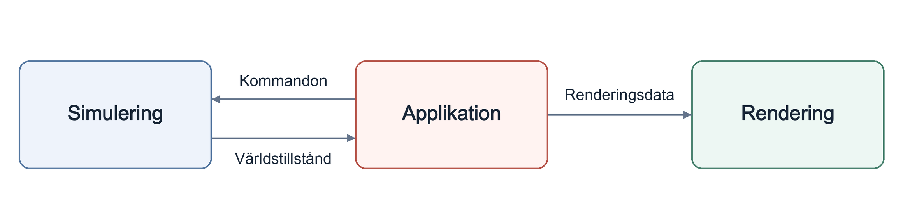

# VERA20k

**Svenska** · [简体中文](../zh-CN/) · [Deutsch](../de/) · [العربية](../ar/) · [Русский](../ru/) · [ไทย](../th/) · [Türkçe](../tr/) · [English](../)

Red Alert 2: Yuri's Revenge — omskrivet från grunden i Rust.

En kort karta över koden. Om den säger emot koden är det koden som gäller. Kommentaren `//!` i början av varje modul beskriver vad modulen gör och vad den får bero på.

## Koden

- `sim/` — allt speltillstånd och den deterministiska spellogiken.
- `render/` — renderaren, byggd på wgpu.
- `app/` — fönster, inmatning, laddning och sparning; kopplar ihop sim, render, ui, audio och net.
- `ui/` — menyer, dialogrutor, skärmar i spelet och sidopanelen.
- `audio/` — ljudeffekter och musik.
- `net/` — deterministisk lockstep. Det finns ingen nätverkstransport än.
- `rules/` — originalspelets INI-filer och deras lager.
- `map/` — kartor, miljöer (theaters), terräng, triggers och generatorn för slumpkartor.
- `assets/` — tolkar för originalets filformat (`.mix`, `.shp`, `.vxl`, `.pal`, Bink-video med mera).
- `util/`, `asset_tools/` och `bin/` — gemensamma hjälpfunktioner, resursinspektion och extra program.

## Hur delarna hänger ihop

Allt föränderligt speltillstånd ligger i en enda struct, `Simulation` (`src/sim/world/mod.rs`). `SimRuntime::advance_frame()` kör en bildruta i samma ordning som originalspelet.

Appen gör om spelarens inmatning till kommandon för simuleringen. Efter varje bildruta lämnar den det nya tillståndet till renderaren och spelar upp ljuden som bildrutan gav upphov till. Renderingen läser bara simuleringens tillstånd, och `sim/` är aldrig beroende av `render/`, `ui/`, `audio/` eller `net/`.

## Determinism

Samma tillstånd, inmatning och slumpfrö måste ge samma resultat på varje plattform och processor.

- Simuleringens matematik använder helst fixpunktstypen `SimFixed` i stället för flyttal.
- Tre slumptalsströmmar motsvarar originalets tre generatorer. En dragning från fel ström ändrar varje senare dragning.
- Objekten turas om i originalets ordning för aktiva objekt.

Vanligt spel hashar hela tillståndet en gång var 15:e bildruta för sin diagnostiska replay-logg; tester och prestandamätningar kan hasha varje bildruta. Flerspelarläget med lockstep kommer i stället att bygga på originalets egen synkroniseringskontrollsumma, som beräknas varje bildruta.
