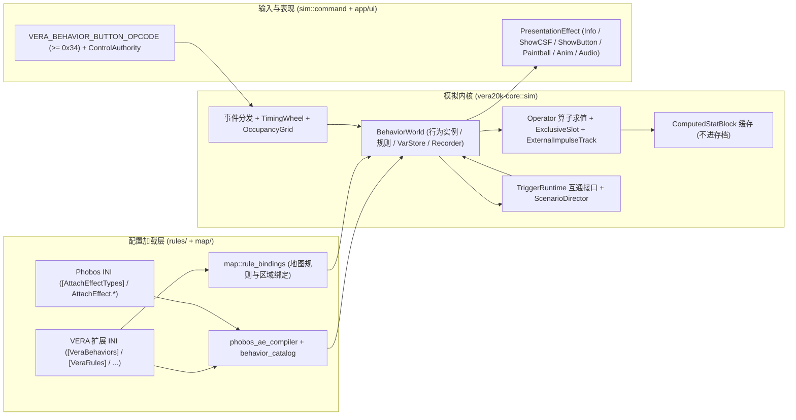
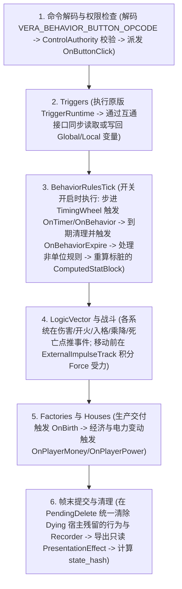
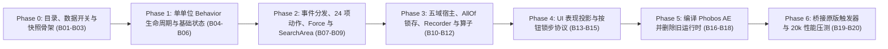

# VERA20k 行为与规则引擎设计

[English](../behavior-rule-engine-roadmap.md) · **简体中文**

本文档说明 VERA20k 原生行为与规则引擎（Behavior & Rule Engine）的整体结构、配置语法、与现有 Phobos `AttachEffect` 及原版地图触发器的关系，以及从 `main` 分阶段落地的开发计划（`Phase 0 – Phase 6`，步骤 `B01–B20`）。这套系统解决两个问题：让单位身上的持续效果、事件触发、历史记录与数值改写能通过 INI 自由组合，同时把触发宿主从单一单位扩展到全局、阵营、空间区域与对象组。

当前 `main` 主干上的相关代码分布在两处：Phobos `AttachEffect` 位于 [rules/attach_effect.rs](../../src/rules/attach_effect.rs)（`1,644` 行）、[sim/attach_effect.rs](../../src/sim/attach_effect.rs)（`6,087` 行）和 [game_entity/attach_effect.rs](../../src/sim/game_entity/attach_effect.rs)（`1,095` 行），全仓共有 `59` 个文件引用它（其中生产代码 `43` 个）；原版与 Ares 地图触发器位于 [trigger_runtime.rs](../../src/sim/trigger_runtime.rs)（`6,508` 行）。开发约束参见 [项目规则](../../AGENTS.md)、[联机规范](../Networking.md)、[Wasm 构建说明](../wasm.md)、[扩展开关说明](../capabilities.md) 与 [依赖检查守卫](../../src/architecture_guards.rs)。

---

## 1. 定位与模块划分

### 1.1 与原版、Phobos、地图触发器的关系

1. **默认编入所有构建，按需自动打开**  
   新引擎全部代码直接进默认构建（包括发布版和 Wasm），不用 `cfg(feature = "...")` 隔离。游戏加载规则与地图时，通过 `RuleSet::vera_behaviors()` 记录是否读到 `[VeraBehaviors]`、`[VeraRules]`、`Vera.*=` 等配置节或键（写法参照 [phobos_switch.rs](../../src/rules/phobos_switch.rs) 和 [ares_switch.rs](../../src/rules/ares_switch.rs)），同时支持由 [模式重构计划](mode-core-plan.md) 中的 `MatchSpec` / `RulePolicy` 启用对应规则包。原版三套预设（`stock_campaign`、`stock_multiplayer`、`stock_cooperative`）和不带新键的零售地图保持关闭，模拟循环直接跳过相关逻辑，不占额外内存，也不影响原版状态哈希。
2. **统一承载单位 AE 并接管 Phobos `[AttachEffectTypes]`**  
   加载边界新增编译器 `rules::phobos_ae_compiler`，把 Phobos `[AttachEffectTypes]`、单位 `AttachEffect.*` 与武器附加条件翻译成同一套内部定义。等现有 Phobos AE 回归测试在新引擎上全部验证等价后，直接删掉 [sim/attach_effect.rs](../../src/sim/attach_effect.rs) 的 `6,087` 行旧运行时并拿掉 AE 的 `#[cfg(feature = "phobos")]`，全仓只保留一套行为实现。
3. **保留原版地图触发器，两边留三个互通接口**  
   [trigger_runtime.rs](../../src/sim/trigger_runtime.rs) 处理了大量原版 `gamemd.exe` 的历史细节（`strtok` 切词、销毁对象不减 `Tag.refs`、共享 `TEvent+54` 透传、事件列表倒序构建等），直接保留它专跑原版和 Ares 战役触发。新老两套系统只在三个点打通：共用底层事件通知出口、共用 Global/Local 变量、允许通过动作互相调用，不在新引擎里背负原版兼容包袱。

### 1.2 模块放在哪一层

各模块位置严格遵守 [architecture_guards.rs](../../src/architecture_guards.rs) 的依赖方向（`rules/` 不依赖 `sim/` 和 `map/`；`map/` 不依赖 `sim/`、`render/` 和 `app/`；`sim/` 不依赖 `render/`、`ui/`、`audio/` 和 `net/`）：

| 所属层次 | 模块位置 | 职责 |
|---|---|---|
| `vera20k-core::rules` | `rules::behavior_catalog`<br>`rules::vera_behavior_switch`<br>`rules::phobos_ae_compiler` | 解析 7 张开放 INI 表，用 [ini_value.rs](../../src/rules/ini_value.rs) 读出 `BehaviorDef`、`RuleDef`、`EffectDef`、`ConditionDef`、`RecorderDef`、`OperatorDef`、`ButtonDef` 和 `ParamSlot`；把 Phobos AE 翻译成同套结构；向 `RuleSet` 提供只读目录和 `vera_behaviors()` 开关。 |
| `vera20k-core::map` | `map::rule_bindings` | 解析地图节里的 `[VeraMapRules]`、`[VeraGroups]` 和 `[VeraSpatialRegions]`，做坐标和引用合法性检查后输出纯静态绑定数据。 |
| `vera20k-core::sim` | `sim::behavior_engine`（`world.rs`、`bus.rs`、`wheel.rs`、`vars.rs`、`recorder.rs`、`operator.rs`、`slots.rs`、`impulse.rs`、`stat_block.rs`、`bridge.rs`） | 保存并推进所有权威运行态：`LiveBehavior`、`LiveRule`、组聚合状态、5 级变量池 `VarStore`、按需分配的 `RecorderStore`、互斥槽 `ExclusiveSlotTable`、三维受力 `ExternalImpulseTrack`；维护不进存档的缓存 `ComputedStatBlock`、事件索引和 `TimingWheel`；把 UI/音效请求写进只读 `PresentationEffect` 列表。 |
| `sim::command` + `net` | [command.rs](../../src/sim/command.rs) 与 `net` | 定义主动技能按钮的网络命令 `VERA_BEHAVIOR_BUTTON_OPCODE`（分配在 `>= 0x34`，避开主干已经使用的 `0x33 TARGET_HOUSE_OPCODE`），接入 `ControlAuthority` 权限检查和房间版本协商。 |
| `app/` + `ui/` | `app::presentation`<br>[added_parts.rs](../../src/ui/added_parts.rs) 与 `app/input/` | 消费每帧导出的 `PresentationEffect` 来画染色、跟随动画、`Info` 数值、`ShowCSF` 文本和 `ShowButton` 按钮；玩家点技能按钮时构造锁步命令提交给队列。 |



---

## 2. 核心设计

### 2.1 五种宿主（`HostScope`）

规则和行为不再死绑在单个单位上，宿主由 `HostScope` 统一表示：

* **`World`**：全局唯一宿主，负责整局时间、全局变量、全局倒计时和游戏结束条件。
* **`House(HouseId)`**：作战方宿主，负责某家玩家的资金、电力、科技和超武事件。
* **`Spatial(SpatialRegionId)`**：地图空间宿主，支持单格（Cell）、横竖触发线（Line）、矩形/格集（Zone）以及路径点半径（WaypointRadius），配合 [occupancy.rs](../../src/sim/occupancy.rs) 监测单位进出与桥面变化。
* **`Group(GroupId, AggregatePolicy)`**：把多个单位、小队或区域编进同一个逻辑组，按三种模式决定何时执行后续效果（覆盖原版 `Tag.repeat = 0 / 1 / 2`）：
  * `AnyOnce`：组里任意成员满足条件就触发一次，随即整组解绑失效；
  * `AllOnce { initial_refs }`：每个成员各自满足并解绑，计数减一，直到最后一个成员完成时才执行动作；
  * `EachRepeat`：组内成员每次满足条件都各自触发一次。
* **`Actor(EntityId)`**：单个单位、建筑或抛射体，承载所有个体身上的行为、局部计数器和历史记录。

### 2.2 把“规则”和“持续效果”拆开

不把触发条件、执行动作和持续状态全揉在一张大结构里，而是明确拆成两类对象：

* **`RuleDef / LiveRule`（响应规则）**：决定“什么事件在什么条件下触发什么动作”。包含规则 ID、默认启用状态、适用难度、重复策略（单次 / 全组单次 / 周期重复 / 次数上限）、串联下一条规则 `LinkedNext`，以及组合事件表达式 **`EventExpr = Single | AllOf { items, latch_mask } | AnyOf`**。需要跨帧等待多个前置事件（例如“A 发生过”且“B 发生过”且“现在 C 满足”）时，开启该子事件的 `latch` 标记，满足一次就在 `LiveRule.completed_bits` 里记住，直到整条规则触发或重设。
* **`BehaviorDef / LiveBehavior`（持续载体）**：贴在宿主身上随时间存续的状态实体，包含全部 13 项固有属性和互斥仲裁信息：
  1. **可堆叠**（`Cumulative`）：刷新剩余时间、允许独立叠层（可设总上限 `MaxCount` 和同来源上限 `PerSourceMaxCount`）、或仅累加内部层数计数。
  2. **持续时间**（`Duration`）：按逻辑帧倒计时；设 `HoldDuration=yes` 时永久保留，同时支持外部传参覆写或乘算倍率。
  3. **可重置计时器**（`RefreshDuration`）：重贴时决定不重置、全层重置、仅重置同一来源，还是延长剩余帧数。
  4. **来源归属**（`SourcePolicy`）：`SelfActor`、`Invoker`、`Producer` 或 `InheritFromParent`，同时记下来源实体 ID 和来源作战方。
  5. **可继承**（`Inheritable`）：按位选择是否在 `CreateUnit` 生成的子体、`Transform` 变身后的新单位、乘客上车/下车或类型转换时自动复制过去。
  6. **无视铁幕与力场**（`PenetratesIronCurtain` / `PenetratesForceShield`）：控制无敌护盾是否挡住这次效果附加。
  7. **最大触发次数**（`MaxTriggerCount=` / `max_trigger_count: Option<u32>`）：达到指定次数后自动过期清理并报告 `Discarded`。
  8. **类型组**（`Groups`）：支持按组名批量查询或用 `DropBehavior` 整组删除。
  9. **标签**（`Mark.Names`）：行为激活期间自动给宿主挂上对应标签（驻留为 `InternedId`），失效或暂停供电时自动撤下。
  10. **防重贴冷却**（`ReapplyCooldown`）：行为结束后在宿主身上记一段冷却帧数，冷却结束前拦截同类型或同组再次贴上。
  11. **生效前延迟**（`InitialDelay`）：刚贴上时先等这么多帧，倒计时结束真正激活时才发 `OnBehaviorStart`。
  12. **触发间隔**（`Interval`）：按固定帧数间隔驱动周期逻辑，统一塞进 `TimingWheel`。
  13. **计数器**（`Counters`）：随这个 `LiveBehavior` 一起创建和销毁的局部整数槽。
  14. **互斥槽与优先级**（`ExclusiveSlot` + `priority`）：用来处理不能同时生效的变形、武器替换或超时空状态。

一个 `BehaviorDef` 可以自带一组 `child_rules`：行为激活时启用这些规则，因断电等原因暂停时挂起，过期或被删除时一并清理。地图级剧本规则直接挂在 `World`、`House`、`Spatial` 或 `Group` 上，不需要创建隐形的假单位。

### 2.3 事件上下文与触发器清单

所有事件派发都传递同一个轻量只读结构 `EventContext`：

```text
EventContext
 ├── event_kind: EventKind                        (事件编号)
 ├── host: HostScope                              (当前规则宿主)
 ├── actor: Option<EntityId>                      (事件主体：如受击者、开火者、进格单位)
 ├── target_or_other: Option<TargetRef>           (互动对象：Entity / Cell / Coord)
 ├── source: Option<EntityId>                     (攻击者 / 生产者 / 效果来源)
 ├── source_house: Option<HouseId>                (来源所属阵营或触发锁存阵营)
 ├── projectile: Option<EntityId>                 (关联抛射体)
 ├── location: Option<(i16, i16, MovementLayer)>  (发生格坐标与高度层：地面/桥面/空中)
 └── payload: EventPayload                        (各事件专用参数)
```

为了保证跨平台联机结果一致并且不拖慢热循环，模拟内所有数值全部采用 **`SimFixed`（`I16F16`，见 [fixed_math.rs](../../src/util/fixed_math.rs)）或整数**，可为空的数字用 `Option<u16>` / `Option<i32>`，不确定的目标用 `TargetRef::Entity | Cell | Coord`，名字一律转成 `InternedId`（[intern.rs](../../src/sim/intern.rs)）。

#### A. 单位与通用触发器（共 39 项）

为了避免 20,000 个单位每帧做条件扫描，除时间触发和极少数有范围限制的比较外，所有条件类触发都在底层数据变动点直接通知订阅者：

| 触发器 | 适用宿主 | 附带参数 | 触发方式 | 说明 |
|---|---|---|---|---|
| `OnTakeDamage` | `Actor` | `source: Option<EntityId>`, `damage: SimFixed`, `source_total: SimFixed`, `all_total: SimFixed` | 扣血点通知 | 历史总额包含本次伤害；仅当订阅了历史值时才给宿主分配历史记录槽 |
| `OnHitBy` | `Actor` | `warhead: InternedId`, `final_damage: SimFixed` | 受击结算通知 | 晚于攻击者的 `OnHitTarget`；被 `ImmuneTo` 免疫或完全无视时不触发 |
| `OnAttackedBy` | `Actor` | `attacker: EntityId`, `weapon_slot: Option<u16>`, `projectile: Option<EntityId>` | 开火发射通知 | 侦测对方开火动作，可按武器槽过滤 |
| `OnTimer` | 五域通用 | `last_trigger_frame: u64` | `TimingWheel` | 经过指定帧数后触发 |
| `OnAimed` | `Actor` | `target: Option<TargetRef>` | 目标变更通知 | 目标可能是单位、格子或空地 |
| `OnProjectileComing` | `Actor` | `projectile: EntityId`, `launcher: Option<EntityId>` | 抛射体创建通知 | 仅针对以该单位为目标的抛射体 |
| `OnBirth` | `Actor` | `producer: Option<EntityId>`, `source_behavior: Option<BehaviorDefId>`, `build_frames: Option<i32>` | 单位创建通知 | 出生自带效果可在 `SourcePolicy` 配自己或生产者；普通建造不带效果器 |
| `OnKilled` | `Actor` | `killer: Option<EntityId>`, `killing_warhead: Option<InternedId>` | 死亡前通知 | `killer` 可为空（如自毁或环境伤害） |
| `OnFire` | `Actor` | `target: Option<TargetRef>`, `weapon_slot: Option<u16>`, `projectile: Option<EntityId>` | 开火发射通知 | 可挂在武器上，或挂在单位上匹配武器槽序号 |
| `OnSpawnFire` | `Actor` | `spawnee: Option<EntityId>`, `target: Option<TargetRef>`, `weapon_slot: Option<u16>`, `projectile: Option<EntityId>` | 子机开火通知 | 子机发射时通过母体引用反向唤醒母体规则 |
| `OnMission` | `Actor` | `mission: Option<i32>`, `target: Option<TargetRef>` | 任务切换通知 | 切到指定任务时触发；需要按间隔反复执行时配合 `TimingWheel` |
| `OnEntry` | `Actor` | `carrier: EntityId`, `passengers: SmallVec<[EntityId; 8]>`, `used_space: i32`, `native_passenger_cap: bool`, `is_garrison: bool` | 乘降提交通知 | 覆盖进载具和驻守建筑两种情况 |
| `OnExit` | `Actor` | `carrier: EntityId`, `remaining_passengers: SmallVec<[EntityId; 8]>`, `used_space: i32`, `native_passenger_cap: bool`, `is_garrison: bool` | 乘降提交通知 | 离开载具或建筑后返回剩余乘客与体积 |
| `OnEntryBy` | `Actor` | `passenger: EntityId`, `passengers: SmallVec<[EntityId; 8]>`, `used_space: i32`, `native_passenger_cap: bool`, `is_garrison: bool` | 乘降提交通知 | 由载具/建筑端响应乘客进入 |
| `OnExitBy` | `Actor` | `passenger: EntityId`, `remaining_passengers: SmallVec<[EntityId; 8]>`, `used_space: i32`, `native_passenger_cap: bool`, `is_garrison: bool` | 乘降提交通知 | 由载具/建筑端响应乘客离开 |
| `OnBehaviorStart` | 容器 | `behavior: BehaviorDefId` | 生命周期通知 | 过完 `InitialDelay` 首次生效时触发；可串 `Next` 或配间隔触发 |
| `OnBehavior` | 容器 | `behavior: BehaviorDefId` | `TimingWheel` | 运行期间按 `Interval` 周期触发；建议配置合理间隔避免过密 |
| `OnBehaviorExpire` | 容器 | `behavior: BehaviorDefId`, `reason: ExpireReason` | 生命周期通知 | 明确区分 `NaturalExpire`（到期）、`Removed`（被移除）、`HostDeath`（宿主死）和 `Discarded`（条件丢弃） |
| `OnBehaviorStack` | `Actor` | `behavior: BehaviorDefId`, `stack_count: i32` | 叠层变动通知 | 只在目标行为挂载或删层时检查层数条件 |
| `OnHitTarget` | `Actor` | `target: TargetRef`, `damage: SimFixed`, `projectile: Option<EntityId>` | 命中结算通知 | 早于受击方 `OnHitBy` |
| `OnFatalDamage` | `Actor` | `attacker: Option<EntityId>`, `damage: SimFixed` | 致死判定通知 | 发生在死亡结算前；配合 `PreventDeath` 决定是否保命 |
| `OnTransportSpace` | `Actor` | `used_space: i32`, `total_space: i32` | 乘降变动通知 | 载具剩余或已用运载空间变动时评估 |
| `OnLandType` | `Actor` | `land_type: InternedId` | 跨格/地形改写通知 | 跨入新格或脚下地形属性变动时触发 |
| `OnCrush` | `Actor` | `crusher: EntityId` | 碾压结算通知 | 碾压发生时立即触发 |
| `OnHealthCondition` | `Actor` | `hp: i32`, `max_hp: i32`, `ratio: SimFixed` | 血量变动通知 | 支持数值与比例条件，可配边沿触发避免每次微调都重复执行 |
| `HoldDuration=yes` | 五域通用 | 无 | 不唤醒 | 只表示永久挂载属性，不挂周期回调时零耗时 |
| `OnHouseTransfer` | `Actor` | `new_house: HouseId`, `is_mind_control: bool` | 转属前通知 | 在新所属写入之前触发，方便检查原所属并处理效果清理 |
| `OnAmmoCount` | `Actor` | `ammo: i32`, `max_ammo: i32` | 弹药变动通知 | 开火减弹或补弹时检查 |
| `OnCounterCondition` | 五域通用 | 支持多条件与或非及来源过滤 | 计数器写入通知 | 计数器改变时评估条件表达式 |
| `OnPlayerMoney` | `House` / `Actor` | `house: HouseId`, `credits: i64` | 资金账本通知 | 阵营资金（[economy.rs](../../src/sim/economy.rs)）变动时检查 |
| `OnPlayerPower` | `House` / `Actor` | `house: HouseId`, `power_output: i32`, `power_drain: i32`, `ratio: SimFixed` | 电力重算通知 | 发电或耗电变化重新算电时检查 |
| `OnPassengerCount` | `Actor` | `count: i32` | 乘降变动通知 | 乘客数量变化时检查 |
| `OnStartMoving` | `Actor` | 拆分为 `OnMoveStart` / `OnMoveStop` / `OnMovingInterval` | 移动状态切换 + 移动中定长节拍 | 静止单位不产生任何轮询开销 |
| `OnStorage` | `Actor` | `stored_ore: i32`, `capacity: i32` | 矿仓变动通知 | 采矿、倒矿或卸货改变储量时检查 |
| `WarheadDetonate` | `Spatial` / `Actor` | `launcher: Option<EntityId>`, `hit_target: Option<TargetRef>`, `cell: (i16, i16, MovementLayer)` | 弹头起爆回调 | 弹头固定属性，负责挂 AE、按标签删 AE 或执行额外效果 |
| `Compare` | 双对象 | `lhs_val: SimFixed`, `rhs_val: SimFixed` | 有界间隔检查 / 变更通知 | 比较宿主与互动对象的距离、血量差、弹药和等；必须设间隔上限或绑定特定目标句柄，禁全图两两轮询 |
| `OnSelect` | `Actor` | `selecting_house: HouseId` | 本地表现 | 选中属于客户端本地状态，不进网络包；加载检查严禁它绑定会改世界状态的效果 |
| `OnButtonClick` | `Actor` / `House` | `button_id: ButtonDefId`, `target: Option<TargetRef>`, `sender_house: HouseId` | 锁步命令解码 | 点击按钮发出网络指令，过权限检查后在所有客户端同一模拟帧执行 |
| `RecorderCondition` | 五域通用 | `var_key: VarKey`, 数值或 `TypeId`/`TypeList` 判定 | 变量刷新通知 | 按类型 ID 或标签集合匹配，不做运行时字符串包含匹配 |

#### B. 非单位宿主事件（4 类）

| 宿主 | 事件名 | 触发时机与附带信息 |
|---|---|---|
| `Spatial` | `OnCellEnter` / `OnCrossLine` / `OnZoneEnter` / `OnBridgeCollapsed` / `OnTerrainMutated` | 单位进入格子、越过触发线或进区域（附 `actor`, `house`, `cell`, `layer`）；桥梁段倒塌或弹坑改变地形（由 [terrain_deformation.rs](../../src/sim/world/terrain_deformation.rs) 与桥梁毁伤入口发出） |
| `House` | `OnHouseBuilt` / `OnHouseLostAll` / `OnHouseSuperWeaponFired` / `OnHouseSuperWeaponReady` / `OnHouseDiscovered` / `OnHouseDiplomacyChanged` | 造出指定类型单位、失去全部单位或建筑/海军、超武发射或就绪、首次被发现、外交结盟改变 |
| `World` | `OnMatchStart` / `OnScenarioTime` / `OnGlobalTimerExpired` / `OnVarChanged` / `OnAmbientLight` / `OnCratePicked` / `OnTypeCountChanged` | 剧本开局、经过时间、倒计时归零、共享变量变动、光照越过阈值、拾取木箱、全图某单位数量变化 |
| `Group` | `OnGroupAny` / `OnGroupAll` / `OnGroupMemberChanged` | 组成员完成 `AnyOnce` / `AllOnce` 聚合裁决，或成员增减 |

### 2.4 效果器与持续状态

#### A. 瞬间效果（24 项常规效果 + 剧本/系统动作）

| 分类 | 效果名 | 说明与实现约束 |
|---|---|---|
| 行为控制 | `AddBehavior`（`AddEffect`）、`DropBehavior`（`DropEffect`） | 按定义名、类型组或 `Mark` 增删效果；可选作用于宿主、来源、互动对象或所在格，支持串联下一个效果 |
| 火力与超武 | `LaunchWeapon`、`LaunchSuperWeapon` | `LaunchWeapon` 可指定武器名或槽位序号，从/向宿主、互动对象、瞄准目标或指定格发射；`LaunchSuperWeapon` 复用超武管理器释放指定超武 |
| 动画与销毁 | `SpawnAnimation`、`Remove`、`Suicide` | 原地刷动画；`Remove` 直接移出世界；`Suicide` 走正常死亡结算并进入帧末清理列表 |
| 生命、生产与经济 | `ModifyHealth`、`CreateUnit`、`CounterModifier`、`GetEXP`、`GetMoney` | `ModifyHealth` 支持指定伤害/治疗量、百分比或覆写血量；`CreateUnit` 按 `Inheritable` 决定是否继承触发器和效果器；`GetMoney` 增减阵营资金 `Credits`（[economy.rs](../../src/sim/economy.rs)）；`CounterModifier` 写入 `VarStore` 并推事件 |
| 移动与任务 | `ForceMoveTo`、`CommandMoveTo`、`ClearDisguise`、`ClearTarget`、`Mission` | `ForceMoveTo` 强制移位到随机或指定格/坐标（必须查通行性与占格）；`CommandMoveTo` 下发寻路移动任务；`ClearDisguise` 清伪装；`ClearTarget` 清目标；`Mission` 切换到攻击、移动、部署、警戒或变卖 |
| 范围检索 | `SearchArea` | 搜索指定范围格、抛射体或单位并贴上行为或执行子效果。必须走 [occupancy.rs](../../src/sim/occupancy.rs) 的空间网格过滤，禁止遍历全局实体列表 |
| 所属与状态改写 | `TechModifier`、`TransferOwnership`、`ClearMindControl`、`AmmoModifier`、`PassengerModifier` | `TechModifier` 修改阵营科技树权限；`TransferOwnership` 提供三种既有行为来源处理选项（`KeepInvoker` 保留原施放者 / `RetargetNewOwner` 转成新阵营 / `TransferOnlyIfMarked` 仅转移带指定标签的）；`ClearMindControl` 解除心控恢复原所属；`AmmoModifier` 与 `PassengerModifier` 增减弹药和乘客 |
| 音频输出 | `PlayAudio` | 写入只读 `PresentationEffect` 队列，不直接放音、不影响哈希 |
| 剧本与互通扩展 | `EnableRule`、`DisableRule`、`ForceRule`、`AttachToGroup`、`DetachFromGroup`、`DestroyGroup`、`SetVar`、`ControlTimer`、`SetDiplomacy`、`SpawnTeam`、`EndMatch`、`BridgeLegacyTrigger` | 负责开关或强触规则、管理组、读写全局变量与倒计时、外交、路径点刷小队、胜负判定以及调用原版触发器 |

#### B. 持续状态（21 项 + `Mark`）

| 分类 | 状态名 | 运行方式与冲突处理 |
|---|---|---|
| 属性修正与战斗开关 | `Status`、`DamageModifier`、`ImmuneTo`、`Silence`、`DisableThreatSearch`、`SearchOnAllies` | 为什么不每帧遍历单位身上所有行为：战斗、索敌和移动热循环高频读这些倍率。引擎在宿主上放一块定长缓存 **`ComputedStatBlock`**，只在挂上、删掉或断电暂停行为时重算一次，包括火力/护甲/速度/攻速/射程倍率、额外射程、暴击修正、隐形、禁止开火、停用索敌、允许友军索敌、弹头免疫以及 `DamageModifier` 固定改伤规则。热循环里 O(1) 直读这个结构体。 |
| 生存与交互限制 | `PreventDeath`、`NoSelect`、`NoCommand`、`NoLegalTarget`、`PowerOff` | `PreventDeath` 在 `OnFatalDamage` 后至少保留 1 点血；`NoSelect` 和 `NoCommand` 在本地选区和命令权限检查两处同时生效；`NoLegalTarget` 屏蔽索敌目标；`PowerOff` 让建筑所属阵营强制断电。 |
| 替身实体 | `Stand` | 挂载时生成附属 `EntityId`（置 `is_stand = true`），每帧同步相对宿主位置与朝向，可独立开火或受击，宿主销毁或效果结束时一并清理。 |
| 互斥叠加状态 | `Transform`、`OverrideWeapon`、`Teleport` | 多种变形、武器替换或超时空效果同时存在会互相打架。统一放进 **`ExclusiveSlotTable`**，按 `(priority, attach_seq)` 排序压栈：永远只让栈顶那个生效；高优先级的被删掉或过期后，自动回退激活次高一层或还原成原始形态。`Transform` 重建单位时按 `Inheritable` 移交触发器、行为、计数器和血量比例。 |
| 三维物理抛起 | `Force` | 不能直接暴力改坐标，否则容易穿模或叠加打架。每个受控实体按需挂接确定性三维定点轨道 **`ExternalImpulseTrack`**，多个 `Force` 效果先把速度和加速度按矢量加在一起，再每帧用 `SimFixed` 积分位置，落点前查询 [resolved_terrain.rs](../../src/map/resolved_terrain.rs) 和 [cell_map.rs](../../src/sim/cell_map.rs) / [occupancy.rs](../../src/sim/occupancy.rs) 检查地形高度与可站立格，避免掉进地下或卡死在建筑里。 |
| 表现与 UI 投影 | `Paintball`、`AttachAnimation`、`Info`、`ShowCSF`、`ShowButton` | 这些状态本身只在 `LiveBehavior` 里占个句柄，每帧把结果整理进只读 `PresentationEffect`：`Paintball` 给单位染色；`AttachAnimation` 绑定跟随动画；`Info` 和 `ShowCSF` 投影到浮字或 [added_parts.rs](../../src/ui/added_parts.rs) 面板；`ShowButton` 注册实体或阵营的可点击按钮和图标。 |
| 标签 | `Mark` | 在宿主身上维护标签引用计数，供 `ConditionDef` 和弹头删除过滤使用。 |

### 2.5 变量、记录器（`Recorder`）与算子（`Operator`）

* **5 级变量池（`VarScope`）**：按 `Campaign`（第 0..49 槽对应原版全局变量）、`Match`（第 0..99 槽对应原版局部变量）、`House`、`Group`、`Actor` 五级寻址。值类型 **`VarValue`** 限定为 `Fixed(SimFixed)`、`Int(i64)`、`Bool(bool)`、`Entity(Option<EntityId>)`、`TypeId(InternedId)`、`TypeList(SmallVec<[InternedId; 8]>)`、`EntityList(SmallVec<[EntityId; 8]>)`，列表带硬上限（如 32 项），不存任意动态字符串。
* **按需分配的 `Recorder`**：平时单位身上没有任何历史记录结构。只有贴了 `Recorder` 行为，或者挂了需要历史总伤参数的 `OnTakeDamage` 规则时，才在 `RecorderStore` 里为该实体开槽；按攻击者区分的历史表采用有上限的 `BTreeMap<EntityId, SimFixed>`（如最多保留 64 个来源，超出时按最早访问或最小贡献淘汰）。刷新模式分为 `OnExpire`（默认，刷新前读到默认值）、`Periodic(frames)` 和 `Immediate`，刷新时把统计结果写入 `VarStore` 并立刻推给监听了 `RecorderCondition` 的规则。
* **强类型算子 `Operator`**：不采用“运行期按字符串行号去改某个 INI 的文本内容”，原因有两个：一是运行时拆字符串极慢，二是各客户端如果对文本格式有一点理解差异就会直接联机失步。正确做法是在加载期把算子静态绑定到强类型枚举 **`ParamSlot`**（例如 `EffectParam::CreateUnitTypes`、`EffectParam::ModifyHealthAmount`、`EffectParam::LaunchWeaponRange`、`BehaviorParam::Duration`），支持两个拦截方向：**`Inbound`**（目标准备收到某效果前先被身上的算子改写参数）和 **`Outbound`**（来源发出某效果前先被身上的算子改写参数）。多条生效算子按 `(priority, attach_seq)` 依次叠加 `Override | Add | Sub | Mul | ClampMin | ClampMax | AppendList`。

### 2.6 约束条件与内存估算

#### A. 约束条件（`ConditionDef`）

加载期把条件编译成紧凑的扁平布尔表达式（支持 `And` / `Or` / `Not` 短路），每次求值只需读取目标字段和 `ComputedStatBlock` 位图：

1. 当前所在地形块类型（[resolved_terrain.rs](../../src/map/resolved_terrain.rs) 中的格面 `LandType`）
2. 单位大类（步兵、车辆、建筑、飞行器四位掩码）
3. 单位位置与高度层（空、地、海、`MovementLayer`）
4. 敌我判定（自身、盟友、敌人、中立）
5. 电力状况（所属阵营红、黄、绿三档）
6. 玩家金钱数值比较
7. 作用对象已拥有某效果器（含最小/最大层数判断）
8. 作用对象不拥有某效果器
9. 作用对象拥有某标签（`Mark`）
10. 作用对象不拥有某标签
11. 作用对象是 X 注册名（白名单）
12. 作用对象不是 X 注册名（黑名单）
13. 作用对象是抛射体
14. 作用对象是 X 类别抛射体（按注册名或弹道种类区分）
15. 作用对象当前是否为平民阵营
16. 是否是替身（直读 `is_stand` 标记）
17. 作用对象护甲类型
18. 作用对象当前血量数值或百分比
19. 与互动对象的距离满足指定射程范围（按距离平方定点比较，不开方）
20. 所检测效果器的来源符合要求（自身 / 施法者 / 所属阵营 / 同源）
21. 额外状态补充：是否处于铁幕或力场、是否处于 Limbo/建造中、全局或局部 `VarStore` 条件

#### B. 20,000 单位内存估算

| 场景 | 内存分配方式 | 估算占用 |
|---|---|---|
| 未启用 VERA 扩展的原版对局 | 只有一个空标头，所有池子长度为 0 | **`0 B`** |
| 20,000 单位中 2,000 个带活跃 AE（各 3 层） | 每个实体只加一个 `Option<NonZeroU32>` 槽句柄（4 字节）；活跃体开 `ComputedStatBlock`（~64 B）与连续 `LiveBehavior`（~56 B/个） | **`< 4 MiB`** |
| 20,000 单位全部挂载 4 层 AE，其中 2,000 个带 `Recorder` | `SlotVec` 连续存储，不挂字符串，按需开 `RecorderStore` 和 `ExclusiveSlotTable` | **`< 24 MiB`** |

---

## 3. 帧内执行、联机同步与存档

### 3.1 在主帧里的执行位置

新引擎按下面顺序插进 [master_frame.rs](../../src/sim/world/master_frame.rs) 的每帧流程里，不改变原版各阶段先后顺序：



### 3.2 战斗伤害的触发顺序

1. 单位开火时发 `OnFire` / `OnSpawnFire`，目标端发 `OnAttackedBy`，锁定型抛射体创建时发 `OnProjectileComing`。
2. 命中生效时先在攻击方发 `OnHitTarget`，随即让 `Outbound` 与 `Inbound` 算子计算本次伤害及附加行为参数。
3. 目标方检查 `ImmuneTo`：免疫或无视这个弹头时跳过不发 `OnHitBy`，否则发 `OnHitBy(warhead, final_damage)`。
4. 叠加护甲、`ComputedStatBlock` 与 `DamageModifier` 算出最终扣血量；实际扣血并发 `OnHealthCondition` 与 `OnTakeDamage`（若订阅历史伤害，此时计入 `Recorder`）。
5. 血量降至 0 时先发 `OnFatalDamage`，如果身上有 `PreventDeath` 就把血量保在 1 点。
6. 确认死亡时发 `OnKilled` 与 `OnBehaviorExpire(HostDeath)`，再按 `Inheritable` 处理继承，剩余数据留到帧末清理。

### 3.3 选中和主动按钮的联机处理

* **`OnSelect` 只走本地表现**：每个玩家自己点选了哪些单位属于 `LocalViewIdentity` 本地视角状态，不进 `fold_identity()` 与 `state_hash()`，也不进网络包。规则加载时会做静态检查：`OnSelect` 下面只允许挂 `PresentationEffect`（提示文本、本地音效、打开说明等）；如果配置里误把扣血、刷兵这类改模拟状态的动作绑给了 `OnSelect`，加载时直接报错拦截。
* **`OnButtonClick` 走锁步命令**：
  1. `ShowButton` 状态随 `LiveBehavior` 存在模拟层，界面根据这个状态画出技能按钮和冷却读条。
  2. 玩家点击按钮后，客户端往帧包写入 **`VERA_BEHAVIOR_BUTTON_OPCODE`**（分配 **`>= 0x34`**，避开主干占用的 `0x33 TARGET_HOUSE_OPCODE`），带上宿主标识、按钮 ID 和目标坐标/实体。
  3. 同一模拟帧全房所有端解码该命令，经过 `ControlAuthority`（[world_commands.rs](../../src/sim/world/world_commands.rs)）的三段鉴权检查（同时受 `NoCommand` 状态限制）。按钮在 `ControlAuthority` 的穷尽 `CommandCapability` 映射中按类别归入 `UnitsOnly`（单位战术技能）或 `FullControl`（阵营/经济技能），不靠 `_ => false` 吞命令；再检查金钱余额、冷却与前置条件，全部通过才派发 `OnButtonClick`。
  4. 该操作码同步记入 `MultiplayerAgreement` 与 [联机规范](../Networking.md)，老版本客户端进房时能直接拿到清晰的拒绝提示或禁用按钮，不会半局掉步。

### 3.4 防死循环与存档布局

* **递归与数量上限**：参考 [trigger_runtime.rs](../../src/sim/trigger_runtime.rs) 的 `MAX_TRIGGER_SPRING_DEPTH`，对新引擎设四道限制：单次事件链最大递归深度 `MAX_DISPATCH_DEPTH = 16`、单次派发最多执行效果数 `MAX_EFFECTS_PER_DISPATCH = 1024`、单宿主最多挂载行为数 `MAX_BEHAVIORS_PER_ENTITY = 64`、单条 `LiveRule` 同帧防重入标记 `dispatch_guard`。超限时按固定位置停下并输出日志警告，确保两端停在完全一致的状态。
* **存档布局**：按 [snapshot.rs](../../src/sim/snapshot.rs) 的位置二进制 `save_codec` 和 `traced_snapshot_layout()` 编码：
  * 全部权威数据（`LiveBehavior`、`LiveRule`、组聚合状态、`VarStore`、`RecorderStore`、冷却表、`ExclusiveSlotTable`、`ExternalImpulseTrack`、`next_seq`）全部写入存档并参与 [world_hash.rs](../../src/sim/world/world_hash.rs)，不用 `#[serde(flatten)]` 和 `#[serde(skip_serializing_if)]`；
  * 派生缓存（`EventSubscriptionIndex`、`TimingWheel`、`ComputedStatBlock`）加 `#[serde(skip)]`，读档时从权威数据重算，Debug 构建下用 `debug_assert!` 核对一致。

---

## 4. INI 配置写法与示例

### 4.1 节与挂载键

沿用 `RULESMD.INI` → `LANGRULE.INI` → 模式 INI → 地图 INI 的分层覆盖顺序和 `[Child]:[Base]` 继承规则，新增 7 张配置节（全部经 [ini_value.rs](../../src/rules/ini_value.rs) 解析，读不到就取代码默认值，越界或格式不对只截断或记录报错跳过，绝不 `unwrap`）：

* **注册节**：`[VeraBehaviors]`、`[VeraRules]`、`[VeraEffects]`、`[VeraConditions]`、`[VeraRecorders]`、`[VeraOperators]`、`[VeraButtons]`
* **挂载键**：单位节 `Vera.InitialBehaviors=` / `Vera.Rules=` / `Vera.ButtonSlots=`；弹头节 `Vera.AttachBehaviors=` / `Vera.RemoveByMark=` / `Vera.DetonateEffects=`；武器节 `Vera.FireConditions=` / `Vera.FireEffects=` / `Vera.SpawnFireEffects=`；地图节 `[VeraMapRules]` / `[VeraGroups]` / `[VeraSpatialRegions]`

只要规则或地图里出现了其中任意一节或键，`RuleSet::vera_behaviors()` 就自动打开。

### 4.2 四个示例

#### 示例 1：记录打过的单位类型，到期按记录刷兵

```ini
[VeraRecorders]
1=RecHitTargets

[RecHitTargets]
Recorder.Type=HitTargetTypes
Recorder.TargetVar=Actor.VarTargetList
Recorder.Flush=OnExpire

[VeraBehaviors]
1=BH_RecordHitTargets
2=BH_GiftBoxOperator

[BH_RecordHitTargets]
Duration=100
Recorder=RecHitTargets
Rules=R_OnExpireGiftBox

[VeraRules]
1=R_OnExpireGiftBox

[R_OnExpireGiftBox]
Event0=OnBehaviorExpire
Condition0=ActorHasNoMark:GiftLocked
Effects=EF_AddGiftOperator,EF_CreateGiftUnit

[VeraOperators]
1=OP_OverrideGiftTypes

[OP_OverrideGiftTypes]
Direction=Outbound
Priority=100
TargetEffect=EF_CreateGiftUnit
TargetSlot=CreateUnit.Types
Op=Override
SourceVar=Actor.VarTargetList

[BH_GiftBoxOperator]
Duration=5
Operators=OP_OverrideGiftTypes

[VeraEffects]
1=EF_AddGiftOperator
2=EF_CreateGiftUnit

[EF_AddGiftOperator]
Type=AddBehavior
Behaviors=BH_GiftBoxOperator
Target=Host

[EF_CreateGiftUnit]
Type=CreateUnit
CreateUnit.Types=HTNK              ; 默认刷天启；如果 VarTargetList 非空则被算子替换掉
CreateUnit.InheritMarks=yes
Target=Host
```

#### 示例 2：记录受到的总伤害，到期对周围敌人反弹“总伤害 + 114”

```ini
[VeraRecorders]
1=RecDamageTaken

[RecDamageTaken]
Recorder.Type=DamageTakenTotal
Recorder.TargetVar=Actor.MyTakenDamageAmount
Recorder.Flush=OnExpire

[VeraBehaviors]
1=BH_StoreDamageAndBurst
2=BH_EnemyDamageOperator

[BH_StoreDamageAndBurst]
Duration=100
Recorder=RecDamageTaken
Rules=R_BurstOnExpire

[VeraRules]
1=R_BurstOnExpire

[R_BurstOnExpire]
Event0=OnBehaviorExpire
Effects=EF_BurstSearchEnemies

[VeraOperators]
1=OP_AddTakenDamage

[OP_AddTakenDamage]
Direction=Inbound
TargetEffect=EF_DoBurstDamage
TargetSlot=ModifyHealth.Amount
Op=Add
; 加载期编译为定点数线性计算：施放者记录的受伤总量 + 114
ValueExpr=Invoker.MyTakenDamageAmount + 114

[BH_EnemyDamageOperator]
Duration=2
Operators=OP_AddTakenDamage

[VeraEffects]
1=EF_BurstSearchEnemies
2=EF_ApplyBurstToEnemy
3=EF_DoBurstDamage

[EF_BurstSearchEnemies]
Type=SearchArea
Radius=5.0
AffectsHouse=Enemies
SearchTargetEffects=EF_ApplyBurstToEnemy

[EF_ApplyBurstToEnemy]
Type=Sequence
Effects=EF_AttachBurstOp,EF_DoBurstDamage

[EF_AttachBurstOp]
Type=AddBehavior
Behaviors=BH_EnemyDamageOperator

[EF_DoBurstDamage]
Type=ModifyHealth
ModifyHealth.Mode=Damage
ModifyHealth.Amount=0              ; 基础伤害为 0，在目标身上的算子介入后加上 MyTakenDamageAmount + 114
Warhead=SSAOT
```

#### 示例 3：两座桥全毁且盟军进区后，触发原版增援

```ini
[VeraGroups]
GRP_KeyBridges=Spatial:WP_BridgeA,Spatial:WP_BridgeB

[VeraSpatialRegions]
REG_SecretZone=CellRadius:WP_LZ,3.0

[VeraMapRules]
1=MR_SabotageComplete

[MR_SabotageComplete]
Host=World
Difficulty=Easy,Medium,Hard
EventLogic=AllOf
Event0=Group:GRP_KeyBridges:AllOnce:OnBridgeCollapsed   ; 组内两座桥都塌掉并锁存
Latch0=yes
Event1=Spatial:REG_SecretZone:OnZoneEnter               ; 跨帧等到目标单位进入区域并锁存
Latch1=yes
Condition0=TargetHouse:Allies
Effects=EF_BridgeStockReinforce

[VeraEffects]
1=EF_BridgeStockReinforce

[EF_BridgeStockReinforce]
Type=BridgeLegacyTrigger                                ; 调起原版 TriggerRuntime 触发器
LegacyAction=ForceTrigger
TriggerId=01000012
```

#### 示例 4：单位主动技能按钮

```ini
[VeraButtons]
1=BTN_Overdrive

[BTN_Overdrive]
UILabel=GUI:BtnOverdrive
Cameo=OVERDRIV
Cursor=SelectSelf
CooldownVar=Actor.CD_Overdrive
CooldownFrames=150
Cost=500                             ; 扣除操作方的阵营资金 Credits

[VeraBehaviors]
1=BH_OverdriveHost
2=BH_OverdriveBuff

[BH_OverdriveHost]
HoldDuration=yes
ShowButtons=BTN_Overdrive
Rules=R_CastOverdrive

[VeraRules]
1=R_CastOverdrive

[R_CastOverdrive]
Event0=OnButtonClick:BTN_Overdrive
Condition0=ActorHasNoMark:OverdriveActive
Effects=EF_ApplyOverdriveBuff

[BH_OverdriveBuff]
Duration=90
Mark.Names=OverdriveActive
Status.ROFMultiplier=1.5
Status.SpeedMultiplier=1.35
Paintball.Color=0,200,255
Paintball.Intensity=0.4
```

---

## 5. 兼容 Phobos、原版触发器与模式系统

### 5.1 把 Phobos `[AttachEffectTypes]` 编译到同一内核

`rules::phobos_ae_compiler` 在读表阶段把 [attach_effect.rs](../../src/rules/attach_effect.rs) 的数据直接转译成统一内核定义：

| Phobos 配置项 | 编译目标 | 说明 |
|---|---|---|
| `Duration`、`Duration.ApplyFirepowerMult`、`Duration.ApplyArmorMultOnTarget` | `BehaviorDef.duration` + 挂载计算倍率 | 挂接瞬间乘算好最终帧数 |
| `Cumulative`、`Cumulative.MaxCount`、`AttachEffect.CumulativeSourceMaxCount`、`CumulativeRefreshAll*`、`ReplaceLongerDuration` | `BehaviorDef.cumulative` + `RefreshTimerPolicy` | 保持总层上限、来源上限和同源刷新条件不变 |
| `InitialDelays`、`Delays`、`RecreationDelays`、`DurationOverrides` | 延迟与重启参数 | 保持 Phobos 四阶段状态顺序 |
| `Powered`、`PenetratesIronCurtain`、`PenetratesForceShield` | 在线供电检查 + `penetrates` | 停电时自动暂停挂起，复电恢复 |
| `AffectTypes`、`IgnoreTypes`、`AffectsTarget`、`Groups`、`AllowTransfer*` | `attach_condition` + `groups` + `inheritable` | 挂接和转移前校验 |
| `Animation*`、`CumulativeAnimations*`、`Tint.*` | `AttachAnimation` / `Paintball` | 全部输出给 `PresentationEffect`，按规则隐藏或暂停 |
| `FirepowerMultiplier`、`ArmorMultiplier*`、`SpeedMultiplier`、`ROFMultiplier*`、`WeaponRange.*`、`Crit.*`、`Cloakable`、`ForceDecloak`、`DisableWeapons`、`Unkillable` | 折叠进 `ComputedStatBlock`；`ArmorMultiplier` 受击动画拆成内置 `OnHitBy` 规则 + 冷却；`Unkillable` 转为 `PreventDeath` | 编译期把 `f64` 倍率安全转成定点数并通过现有回归用例核对误差；保留 `ROFMultiplier.ApplyOnCurrentTimer` 初帧重算 |
| `DiscardOn` 全部 18 项（`Entry` / `Move` / `Stationary` / `Drain` / `InRange` / `OutOfRange` / `Firing` / `Selling` / `Undeploying` / `Harvesting` / `InvokerDie` / `Ammo` / `Health` / `Mission` / `LandType` / `Sequence` / `ReceivedDamage` / `OwnerChange`） | 编译成随行为启停的 **`DiscardRule`** | 除个别需状态对比的项外，全部变成事件驱动触发 `DropBehavior(Self, Discarded)`，不再每帧扫 18 个开关 |
| `ExpireWeapon*`、`RevengeWeapon*`、`ReflectDamage*` | 编译成内嵌 `RuleDef` | 分别挂在 `OnBehaviorExpire`、`OnKilled` 和 `OnTakeDamage/OnHitBy` 执行 `LaunchWeapon` |
| 武器门控 `AttachEffect.Required*` / `Disallowed*` | 编译为挂载在武器上的 `ConditionDef` | 在 [fire_error.rs](../../src/sim/combat/fire_error.rs) 走同一检查接口 |

`LaserTrail.Type` 按 [phobos-attach-effect.md](../../docs/phobos-attach-effect.md) 现状保持只读字段，等以后有 Trail 所有者后再接；现有 Phobos AE 测试在新内核上全部双跑校验通过后，用一个独立 PR 删掉旧的 `sim/attach_effect.rs` 并把 AE 从 `cfg(feature = "phobos")` 中解放出来。

### 5.2 与原版触发器的三个互通点

1. **共用底层事件出口**：单位受伤、死亡、入格、生产、建筑被占、超武启动只在各自模块保留一处发送点，两边各自按需订阅。
2. **共用剧本变量**：`VarScope::Campaign(0..50)` 和 `VarScope::Match(0..100)` 直接读写 [trigger_runtime.rs](../../src/sim/trigger_runtime.rs) 的 `globals_set` / `locals_set`，让新规则能直接响应原版全局变量变动。
3. **互相触发动作**：新规则可通过 `BridgeLegacyTrigger` 开关或强触原版触发器；原版扩展动作也能给目标贴新引擎的 `Behavior` 或 `Effect`。

### 5.3 与模式重构的衔接

配合 [模式重构计划](mode-core-plan.md)，行为与规则引擎在三个地方对接模式内核：

1. **`MatchSpec` / `RulePolicy` 启用**：新模式和联机战役清单可通过 `MatchSpec` / `RulePolicy` 声明启用指定规则集，不需要在代码里新增硬编码模式分支。
2. **作为 `ScenarioDirector` 的执行后端**：承接预留给后续模式层扩展的 `ScenarioDirector` 玩法驱动接口，把自定义胜利条件、波次编排或特殊玩法规则落到 `HostScope`、`RuleDef` 和 `BehaviorDef` 上；所有权威状态随 `BehaviorWorld` 一并进 `GameSnapshot` 与 `state_hash()`。
3. **复用 `ControlAuthority` 与 `LocalViewIdentity`**：`OnButtonClick` 直接走 `ControlAuthority` 三段鉴权，按按钮类型归入 `UnitsOnly` 或 `FullControl`；`OnSelect` 和按钮界面投影只消费本地视角态 `LocalViewIdentity`。

---

## 6. 分阶段开发计划（Phase 0 – Phase 6，步骤 B01–B20）



| 阶段 | 核心目标 | 步骤 | 前置 | 预计 PR | 主要产出 |
|---|---|---|---|---|---|
| **Phase 0** | 目录结构、开关、快照和守护基准 | `B01–B03` | 无 | 1 | `rules::behavior_catalog`、`RuleSet::vera_behaviors()`、`BehaviorWorld`、存档布局与 `--release` 基线 |
| **Phase 1** | 单单位生命周期、时间轮、缓存与基础持续态 | `B04–B06` | `Phase 0` | 1–2 | `Duration/HoldDuration/Delay/Interval/Cooldown/Cumulative/Mark`、约束求值、`Status/ImmuneTo/Silence/DamageModifier/PreventDeath` |
| **Phase 2** | 事件订阅、全部单位触发、24 项瞬间效果与受力 | `B07–B09` | `Phase 1` | 2 | 零盲扫事件索引、全部单位事件、24 项效果、`ExclusiveSlotTable`、`Stand` 与 `ExternalImpulseTrack` |
| **Phase 3** | 五域宿主、`AllOf` 锁存、5 级变量、记录器与算子 | `B10–B12` | `Phase 2` | 1–2 | `World/House/Spatial/Group`、`AllOf+Latch`、按需 `RecorderStore`、强类型 `Operator` |
| **Phase 4** | 只读表现输出、UI 按钮与联机指令 | `B13–B15` | `Phase 3` | 1 | `Paintball/AttachAnimation/Info/ShowCSF/ShowButton`、`OnSelect` 校验、`VERA_BEHAVIOR_BUTTON_OPCODE` |
| **Phase 5** | Phobos AE 编译接入并删掉旧实现 | `B16–B18` | `Phase 4` | 1–2 | `rules::phobos_ae_compiler` 通过全部旧回归，删除 `sim/attach_effect.rs` 及 AE 的编译特性门 |
| **Phase 6** | 原版触发互通、模式接入与压测验收 | `B19–B20` | `Phase 5` | 1 | `TriggerRuntime` 三点互通、`MatchSpec`/`RulePolicy`/`ScenarioDirector` 接入、20k × 30 压测与 Wasm 通过 |

### 详细步骤表

| 步骤 | 要做的事 | 负责模块 | 前置 | 不要做什么 | 怎么算完成（Done When） |
|---|---|---|---|---|---|
| **B01** | 在 `src/rules/behavior_catalog.rs` 和 `vera_behavior_switch.rs` 建立 7 张开放表和 `ParamSlot`，用 `ini_value.rs` 读取，在 `RuleSet` 暴露 `vera_behaviors()`。 | `rules`、[ruleset.rs](../../src/rules/ruleset.rs) | 无 | 不用 `cfg(feature)`；`rules/` 不引 `sim/`/`map/`；读表不 `unwrap`。 | 零售 INI 加载下开关为 `false`；格式错乱的 INI 输出定位报错并安全跳过。 |
| **B02** | 建立 `src/sim/behavior_engine/mod.rs` 的 `BehaviorWorld`，接入 [world/mod.rs](../../src/sim/world/mod.rs)、[snapshot.rs](../../src/sim/snapshot.rs) 和 [world_hash.rs](../../src/sim/world/world_hash.rs)。 | `sim::behavior_engine` | `B01` | 不使用 `#[serde(flatten)]`；未启用时零分配、不改原版哈希。 | [snapshot-layout.rs](../../src/bin/snapshot-layout.rs) 正常出布局号；读档前后 `state_hash()` 一致。 |
| **B03** | 在 [architecture_guards.rs](../../src/architecture_guards.rs) 加依赖与禁浮点守卫；跑 20k × 30 `--release` [sim-bench.rs](../../src/bin/sim-bench.rs) 留基线；`group_tests tag` 登记新测试组。 | [architecture_guards.rs](../../src/architecture_guards.rs) | `B02` | 不改变原版活动对象执行顺序。 | 零售基准哈希与改前一致，帧耗时无上升。 |
| **B04** | 实现 `LiveBehavior` 生命周期、`TimingWheel`、延迟、冷却、叠层上限、`Groups`/`Mark`，以及 `OnBehaviorStart` / `OnBehavior` / `OnBehaviorExpire`。 | `sim::behavior_engine` | `B03` | 没挂行为的单位不分配堆内存也不进时间轮。 | 回归测试验证延迟、冷却、过期原因与叠层上限；20k 空载零开销。 |
| **B05** | 实现约束求值器（全部 21 项条件）和 `ComputedStatBlock` 缓存（只在行为增删或断电切换时重算）。 | `sim::behavior_engine` | `B04` | 不在移动和索敌内循环每次扫行为列表。 | 全部条件求值与停电暂停/复电恢复测试通过。 |
| **B06** | 实现首批持续状态：`Status`、`Mark`、`Silence`、`DisableThreatSearch`、`SearchOnAllies`、`ImmuneTo`、`DamageModifier`、`PreventDeath`、`NoSelect`/`NoCommand`/`NoLegalTarget`/`PowerOff`。 | `sim` 战斗与命令入口 | `B05` | 不改动无行为单位的默认战斗逻辑。 | 测试覆盖 `PreventDeath` 留 1 血、`ImmuneTo` 挡 `OnHitBy`、`DamageModifier` 改伤和 `PowerOff` 断电。 |
| **B07** | 建立二级事件索引并接入全部剩余单位事件：`OnTakeDamage`、`OnHitBy`、`OnAttackedBy`、`OnAimed`、`OnProjectileComing`、`OnBirth`、`OnKilled`、`OnFire`、`OnSpawnFire`、`OnMission`、`OnEntry`/`OnExit`/`OnEntryBy`/`OnExitBy`、`OnBehaviorStack`、`OnHitTarget`、`OnTransportSpace`、`OnLandType`、`OnCrush`、`OnHealthCondition`、`OnHouseTransfer`、`OnAmmoCount`、`OnPlayerMoney`、`OnPlayerPower`、`OnPassengerCount`、`OnStartMoving`、`OnStorage`、`WarheadDetonate`。 | `sim::behavior_engine::bus` 与各模块发送点 | `B06` | 不允许用周期轮询代替变更通知。 | 每个事件至少有 1 条真实链路测试，只在状态改变时触发一次。 |
| **B08** | 实现效果调度与深度/次数上限，补齐全部 24 个瞬间效果（包括走 `occupancy.rs` 的 `SearchArea` 与 `TransferOwnership` 三档策略）。 | `sim::behavior_engine::effects`、[occupancy.rs](../../src/sim/occupancy.rs) | `B07` | `SearchArea` 不准全局扫实体表；递归不能爆栈。 | 构造互相递归规则测试确认稳定截断；多高度层 `SearchArea` 和继承/转属全过。 |
| **B09** | 实现互斥优先级栈 `ExclusiveSlotTable`（`Transform`/`OverrideWeapon`/`Teleport`）、确定性受力 `ExternalImpulseTrack`（`Force`）与替身 `Stand`。 | `sim::behavior_engine` | `B08` | `Force` 不直接硬写坐标跳过地形检查。 | 双重击飞落地准确；叠加多层变形或换武器时剥离高层能准确还原下层。 |
| **B10** | 落地五域 `HostScope`（`World/House/Spatial/Group`）、`AnyOnce`/`AllOnce`/`EachRepeat` 聚合、`AllOf(latch_mask)/AnyOf` 与 `LinkedNext`。 | `sim::behavior_engine::host` | `B09` | 不生成隐形假单位来凑区域触发器。 | 跨帧 `AllOf+Latch`、3 对象 `AllOnce` 聚合与难度过滤测试全过。 |
| **B11** | 实现 5 级 `VarStore`、`OnCounterCondition`、`Compare`，以及按需开槽、有来源上限淘汰的 `RecorderStore` 与 `RecorderCondition`。 | `sim::behavior_engine::vars`、`recorder` | `B10` | 不存无上限字符串；普通 20k 对局不给无需求的单位开记录槽。 | 满来源冲击正确淘汰；读写档前后变量与记录器哈希一致。 |
| **B12** | 实现静态绑定的 `OperatorPipeline`（`Inbound` / `Outbound`、`ParamSlot` 与定点线性计算），验证示例 1 和示例 2。 | `sim::behavior_engine::operator` | `B11` | 禁止运行期按字符串匹配 INI 文本行。 | 示例 1（刷兵列表覆写）与示例 2（记录受伤总量反伤 + 114）完整跑通。 |
| **B13** | 打通只读 `PresentationEffect`（`Paintball`、`AttachAnimation`、`PlayAudio`、本地 `OnSelect`、`Info`、`ShowCSF`）到表现层和 [added_parts.rs](../../src/ui/added_parts.rs)。 | `app::presentation`、[added_parts.rs](../../src/ui/added_parts.rs) | `B12` | `PresentationEffect` 和 `OnSelect` 不许改写世界状态。 | 切换选区/语言不改变 `state_hash()`；给 `OnSelect` 绑扣血动作加载即拒。 |
| **B14** | 上线 `ShowButton` 投影、按钮锁步指令 `VERA_BEHAVIOR_BUTTON_OPCODE`（`>= 0x34` 避开 `0x33 TARGET_HOUSE_OPCODE`）、`ControlAuthority` 鉴权与 `OnButtonClick`。 | [command.rs](../../src/sim/command.rs)、[world_commands.rs](../../src/sim/world/world_commands.rs)、`app/input/` | `B13` | 不允许绕过权限校验触发其他玩家按钮。 | 双端锁步测试：非法发包被拒，合法点击同一帧扣减 `Credits` 并触发一致后效。 |
| **B15** | 把新操作码与能力协商写入 `MultiplayerAgreement` 与 [联机规范](../Networking.md)，验证混版本与回滚提示。 | `net`、[Networking.md](../Networking.md) | `B14` | 不允许改了协议不测混版本表现。 | 新老客户端组房给出清晰本地化提示，不卡死、不掉步。 |
| **B16** | 实现 `rules::phobos_ae_compiler`，覆盖 18 项 `DiscardOn`、`ExpireWeapon`、`RevengeWeapon`、`ReflectDamage`、`ArmorMultiplier` 条件动画与武器门控。 | `rules::phobos_ae_compiler` | `B15` | 不修改 Phobos INI 原本容错语法。 | 全部现有 Phobos AE 单元测试在新内核上对照双跑通过。 |
| **B17** | 切换全部战斗与实体消费点到 `BehaviorWorld`，删除旧 `src/sim/attach_effect.rs`（`6,087` 行）及 `game_entity/attach_effect.rs` 重复状态机。 | `sim::behavior_engine`、[world_receiver.rs](../../src/sim/combat/world_receiver.rs) | `B16` | 全仓不留两套并存的 AE 实现。 | 所有旧引用清理干净，`snapshot-layout` 正常，回归全绿。 |
| **B18** | 移除遗留在 AE 上的 `#[cfg(feature = "phobos")]`，改由 [phobos_switch.rs](../../src/rules/phobos_switch.rs) 数据探测打开；更新 [phobos-attach-effect.md](../../docs/phobos-attach-effect.md)。 | [ruleset.rs](../../src/rules/ruleset.rs)、[phobos_switch.rs](../../src/rules/phobos_switch.rs) | `B17` | 零售数据不得误开启 Phobos AE。 | 不带 `--features phobos` 的默认构建跑通全量 AE 测试。 |
| **B19** | 落地 [trigger_runtime.rs](../../src/sim/trigger_runtime.rs) 三点互通（事件点、`globals_set`/`locals_set`、`BridgeLegacyTrigger`），并接入 `MatchSpec` / `RulePolicy` 与 `ScenarioDirector` 后端。 | `sim::behavior_engine::bridge`、[trigger_runtime.rs](../../src/sim/trigger_runtime.rs) | `B18` | 不得破坏现有原版战役与遭遇战回归。 | 原版写 `Global` 触发新规则、新规则反手 `Force` 原版触发，以及模式清单通过 `ScenarioDirector` 启停规则全通。 |
| **B20** | 补充无头 INI 环路诊断到 [headless_scenario.rs](../../src/headless_scenario.rs)；完成 20k × 30 `--release` 压测、[.github/workflows/wasm.yml](../../.github/workflows/wasm.yml) 检查与零售 INI 测试。 | 全仓集成 | `B19` | 不得放过任何 `SKIPPED` 的零售测试。 | 第 7 章全部指标与约束达标。 |

---

## 7. 性能目标、核心约束与开发流程

### 7.1 `--release` 20,000 单位 × 30 阵营性能指标

压测统一使用 [sim-bench.rs](../../src/bin/sim-bench.rs) 跑相同随机种子：

| 测试项 | 负载场景 | 合格要求 |
|---|---|---|
| 未启用零售基准 | 原版规则 20,000 单位 × 30 阵营 | 热路径额外耗时 **`0.00 ms/帧`**，额外内存 **`0 B`**，终局哈希不变 |
| 缓存查询与时间轮 | 20,000 单位直读 `ComputedStatBlock` + 2,000 单位运行周期行为 | 总耗时 **`< 0.8 ms/帧`** |
| 高频事件分发 | 单帧 500 次集火触发 `OnTakeDamage` / `OnHitBy` / 算子折叠，其余空闲 | 事件分发 **`< 0.6 ms/帧`**，空闲单位零耗时 |
| 区域搜索 | 单帧 200 次半径 5 格 `SearchArea` | 空间索引查询 **`< 0.5 ms/帧`** |
| 内存峰值 | 2,000 活跃单位（各 3 层）/ 全员 20,000 单位（各 4 层 + 2,000 记录器） | **`< 4 MiB`** / **`< 24 MiB`** |
| 循环递归规则保护 | 100 节点互指死循环触发图 | 按固定深度和条数上限确定性截断，不崩溃、不爆栈 |

### 7.2 核心约束

1. 功能进默认构建、按数据开 `RuleSet::vera_behaviors()`，不用编译特性藏玩法。
2. 模拟内只用 `SimFixed` 和 `InternedId`，外部 INI 读入异常只钳位报错跳过，不 `unwrap`/`expect`。
3. 靠变更事件驱动和空间网格运行，不加全图按帧轮询。
4. 遵守 `LAYER_RULES` 并只保留一套行为/AE 状态机，不在全仓同时维护两份逻辑。
5. 权威状态全进 `save_codec` 二进制存档和 `world_hash`，派生索引全部 `#[serde(skip)]` 并在读档后重算核对。
6. `OnSelect` 只允许本地表现；`OnButtonClick` 必走 `VERA_BEHAVIOR_BUTTON_OPCODE` 与 `ControlAuthority` 校验并写进 [联机规范](../Networking.md)。
7. 保持 Linux / macOS / Windows 与 [.github/workflows/wasm.yml](../../.github/workflows/wasm.yml) 正常编译。

### 7.3 开发与检查流程

1. 每次从最新 `origin/main` 拉小分支，按 [项目规则](../../AGENTS.md) 先写 1–3 个能复现问题的边界回归测试再改代码。
2. 所有 Cargo 命令走 `python -m tools.cargo_run -- <参数>`；新增测试模块后运行 `python -m tools.group_tests tag` 归组到 [src/Cargo.toml](../../src/Cargo.toml)。
3. 改过快照结构跑 [snapshot-layout.rs](../../src/bin/snapshot-layout.rs) 与存读档测试；改过热路径跑 `--release` `sim-bench` 前后对照；涉及 Phobos/零售流程时开启 `VERA20K_REQUIRE_RETAIL_INI=1` 和 `VERA20K_REQUIRE_RETAIL_ASSETS=1`，确认零 `SKIPPED`。
