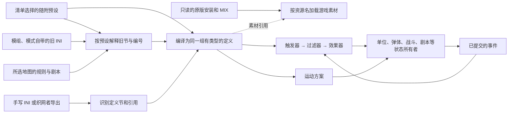

# VERA Mod Engine 可组合玩法系统规格

本规格面向 RA2/YR 模组、战役和地图制作者，以及维护引擎和编辑器的开发者。它规定模组怎样声明对象、选择目标、定义运动和附加效果（AE），以及同一份规则在单机、联机和读档后的执行结果。

| 项目 | 范围 |
|---|---|
| 文档状态 | 设计草案。`[Actor …]`、`[Motion …]` 等新节与示例键名属于拟议格式。文中单独标明已经存在的原版或扩展写法。 |
| 产品范围 | RA2、YR 和指定版本的 Ares 分别从同一套引擎派生。项目编写并随引擎提供版本化基础预设，定义单位与武器、默认标签、运动参数、素材引用和地图动作编号。Ares 复用随附的 YR 预设并应用所选版本的差异。制作组也可基于 RA2 单独使用一款减速 AE。 |
| 首发目标 | 支持手写 INI、织网者模板和字段字典。零售 YR 以战役通关和遭遇战为首批验收范围。RA2 单独对照零售 RA2，Ares 对照零售 YR 1.001 加指定扩展版本。第三方地图和战役逐项给出导入结果。[Ares 的原版运行环境](https://ares-developers.github.io/Ares-docs/#introduction) |
| 后续扩展 | 模组自编 Wasm 按实际玩法需求增设。其事件、效果请求和联机约束见第 7 节。 |

例示参数均有可观察的游戏结果。慢弧线炮弹与跳跃步兵可引用同一条 60 帧运动，在同一帧达到相同高度。炮弹接触桥面时按弹头结算，步兵落地时由单位系统检查占格。两者均可临时获得 `Tesla`，由同一条区域规则识别。

三套预设的用途与兼容范围见产品说明书。旧键的读取顺序、版本差异和索引由兼容预设规格维护。实施路线图规定开发顺序、测试地图及发布条件。本文的 VERA 源码对照最初取自 `f9e5717eb`。[产品说明书](mod-engine-product-guide.md) · [旧 INI 的兼容预设与逐项索引](ini-preset-wrapping.md) · [可组合玩法与 INI 兼容实施路线图](composable-gameplay-roadmap.md)

本规格保留行为规则原案中的五类宿主、持续行为、跨帧条件、记录器、主动技能和地图剧本交互。包内定义采用自动发现，Flag 可在运行中增减，单位与弹体共享位移计算，原有 AE 语法按预设翻译。[原行为与规则路线图](behavior-rule-engine-roadmap.md)

## 1. 定义与执行路径

对局先载入所选预设，再编译模组、模式和本局地图明确提供的覆盖，生成带类型的只读定义。玩家的游戏安装以只读方式提供素材，例如 SHP、VXL、地块、音频，以及选定的原版地图。安装中散装或封装在 MIX 里的原生基础 INI 仅供离线对照或显式导入，开局无需读取或提取这些文件。地图内的对象、规则覆盖和 FA2 触发仍随本局地图载入。进入对局后，规则只向单位、弹体、战斗或剧本系统请求变更。各系统在状态实际变更后发出事件。



| 配置概念 | 语义 |
|---|---|
| 对象与能力 | `Actor` 声明可实例化的对象。可组合位置、阵营、生命、地面占位、运动和载荷，也可从预设原型继承。每种能力列明可读属性、支持的操作及其前提。同一对象可具有生命、占位和落地载荷。 |
| 对象标签 | `Flag` 供过滤器按玩法属性选择对象。预设可声明 `Infantry`、`Hero`、`Building`、`Psionic`、`Tesla`、`Projectile` 等公共标签。模组可定义新标签，规则可授予、撤销或屏蔽标签。 |
| 规则 | `Rule` 指定宿主、事件、过滤条件及动作顺序。触发器订阅事件，过滤器读取当前状态，效果器向负责该状态的系统提交请求。 |
| 持续行为 | `Behavior` 统一管理所授标签、属性修正、事件订阅和计时器的寿命。需要保存进度的规则或行为建立实例。一次性动作直接向相应系统提交。 |
| 运动方案 | `Motion` 声明目标取样、路径、速度或耗时、高度和朝向。单位与弹体可引用同一方案，由使用方指定碰撞、占格和到达后的处理。 |
| 预设与字典 | 预设提供可直接使用的定义组合，导入器按版本解释旧写法。字段字典记录键名、类型、单位、默认值、适用能力和公开参数，供编译器、编辑器和制作者查用。 |

## 2. 配置包、命名与装载

每个包通过清单的 `Base=` 选择一个基础预设，取值可为 `ra2`、`yr`、`ares@3.0` 或制作组发布的预设名。选用 Ares 时，加载器解析其清单指定的随附 YR 版本，再应用 Ares 对标签、地图指令和默认行为的修订。包内的单位、规则、效果和运动方案通过带种类的节头声明，无需另行登记编号。以下新格式示例共用 `demo` 包。

```ini
[Package]
Id=demo
Format=1
Base=yr
```

1. **发现定义。** 编译器扫描包指定的规则文件和当前地图的扩展节，收集全部声明后解析引用。`[Motion demo.HighArc]` 声明运动方案，`Motion=demo.HighArc` 引用该方案。允许向后引用。规则可内联动作，也可引用 `[Effect 包名.名称]` 定义的具名动作。
2. **解析名称。** 新定义使用区分大小写的包限定名。预设可导出 `Infantry` 等公共标签。自定义标签可由 `Flag=`、`Flag.Add=` 或 `Flag.Grant=` 首次声明。仅在过滤器中出现的未知名称须报告所在位置及可能的正确拼写。已有包使用 `Infatry` 时，可在本包字典中声明其为 `Infantry` 的别名，其他包的命名不受影响。
3. **应用覆盖。** 装载顺序为基础预设、按顺序声明的扩展及依赖、模组、模式、地图。新格式用 `[Patch 完整名]` 修改既有定义。标量采用后层值，列表用 `=` 替换、`.Add` 追加、`.Remove` 删除指定项。同层重名须列出两个来源位置，依赖环和未指定顺序的冲突须在开局前报告。旧 MOD 自带的 `rulesmd.ini` 等文件按包来源识别，由所选预设规定该文件是整份替换还是局部覆盖，并保留该版本的读取轮次、数值解析、大小写和注册顺序。
4. **绑定与校验。** 编译器检查字段单位、目标能力、必填引用、同阶段写入冲突和模板参数。它按包名和定义名稳定分配 ID，并保留作者指定的动作和列表顺序。旧地图的数字索引保留独立的原序映射。编译出的操作可追溯至包、文件、节、键和模板实例。
5. **发布与启动。** 随附预设保存项目自编的定义及素材逻辑名，制作组也可发布自己的预设。加载器只从项目与包清单声明的来源解析预设。缺少必需的预设或版本时，启动界面列出所需包及版本，待补齐后重试。素材缺失则列出所需资源和安装路径，地图动作缺失则定位到地图触发。制作者可以在编辑工具中显式导入旧 INI，生成的覆盖保存到自己的包。

### 织网者模板与手写 INI

织网者可以复制带连线的模板、按类别生成旧注册项，也可以为模板占位段名生成随机名称。导出新格式时，作者可引用的名称必须稳定。复制节点时分配新 ID，再次导出同一工程时保留已有 ID。手写 INI 与模板导出的等价规则应有相同的执行顺序和规则摘要。[织网者模板与注册](https://github.com/ra2diy/INIWeaver-1.0/blob/dc490bdf60cf058c9ae95f5380a032a997df9267/docs/Info.md#L18-L31)

引擎的版本化字段字典同时生成织网者的类别、输入连接、字段说明和纯文本参考。慢弧线模板可只公开飞行时长和顶高，制作者展开后可直接编辑生成的 `Motion` 节。导出到旧格式时，工具须生成目标版本所需的注册表，并逐项报告该格式无法表达的动态行为。[织网者导出与类别字典](https://github.com/ra2diy/INIWeaver-1.0/blob/dc490bdf60cf058c9ae95f5380a032a997df9267/docs/Info.md#L49-L86) · [织网者模块库](https://github.com/ra2diy/INI-Weaver-Module-Library)

## 3. 对象标签与目标过滤

类型定义提供初始 Flag。对象在某帧可见的标签，为“默认标签与所有生效授予的并集”扣除“所有生效屏蔽的并集”。每项记录保存标签、操作（授予或屏蔽）、来源实例和有效期。`Flag.Suppress` 可屏蔽类型默认标签。`Detach` 只撤销指定实例的记录，重复撤销的结果相同。可见集合发生变化时才发送 `Flag.Changed`。

效果器可通过 `GrantFlag(Subject,Tesla,Source=Host)` 直接授予标签，由 `RevokeFlag(Subject,Tesla,Source=Host)` 撤销本来源的直接授予。重复授予具有幂等性，默认保留至显式撤销或宿主销毁。`SuppressFlag` 与 `ReleaseFlagMask` 成对管理直接屏蔽。`Behavior` 中的 `Flag.Grant` 和 `Flag.Suppress` 写入相同的记录，由各行为实例持有并在到期时撤销。两个电场对同一对象的授予各自计时。

| 筛选目标 | 表达式 | 匹配条件 |
|---|---|---|
| 英雄步兵 | `Flag.All(Subject,Infantry,Hero)` | 两个标签均可见。 |
| 通电或灵能对象 | `Flag.Any(Subject,Tesla,Psionic)` | 至少一个标签可见。可匹配单位、建筑或弹体。 |
| 排除绝缘对象 | `Flag.None(Subject,Insulated)` | 所列标签均不可见。 |
| 可拦截对象 | `Flag.All(Subject,Interceptable)` | 对象可被本规则选中。结算拦截时还需检查该操作要求的能力。 |
| 可受伤对象 | `Has(Subject,Health)` | 对象具有生命能力。配置了生命的弹体同样可受伤。 |
| 敌对及其他条件 | `Relation(Invoker,Subject)=Enemy`、距离、层、属性范围、行为来源 | 读取阵营、空间或属性系统的当前值。可用与、或、非及括号组合。 |

给建筑授予 `Infantry` 后，按该标签筛选的规则将选中它。使建筑移动还须配置运动和占位能力。导入原版单位时，`[InfantryTypes]` 等注册表提供初始 Flag，构造原型、数字索引和逐层注册时机也须保留，供地图、AI 和剧本引用。原版武器和弹体按引用分配的路径由对应的读取器保留。[VERA 零售规则读取说明](../../src/rules/mod.rs#L65-L83)

例如，地图信标仅声明位置、阵营与生命能力，生命上限为 200，可在无头场景中受击。`Flag=` 使其同时匹配英雄、建筑、灵能与电气规则。运动、占位范围及图像另行配置。

```ini
[Actor demo.Relay]
Capabilities=Pose,Faction,Health
Flag=Hero,Building,Psionic,Tesla
Health.Max=200
```

### 配置示例 · 电场与绝缘区

以下定义位于当前地图的扩展节。区域事件的 `Host` 为该区域，`Subject` 为进入者。同一电场重复进入时刷新 90 逻辑帧。两个电场各授予一份 `Tesla`。进入绝缘区后，行为在 15 帧内同时屏蔽类型自带或其他来源授予的 `Tesla`。

```ini
[Region demo.CoilA]
Rect=10,10,12,12
Rules=demo.ChargeOnEntry

[Region demo.CoilB]
Rect=15,10,17,12
Rules=demo.ChargeOnEntry

[Region demo.Insulator]
Rect=20,10,22,12
Rules=demo.InsulateOnEntry

[Rule demo.ChargeOnEntry]
On=Region.Entered
Where=Flag.Any(Subject,Infantry,Projectile)
Do=Attach(Subject,demo.Charged,Source=Host)

[Behavior demo.Charged]
Duration=90tick
Stack=RefreshPerSource
Flag.Grant=Tesla

[Rule demo.InsulateOnEntry]
On=Region.Entered
Do=Attach(Subject,demo.Insulated,Source=Host)

[Behavior demo.Insulated]
Duration=15tick
Stack=RefreshPerSource
Flag.Grant=Insulated
Flag.Suppress=Tesla

[Region demo.Detector]
Rect=24,10,24,12
Rules=demo.CountCharged

[Rule demo.CountCharged]
On=Region.Entered
Where=Flag.All(Subject,Tesla)
Do=AddVar(World,demo.ChargedCrossings,1)

[Var demo.ChargedCrossings]
Scope=World
Type=Int
Default=0
```

**地图与检测条件。** 区域矩形使用闭区间格坐标，默认覆盖所有高度层。以实际提交的运动线段检测进入，因此一帧穿过窄区也要触发。一步经过多个区域时，按各进入点的先后派发，同点以稳定区域 ID 排序。

**验收时序。** 选择自身不带 `Tesla` 的单位，再用寿命足够且带 `Projectile` 的慢弹重复同一过程。二者应得到相同结果。

| 逻辑帧 | 地图事件 | 预期结果 |
|---|---|---|
| 10、40 | 先进入电场 A，再进入电场 B | A、B 各持一份 `Tesla`，分别于第 100、130 帧到期。 |
| 95 | 进入绝缘区 | `Tesla` 被屏蔽。 |
| 100 | A 到期，进入检测区 | B 尚在有效期，绝缘仍生效，计数保持 0。 |
| 110 | 绝缘到期 | B 授予的 `Tesla` 恢复可见。 |
| 120 | 再次进入检测区 | `demo.ChargedCrossings` 增至 1。 |
| 130 | B 到期 | `Tesla` 消失。 |

## 4. 事件、效果与生命周期

### 宿主与事件参数

规则可绑定到世界、阵营、区域、组或对象五种宿主。对象引用携带所属存储和稳定 ID，可指向单位或在途弹体。引用在对象退场后失效，复用同一存储位置的新对象获得独立身份。

| 参数 | 含义 |
|---|---|
| `Host`、`Subject` | `Host` 为挂载规则的宿主，`Subject` 为本次事件直接涉及的对象。例如，入区事件的宿主是区域，进入者是 `Subject`。 |
| `Target` | 技能或动作的目标，按事件定义取对象、格或坐标。 |
| `Invoker`、`Source` | 分别记录施加者和实际来源。施加时的阵营与施加者当前阵营分别可查。来源死亡后仍保留归因，显式要求来源存活的条件返回假。 |
| 位置、原因与可选字段 | 每种事件列出必有和可选字段，按实际情况携带事件位置和发生原因。 |

规则由宿主的 `Rules=` 或活跃行为绑定。缺失的可选字段求值为“未知”，取反后仍为“未知”，整条过滤式求值为真时才执行。环境伤害等没有施加者的事件可用 `Exists` 处理。动作在执行前失去目标时，按该动作策略跳过并记录原因。付费技能由技能系统一次检查目标、费用与效果，全部通过后统一提交。

### 帧内顺序与跨帧状态

| 机制 | 执行约定 |
|---|---|
| 事件产生 | 负责状态的系统提交入格、开火、受击、转属、数值变化或销毁时通知订阅者。阈值可在进入、退出或数值变化时触发，周期效果在到期帧唤醒。 |
| 条件组合 | 同一事件的全部订阅者对同一份事件和提交时的筛选状态求值，再执行入选动作。跨帧 `AllOf` 保存完成位及绑定对象，`AnyOf` 取首次满足项。单次规则成功后停用，重复规则执行后清除完成位。组规则可在开始时固定成员，并为每名成员分别记一次完成。成员离开或死亡是否计入完成，由组策略声明。 |
| 结算前修正 | 战斗、射速和移动系统分别规定结算前可以修改的值与操作。每个参数明确类型、单位、可用的加乘或替换操作、舍入和钳位时机。新规则修改本次伤害时先发出方、后接收方，同侧按优先级从低到高，同级按挂载顺序。允许的修正包括修改本次伤害倍率、取消准入、限制最低生命。兼容扩展保留原先的介入位置与顺序。战斗系统最终提交一次伤害，并发布实际扣血量。 |
| 结算后动作 | 伤害、治疗、发射、挂载、移除及剧本变量写入按显式顺序提出，各系统在执行前复查目标及权限。当前事件的动作批次执行完毕后，处理这些动作产生的后继事件。当前系统在安全点处理完毕，再进入后续帧阶段。新格式的多个监听者按优先级从高到低，再按稳定定义 ID、实例序升序执行。兼容项保留原顺序。 |
| 行为寿命 | 状态依次为等待、活跃、可选暂停、终止。第 `s` 帧生效且持续 `d` 帧的行为覆盖 `[s,s+d)`，在到期帧首次可观察该规则的操作前结束。持续 0 帧应在装载时提示使用一次性动作。同源刷新的索引由宿主、定义、来源组成。可配置独立层、总层数与每源上限、冷却和互斥优先级。新行为默认继续计时、保留施加时归属、宿主销毁时结束。转型继承、暂停时冻结计时须显式声明。结束时一次撤销本实例的标签、修正、订阅、计时器和附属对象。 |
| 属性与记录器 | 火力等属性在现有读取点按需计算和缓存。挂载、移除、暂停和相关基础值改变均使缓存失效。计数、累计伤害和命中过的类型可记录在行为、对象、组、阵营、对局或战役作用域。按来源记录的历史须有容量上限，满时先淘汰最久未更新项，同帧按稳定来源 ID 选取。表达式读带类型的值，写效果公开的参数或命名变量。行为到期时先冻结记录供结束动作使用，再释放实例。 |
| 连锁与终止 | 移除、销毁、收容和转型均发布带原因的事件。每个后继事件保留根事件与父事件，载荷结算用一次性标识去重。每个版本应固定单根事件的最大深度和动作数。达到上限时保留已提交动作、停止该根剩余动作并报告触发来源，其他根事件继续执行。兼容项保留各自的递归保护及模拟随机数取用位置。 |

### 玩法验收用例

| 玩法 | 运行要求 |
|---|---|
| 按已命中兵种生产单位 | 记录器按兵种去重，到期冻结类型列表后交生产动作。 |
| 累计受伤后反弹 | 到期时读取累计实际掉血量，对范围内每个合法敌人分别发出 `实际扣血之和 + 114` 的伤害请求。 |
| 断桥与入区触发增援 | 分别记录两个不同桥段的坍塌和指定阵营入区。三个条件满足后调用旧剧本的增援动作。 |
| 主动加速 | 技能按钮发出锁步命令，经权限与费用检查后统一扣费、挂载限时行为和启动冷却。 |

每个场景中的类型列表、剧本变量或技能冷却均由一个系统写入。[原路线图第 4.2 节](behavior-rule-engine-roadmap.md#42-四个示例)

KratosPP 提供了这些玩法的对照实现。单位与弹体均可挂载 AE，叠层时能区分施加者或阵营，存档保存来源与计时。其筛选按建筑、步兵和弹体子类分派，并另查 Mark。计数触发可把效果施给自身、来源或计数器持有者。本规格把相应筛选与目标选择开放给所有规则，事件按订阅派发。[单位挂载](https://github.com/ra2diy/KratosPP/blob/aa31abf88ccef574c042ed84baccafa98c2a0bbb/src/Extension/TechnoExt.cpp#L7-L13) · [弹体挂载](https://github.com/ra2diy/KratosPP/blob/aa31abf88ccef574c042ed84baccafa98c2a0bbb/src/Extension/BulletExt.cpp#L7-L13) · [来源与叠层](https://github.com/ra2diy/KratosPP/blob/aa31abf88ccef574c042ed84baccafa98c2a0bbb/src/Ext/ObjectType/AttachEffect.cpp#L478-L566) · [实例存档](https://github.com/ra2diy/KratosPP/blob/aa31abf88ccef574c042ed84baccafa98c2a0bbb/src/Ext/EffectType/AttachEffectScript.h#L201-L243) · [分类和 Mark](https://github.com/ra2diy/KratosPP/blob/aa31abf88ccef574c042ed84baccafa98c2a0bbb/src/Ext/ObjectType/FilterData.h#L187-L277) · [计数触发时选择目标](https://github.com/ra2diy/KratosPP/blob/aa31abf88ccef574c042ed84baccafa98c2a0bbb/src/Ext/EffectType/Effect/CountTriggerEffect.cpp#L77-L110)

## 5. 运动方案与弹道

运动器标签集是 `Motion` 定义的一组带类型参数。`Pace=FixedTicks(60)` 指定运动时长，编译器须校验类型及单位。`Hero` 等对象 Flag 则用于过滤，可在对局中由效果授予。

| 参数组 | 可选策略 | 游戏行为 |
|---|---|---|
| 目标与更新 | 起步时记录坐标、逐帧跟踪对象、沿航点或任务路径前进。跟踪目标失效时可保留末次位置、停止或重新选择 | 决定目标移动、死亡或转属后的目的地。 |
| 水平路径与导向 | 直线、寻路走廊、限转速追踪、分段航点 | 导向决定前进方向，运动节奏决定步长。车辆可绕开占用格，弹体可保持发射方向，二者可采用同一转向约束。 |
| 前进节奏 | 固定耗时、按速度、按加减速。每一段选一个主约束，其余数值由此推导。速度单位为每逻辑帧的地图长度 | 固定 60 帧时各射程耗时相同。选用固定速度时，耗时随路程变化。 |
| 高度与朝向 | 贴当前表面、固定离地高度、两端点间拱起、按预设重力积分。朝向可跟随速度、目标或保持 | 相同水平路径可用于贴地、悬浮或弧线运动。跳跃与抛射可共用高度函数。 |
| 接触与位置提交 | 使用方指定地表、桥面、占格、落点预留或弹体扫掠。每步输出候选线段和进度，宿主按首次有效接触截取并提交 | 一帧跨越数格仍可检测撞桥。步兵落地只提交一次占格。 |
| 结束与切换 | 到达、接触、目标失效、被拦截或外部取消均有独立原因。使用方可配置落地、停止、反弹、穿透、引爆或切换下一段 | 弹体可先爬升再追踪，跳跃步兵可挂起并恢复原行走任务。 |

导入器将旧 `Locomotor=` GUID 绑定为初始运动组合。Drive 使用地面路径、车辆转向和格准入，Walk 可复用路径并保留步兵的停靠阈值。`SpeedType` 参与地表通行判定，`MovementZone` 参与寻路。Jumpjet 可分为升空、巡航、下降，Teleport 可分为准入、离场、重新入场。各阶段需列明进入和退出条件，仅替换本阶段使用的运动参数。迁移原版运动器前须核实地形、任务和计时状态的使用位置，共用计算通过对应场景验收后再切换。新定义通过组合字段选择方案，无需另设 GUID。[VERA 的四种移动输入与现有种类](../../src/rules/locomotor_type.rs#L1-L58)

### 配置示例 · 慢弧线炮弹与跳跃步兵

`yr.Projectile.Cannon`、`yr.Weapon.105mm` 和 `yr.Infantry.E1` 是拟议 YR 预设提供的原型名。步兵主武器改发慢弹，原武器的弹头继续使用。跳跃技能使用玩家命令中的目标格，普通移动沿用原步兵的行走方案。

```ini
[Motion demo.HighArc]
Goal=SnapshotAtStart
Path=Line
Pace=FixedTicks(60)
Height=PeakAboveHigherEnd(192lepton)
Facing=AlongPath

[Actor demo.SlowShell]
From=yr.Projectile.Cannon
Flag.Add=Interceptable
Motion=demo.HighArc
Motion.Contact=Sweep(Terrain,Bridge)
Motion.OnContact=DetonatePayload
Motion.OnArrive=DetonatePayload

[Weapon demo.ArcGun]
From=yr.Weapon.105mm
Projectile=demo.SlowShell

[Actor demo.Jumper]
From=yr.Infantry.E1
Primary=demo.ArcGun
Abilities.Add=demo.Jump

[Ability demo.Jump]
Target=Cell
Motion=demo.HighArc
Motion.Contact=UnitLanding
Motion.OnArrive=CommitLanding
Motion.OnBlocked=RecoverLegalCell
```

#### 参数与验收

`tick` 为逻辑帧，1 格为 256 `lepton`。`SnapshotAtStart` 在开始时固定终点。`Path=Line` 可按速度或固定时间推进。在本例中，水平进度从起点至终点匀速变化。峰值取较高端点加 `Height`，奇数总帧取较早的中间帧，弧线至少需两帧。上半段按二次缓出升至峰值，下半段按二次缓入降至终点。各段从原始端点按整数进度采样，中间长度与高度使用宽整数，最终地图坐标向零取整。持续追踪任意移动目标且限时到达时，导向须声明重规划策略。装载时应指出相互冲突的字段。

在无遮挡地图上放置水平间距两格、起点高 0、终点高 128 `lepton` 的两个端点。炮弹与步兵应得到下列结果。

| 耗时（帧） | 相对顶高（lepton） | 预期峰值与到达 |
|---|---|---|
| 60 | 192 | 第 30 帧高 320，第 60 帧到达起步时选定的坐标。 |
| 60 | 64 | 第 30 帧高 192，第 60 帧到达同一坐标。 |
| 90 | 192 | 第 45 帧高 320，第 90 帧到达同一坐标。 |

目标移动时，定点弹在已采样的坐标按弹头规则结算。炮弹提前接触桥面时只在首次有效接触处结算。同一步内接触与到达重合时，弹头只引爆一次。具体对象是否受击，取决于接触及弹头规则。

#### 跳跃、接触与运动切换

跳跃起步时由单位运动系统检查并预留落点，再挂起地面路径。落地时提交所在层和占格，释放预留并重新检查原任务。途中桥塌时先回退至上一个合法落点，再按固定顺序寻找最近合法格。没有可用位置时交给单位的坠落或死亡处理。`SwitchMotion` 必须声明是否保留原目标、继承速度及进度。运动系统在切换前验证这些参数，失败时沿用当前方案。击退和多段飞行共用此入口，每个对象在每一步由一个系统写入坐标。

VERA 的单位已有活动及挂起的运动器、地面行走和格准入。`ProjectileStore` 保存弹体飞行状态。弹体在自己的 LogicVector 位置推进，满足引爆条件后交由战斗系统。两者应共用位移计算，分别提交运动结果。一个对象兼具占位和载荷时，由占位系统提交位置，由战斗系统处理接触载荷。验收使用同一实例的实际落点与伤害。[单位运动分派](../../src/sim/world/object_turn.rs#L258) · [活动运动器与挂起状态](../../src/sim/movement/locomotor.rs#L80) · [弹体推进](../../src/sim/world/techno_ai.rs#L407) · [弹体与战斗的交接](../../src/sim/projectile.rs#L1-L33)

**原版和扩展的弧线。** 在 VERA 移植的 `WeaponTypeClass::GetSpeed` 中，`ROT=0` 时按水平距离和重力计算起速。武器 `Speed=` 在此路径上不能直接指定耗时。地面、桥面、引信和命中后的坐标修正参与最终结果。KratosPP 的增强弧线单独求解固定速度、重力和散布。旧弹道应按各自版本核对。本例 60 帧的到达保证仅适用于 `FixedTicks(60)`、起步取样且途中未提前接触的配置。[VERA 发射速度](../../src/sim/projectile/launch.rs#L211-L238) · [VERA 引爆条件](../../src/sim/projectile.rs#L9-L33) · [KratosPP 弧线源码](https://github.com/ra2diy/KratosPP/blob/aa31abf88ccef574c042ed84baccafa98c2a0bbb/src/Ext/BulletType/Trajectory/ArcingTrajectory.cpp#L14-L64)

## 6. 旧 INI、扩展与地图兼容

所选预设决定旧 INI 的读取规则和版本。各预设通过公共武器、运动、伤害和触发系统重现原行为。缺少的能力由负责相应状态的系统补足。Ares 和 Phobos 保留各自的 AE 写法，按效果逐项迁移到公共持续行为。Phobos 弹道按版本绑定为运动预设。

| 预设或扩展 | 规则来源与验收范围 |
|---|---|
| 随附 YR 预设 | 提供 YR 的规则、AI 和美术定义。保留零售规则、可用语言规则、模式和地图覆盖、战役附加遍次的生效顺序，以及 ART 独立读取的语义。单位默认 Flag、构造参数、地图动作编号和触发顺序由单位及剧本系统执行。 |
| 随附 RA2 预设 | 提供 RA2 自己的素材引用、规则默认值、单位和地图编号。第一批对照使用一门 RA2 原版武器和一关 RA2 零售任务。[零售层与 RA2/YR 边界](../../src/rules/mod.rs#L5-L37) |
| Ares AE | 单位类型或弹头上的内联 `AttachEffect.*` 生成保留原始来源身份的匿名行为。单位自带及弹头附加的效果分别核对进载具时的计时、重新附加、动画、归属和倍率舍入。弹头挂载发生在相应的 EMP 与常规伤害处理之间，零伤弹头亦须覆盖。[Ares 规范](https://ares-developers.github.io/Ares-docs/new/attacheffect.html) · [Ares 读取](../../src/rules/ares_warhead.rs#L854) · [挂载入口](../../src/sim/combat/world_receiver.rs#L4017) |
| Phobos AE | 每层按 `[AttachEffectTypes]` 和引用键的原次序读取，分别保留来源、施加者及阵营。叠层上限、同源刷新、断电、到期武器、反射和武器准入须接入相应的结算位置及属性读取点。解析、实际效果和画面分别验证。[Phobos 规范](https://phobos.readthedocs.io/en/build-48/New-or-Enhanced-Logics.html#attached-effects) · [类型目录](../../src/rules/attach_effect.rs#L610) · [开火检查](../../src/sim/combat/fire_error_world.rs#L669) |
| Phobos 弹道 | 保留 `Trajectory=Parabola`、`Trajectory.Parabola.OpenFireMode`、`Trajectory.Parabola.ThrowHeight` 等旧写法。按所选版本组合起射、导向、接触和结束规则，模板仅开放本模式读取的参数。`Height` 模式按较高端点确定顶高，再解起速。六种起射模式、引爆距离、吸附、反弹及不同射程的抵达帧均须核对。[Phobos 读取器](https://github.com/Phobos-developers/Phobos/blob/31ae9f859f778880c61465c58eb0342b5e2474c8/src/Ext/Bullet/Trajectories/ParabolaTrajectory.cpp#L50-L87) · [高度与模式](https://github.com/Phobos-developers/Phobos/blob/31ae9f859f778880c61465c58eb0342b5e2474c8/docs/New-or-Enhanced-Logics.md#L1231-L1246) |
| KratosPP | 作为弹体携带 AE、按来源叠层和临时标记的玩法参照。有实际旧包时按版本建立具名导入规则。宿主上的 `AttachEffectTypes=` 和 Phobos 的注册节 `[AttachEffectTypes]` 分别解释。替身（Stand）须具备生成、武器归属、跟随和销毁处理。[KratosPP 宿主读取键](https://github.com/ra2diy/KratosPP/blob/aa31abf88ccef574c042ed84baccafa98c2a0bbb/src/Ext/EffectType/AttachEffectTypeData.h#L29-L45) |

### 兼容示例 · Phobos 抛物线弹道

以下为 Phobos 已有写法。作为织网者模板时，制作者可只公开顶高和末段吸附距离。

```ini
[ModLobShell]
Trajectory=Parabola
Trajectory.Parabola.OpenFireMode=Height
Trajectory.Parabola.ThrowHeight=600
Trajectory.Parabola.TargetSnapDistance=0
```

`Height` 模式根据最高点和目标坐标解起速，`600` 表示相对较高端点的顶高，`0` 关闭引爆时向目标位置吸附。运动阶段使用求得的速度，接触与引爆由所选 Phobos 版本处理。地图只覆盖 `ThrowHeight` 时，其余公开参数和固定参数沿用该版本的读取规则。验收应在不同射程记录抵达帧、首次接触点和引爆位置。[Phobos 抛物线模式与吸附规则](https://github.com/Phobos-developers/Phobos/blob/31ae9f859f778880c61465c58eb0342b5e2474c8/docs/New-or-Enhanced-Logics.md#L1231-L1246)

### 兼容示例 · 减速弹头

以下两份旧配置分别用于 Ares 模组和 Phobos 模组，假定 `ColdWH` 已在各自的弹头目录中登记。两份配置均施加持续 90 帧、速度倍率 0.5 的 AE。重复施加、暂停和恢复时分别按各预设执行。

**Ares 弹头内联写法**

```ini
[ColdWH]
AttachEffect.Duration=90
AttachEffect.SpeedMultiplier=0.5
```

**Phobos 登记 AE 后由弹头引用**

```ini
[AttachEffectTypes]
0=Frost

[Frost]
Duration=90
SpeedMultiplier=0.5

[ColdWH]
AttachEffect.AttachTypes=Frost
```

### 扩展混用与旧 AE 迁移

同一包启用两个扩展时，由各读取器按节种类、完整键和加载阶段识别输入。有意配置的两个效果分别取得带所属包名的身份，各自在已核实的阶段结算一次。存在歧义时须在包中指定采用的方言。

迁移某一项效果前，须列出原有的状态写入点、战斗和动画的读取点、计时及存档字段。用相同场景分别运行新旧实现比较。切换后，该项效果在对局中只保留一套有效状态。全部受支持玩法、存档策略和已知差异明确后，方可移除整套旧 AE。现有 Ares 实例归 `sim/game_entity/attach_effect.rs`，Phobos 实例归 `sim/attach_effect.rs`。两个预设均须测试两名施加者反复命中同一目标并在效果持续期间存读档。[Ares 实例与更新](../../src/sim/game_entity/attach_effect.rs#L622) · [Phobos 实例](https://github.com/EncoreAlpha/vera20k/blob/f9e5717eb719e5a6c67ed3774b39a8d9da8d1b8d/src/sim/attach_effect.rs#L1835) · [现有 Phobos 开关](https://github.com/EncoreAlpha/vera20k/blob/f9e5717eb719e5a6c67ed3774b39a8d9da8d1b8d/src/rules/phobos_switch.rs#L62)

### FA2 地图、战役和第三方导入

RA2、YR 或 Ares 预设将 `[Triggers]`、`[Events]`、`[Actions]`、`[Tags]` 的旧编号映射到相应事件和动作，并保留本版的 Tag 引用、重复方式、难度和触发顺序。FA2 地图中的 Tag 用于关联地图触发器，对象 Flag 用于玩法筛选。三套预设共用剧本系统的触发实例、计时器和变量。新规则可读取事件和剧本变量，也可显式触发旧图动作。写入全局或局部变量须经 `set_trigger_variable`，以保留相应 Tag 计时器的重置时机。相互强触时应保留根事件，检测循环。[剧本变量入口](https://github.com/EncoreAlpha/vera20k/blob/f9e5717eb719e5a6c67ed3774b39a8d9da8d1b8d/src/sim/trigger_runtime.rs#L3651)

第三方导入报告按地图列出旧节和键、引用它的地图对象或触发器、采用的解释、验证状态及可采取的修正。每项可标记为“已对照”“仅能读取”“有已知差异”“缺少实现或素材”。如未知动作影响胜利条件，报告须标出触发器 ID 与动作编号，并将本关标为待适配。可选表现缺失时，提示差异后可继续。原文件保留原文，旧数字 ID 保留原索引。零售 YR 战役须逐关验证目标和切关，遭遇战须验证开局、交战和结束。RA2 使用自己的对照清单。

## 7. 引擎接入、存档与联机

继承的 VERA20K 客户端由 `RetailRulesSources` 选择零售数据，再交给 `NativeRulesProcessOwner` 维护类型目录及逐层覆盖。改造时由所选预设向该目录提供基线，保留原有的注册时机和后处理。游戏资源加载器按已绑定的素材名访问安装目录或 MIX。规则编译、地图预览、正式对局和无头场景均使用相同的预设选择结果。[现有零售来源](../../src/rules/retail_sources.rs#L217) · [规则目录所有者](../../src/rules/process_owner.rs#L239)

| 子系统 | 责任与验收 |
|---|---|
| 规则与地图 | `rules` 编译包与预设，保留旧读取遍次。`map` 解析格、层、区域、地图实例和旧引用。二者输出静态数据。新规则完成装载和绑定后才订阅事件。构造一项只在地图层注册、较早层已有同名孤立节的输入，检查旧注册时机。[规则层](../../src/rules/native_processing.rs#L266) · [INI 节枚举](../../src/rules/ini_parser.rs#L570) |
| 模拟与事件 | 规则运行时持有行为实例、来源贡献、跨帧条件完成位、作用域变量、订阅和到期信息。生命、阵营资金、武器冷却、位置、弹头和既有剧本变量继续由原系统写入。新命令经原入口校验。结算前修正参与本次操作，后续事件在产生它的帧阶段内处理。命令、触发器、LogicVector、工厂等原有阶段保持先后顺序。[主帧阶段](../../src/sim/world/master_frame.rs#L88) · [反射伤害窗口](../../src/sim/combat/world_receiver.rs#L1734) |
| 空间查询 | 地面与桥面使用现有格占用，空中单位使用对应的空间数据。需要弹体范围订阅时，弹体系统在创建、移动和移除时更新分格索引。查询先按格和高度层收集候选，再按稳定引用去重、排序。一个多格对象每次查询只命中一次。入区按实际运动线段检查。针对单个来弹的事件直接携带弹体引用。[地面及桥面占用约束](../../src/sim/occupancy.rs#L845) · [弹体权威集合](../../src/sim/projectile.rs#L1778) |
| 表现与玩家命令 | 动画、音效、选中状态和按钮读取模拟状态。本地选中事件只连接表现动作。主动技能通过锁步命令提交玩家、对象、技能定义及目标。执行帧重新核对控制权、目标、费用和冷却，成功时统一提交。命令协议号在实现时分配。[命令入口](../../src/sim/command.rs) · [世界的命令处理](../../src/sim/world/world_commands.rs) |
| 联机、回放与版本回退 | 开局约定包含包和预设版本、编译器语义版本、规范化执行定义的摘要。两端选用相同预设、模组、模式和地图时，安装目录中原生基础 INI 的存在与内容应对规则摘要无影响。地图显式覆盖武器射程并改变生效值时，摘要须改变。默认值、计算顺序或单位变化时同样检查。编辑器布局、注释及模板节点位置不参与摘要。回放固定相应版本。房间须指出不兼容的版本或规则。VERA 的 `MultiplayerAgreement` 已有 `version` 和 `rules_digest`。[现有房间约定](../../src/app/shell_network_setup/agreement.rs#L8) · [联机协议](../Networking.md) |
| 存档与确定性 | 保存影响后续对局的实例顺序、来源引用、施加时阵营、跨帧条件、剩余寿命、暂停状态、冷却、运动段与进度、落点预留及待办操作。普通存档在已处理完当前工作的安全点生成。支持帧中恢复时须保存待办顺序及去重状态。读档时从原始状态重建 Flag 位集、事件索引及空间索引。相同输入的逐帧哈希和终局哈希须跨平台相同。存档布局或规则包摘要有差异时，提供相应迁移程序或在读档界面列明需要的构建和包。[存档准入](../../src/sim/snapshot.rs#L1109) · [世界哈希](../../src/sim/world/world_hash.rs#L246) |

### 数值、随机数与性能

新增计算应使用明确规定舍入、饱和及越界行为的整数或定点数。地图绝对位置需有足够的整数位，整张地图的坐标可能超出 `I16F16` 的整数范围。已核实的零售计算及 Ares 倍率组合保留所需精度和运算顺序。随机选取目标前先将候选排序，在动作规定的帧阶段取用模拟随机数。兼容项须核对抽取顺序。绘制及打开说明面板等本地操作不得消费模拟随机数。[当前定点类型](../../src/util/fixed_math.rs#L24) · [Ares 倍率折叠](../../src/sim/game_entity/attach_effect.rs#L116)

类型默认 Flag、编译后的过滤条件和运动定义可跨实例共享。静止且未订阅事件的对象无需逐帧检查效果。限时实例按到期帧唤醒，运动中的对象直接调用绑定的运动方案。常用 Flag 可采用紧凑位集，模组扩展标签可采用稀疏 ID。缓存须随有效授予或屏蔽变化而失效。

性能验收在相同地图、种子、构建配置和硬件上，对改造前后分别运行 `--release` 基准。负载包括 20,000 单位、30 家参战方的基础场景，以及局部密集 AE 和大量弹体穿区场景。记录帧时长分布、额外内存、活跃实例、空间候选和事件数。预期行为等价的输入须比对状态哈希。既有表格中的毫秒和 MiB 数值属于待测预算。[sim-bench](../../src/bin/sim-bench.rs)

### 浏览器目标与后续 Wasm 脚本

首发的数据驱动玩法应能在 VERA 的浏览器目标上运行。后续按实际需求开放模组自编 Wasm 时，模块可订阅具名事件、读取带类型的上下文，并通过与 INI 相同的能力接口请求效果。游戏对外开放的 Hook 对应已定义的结算窗口。

模块须声明 ABI 和资源需求。引擎限制内存、每次调用和每帧的指令额度，且只在调用成功结束后提交效果请求及持久变量写入。超过额度或陷阱中断时丢弃该次写入，报告包和事件。持久变量进入存档及状态哈希。相同输入须产生相同的请求序列。脚本使用逻辑时钟和受控的模拟随机数接口。联机房间将模块代码摘要纳入开局约定。[浏览器构建目标](../wasm.md) · [上游 Wasm 草案与 INI 接口意见](rfc-4653-feedback.md)

## 8. 交付与验收

第一阶段交付预设加载、战区定义、对象创建和普通地面移动。下面六组玩法从这一基础上继续验证，编号用于在规格与测试地图间查找对应场景。

| 后续玩法用例 | 交付范围 | 验收结果 |
|---|---|---|
| 1 · 灰熊坦克与慢弧线炮 | 随附 YR 预设交付原炮所需的定义。接入定义自动发现、最小字段字典、织网者模板、炮弹绑定、碰撞和弹头结算。在同一张图布置原版 `[105mm]`、新武器、固定目标和桥面 | 在测试资源目录中保留素材与地图，屏蔽散装及 MIX 内的原生基础 INI，仍应按随附预设开局。独立改变时长和顶高，记录中点高度、抵达帧、提前撞桥、目标走开及引爆次数。半程读档后终点和伤害一致。原版 `Cannon` 按零售参照单独核对。 |
| 2 · 跳跃步兵 | 步兵技能引用同一运动节，接入玩家命令、落点预留、原任务挂起及恢复 | 无遮挡时步兵与炮弹轨迹相同。落地后可继续移动，落点被占或桥塌按规则恢复。无权或目标非法的命令保留费用。两端回放结果一致。 |
| 3 · 电场与绝缘区 | 通用区域事件、目标过滤、持续行为、单位和弹体查询、模板与字典导出 | 第 3 节的生效、屏蔽、恢复与到期结果在单位和弹体上相同。两份授予撤去一份时另一份仍有效。手写和模板导出取得相同摘要，拼错的只读 Flag 可定位。 |
| 4 · 零售 YR 战役与 AI | 以盟军第一关 `ALL01UMD.MAP` 验证地图触发器、作战小队、剧本变量、胜负及切关 | 从任务入口开局及中途读档均能收到对应援军、达成胜利目标并进入下一关。第三方地图引用未知关键动作时，导入报告指出触发器及动作编号。 |
| 5 · 旧 MOD 的减速弹头 | Ares 弹头内联和 Phobos 具名 AE 分别接入，并在自定义 RA2 模组中单独选用同种减速行为 | 覆盖重复附加、不同来源、乘降或断电、转型或销毁、存读档和实际移速。混用扩展时每个已配置效果各执行一次。每项验证完成后切换该项的全部写入与读取。 |
| 6 · 制作组样例 MOD | 将记录器、区域、分组、命名变量、费用和冷却用于第 4 节的四种玩法，并提供 INI、可重新导出的织网者模板与地图 | 桥毁加入区只触发一次增援，主动技能只扣一次费用，反弹使用累计实际掉血，生成名单可追溯来源。单机、锁步和中途读档结果一致。 |

发布时按预设列出已验证的版本、键与玩法、已知差异、第三方地图导入结果，并附桌面及浏览器检查和 20,000 单位性能实测。零售 YR 逐关验收战役并验证遭遇战，RA2 及各版 Ares 使用各自的对照清单。扩展 AE 和旧弹道逐项核销，达到第 6 节迁移条件后移除相应旧运行时。KratosPP 导入和模组自编 Wasm 按各自的范围另行验收。
